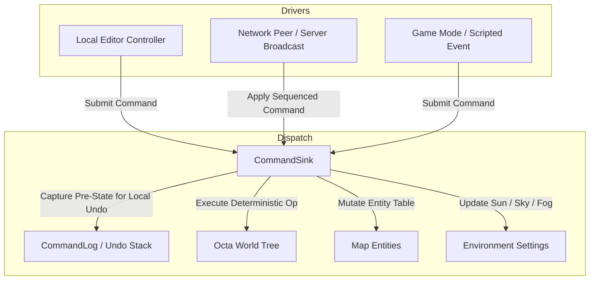

# ADR 0008: Deterministic Command Logic, Unified Schema, and Server-Authoritative World Mutation

## Status

**Approved** (Implemented in Milestone M5).  
Governs the core command model defined in [editor-and-commands.md §2–§5](../editor-and-commands.md) and server authority in [authority-and-latency.md §1](../authority-and-latency.md#1-the-decision).

---

## Context

In Sauerbraten Revival, the world is a runtime-mutable octree. The map is modified not only by the in-game editor, but also by gameplay mechanics (destructible walls, doors, crumbling geometry), cooperative multi-user editing, and scripted events.

Early iterations suffered from architectural fragmentation:
1. **Dual Command Representations**: In-memory `Command` classes, `WorldOp` enums, and manual C# structs existed side-by-side with wire-serialization schemas (`schema.fbs`), requiring maintenance of error-prone adapter and translation layers (`NetMessage`, `CommandCodec`).
2. **Artificial `CommandSource` Tags**: Commands were tagged with a `CommandSource` enum (`LocalEditor`, `RemoteEditor`, `GameMode`, etc.) conflating network authority, execution context, and undo provenance into data structs.
3. **Floating-Point Non-Determinism**: Floating-point spatial offsets risked cross-platform divergence across different CPU architectures during replay or multiplayer editing.
4. **Ad-Hoc Undo/Redo**: Undo mechanisms lacked clear boundaries regarding what data is local-only versus what is synchronized across the network in cooperative editing.

---

## Decision

We establish a **single, unified, deterministic command pipeline** built on Google FlatBuffers (via **FlatSharp**). Every mutation to world geometry, entities, and environment settings is expressed as a discrete, deterministic `Command`.



---

## 1. Single Source of Truth: FlatSharp `Command`

The FlatBuffers schema in `World/Schema/schema.fbs` is the authoritative specification for all world mutations. FlatSharp compiles this schema directly into C# domain models. The engine eliminates all parallel struct definitions and translation layers.

### Schema Definition (`schema.fbs`)

```flatbuffers
namespace SauerbratenRevival.Format;

enum WorldOp : ubyte {
    None = 0,
    DeleteCube = 1,
    EditFace = 2,
    SetFaceTexture = 3,
    ReplaceTexture = 4,
    SetFaceMaterial = 5,
    FlipCube = 6,
    RotateCube = 7,
    Remip = 20,
    NewMap = 30,
    AddEntity = 40,
    RemoveEntity = 41,
    EditEntity = 42,
    SetEnvironment = 43,
    ReplaceBlock = 50
}

struct Vec3i {
    x: int32;
    y: int32;
    z: int32;
}

struct Vec3f {
    x: float32;
    y: float32;
    z: float32;
}

struct SelectionBox {
    origin: Vec3i;
    size: Vec3i;
    grid: int32;
    orient: int32;
}

table EditFaceCmd {
    sel: SelectionBox;
    dir: int32;
    mode: int32;
    stride: int32;
}

table SetTextureCmd {
    sel: SelectionBox;
    texture_id: int32;
    flags: int32;
}

table ReplaceTextureCmd {
    sel: SelectionBox;
    old_texture: int16;
    new_texture: int16;
    in_selection: bool;
}

table SetMaterialCmd {
    sel: SelectionBox;
    material_id: int32;
    filter: int32;
}

table DeleteCubeCmd {
    sel: SelectionBox;
}

table FlipCubeCmd {
    sel: SelectionBox;
}

table RotateCubeCmd {
    sel: SelectionBox;
    direction: int32;
}

table RemipCmd {
    mip_vis: bool;
}

table NewMapCmd {
    scale: int32;
}

table ReplaceBlockCmd {
    sel: SelectionBox;
    data: [ubyte];
}

table EntityCmd {
    entity_id: uint64;
    type: int32;
    pos: Vec3f;
    attr1: int32;
    attr2: int32;
    attr3: int32;
    attr4: int32;
    attr5: int32;
}

table SetEnvironmentCmd {
    sun_color: uint32;
    sun_scale: float32;
    sun_yaw: float32;
    sun_pitch: float32;
    sky_color: uint32;
    ambient_color: uint32;
    skybox: string;
    fog_distance: float32;
    fog_color: uint32;
}

union CommandPayload {
    EditFaceCmd,
    SetTextureCmd,
    ReplaceTextureCmd,
    DeleteCubeCmd,
    RemipCmd,
    EntityCmd,
    SetEnvironmentCmd,
    FlipCubeCmd,
    RotateCubeCmd,
    SetMaterialCmd,
    NewMapCmd,
    ReplaceBlockCmd
}

table Command {
    sequence: uint64;
    peer_id: int32;
    timestamp: uint32;
    op: WorldOp;
    payload: CommandPayload;
}
```

### Domain Extension via C# Partial Classes

In C# (`World/Commands/Command.cs`), the FlatSharp `Command` class is extended with static factories and ergonomic helper properties:

- `Command.CreateEditFace(sel, dir, mode, stride, author)`
- `Command.CreateDeleteCube(sel, author)`
- `Command.CreateSetTexture(sel, textureId, flags, author)`
- `Command.CreateSetMaterial(sel, matId, filter, author)`
- `Command.CreateReplaceBlock(sel, blockData, author)`
- `Command.CreateAddEntity(entity, author)`
- `Command.CreateEditEntity(entity, author)`
- `Command.CreateRemoveEntity(entityId, author)`
- `Command.CreateSetEnvironment(env, author)`
- `Command.CreateRemip(mipVis, author)`

No conversion or copying occurs between UI, memory, network transmission, or storage.

---

## 2. CommandSink: Authoritative Execution Seam

All mutations to live world state flow exclusively through `CommandSink` (`World/Commands/CommandSink.cs`):
1. **Encapsulated State**: `CommandSink` holds `Octa` (the geometry tree), `Entities` (dynamic map entity list), `Environment` (sun, sky, and fog settings), and `CommandLog`.
2. **Direct Mutation Forbidden**: No component (editor tool, game mode, or packet handler) is permitted to call `OctaEdit` directly without dispatching through `CommandSink`.
3. **Execution Separation**:
   - `Submit(cmd)`: High-level entry point used by local drivers. Captures pre-state for undo (if destructive), applies mutation deterministically, records the command in the log, and assigns the sequence.
   - `Apply(cmd)`: Low-level deterministic execution without recording undo or log entries. Used when replaying incoming server packets or rolling forward saved keyframe deltas.

---

## 3. Total Ordering and Server Authority

### Monotonic Sequencing
Every command in the live world has a strictly monotonic 64-bit sequence number:
$$\text{Sequence}_{k+1} = \text{Sequence}_k + 1$$
This establishes a **single total order** across all mutations.

### Server Authority vs. Local Sequencing
- **Single-Player / Offline Editor**: `CommandSink` and `CommandLog` generate sequence numbers locally.
- **Multiplayer (Dedicated Server / Listen Server)**:
  1. The client sends a proposed command across ENet.
  2. The server validates the command payload against the current authoritative world state.
  3. The server stamps the command with the next authoritative `Sequence` and the author's `PeerId`.
  4. The server applies the command to its authoritative octree and broadcasts the sequenced command to all connected peers.
  5. Clients apply the broadcasted command in exact sequence order.
- **Client Prediction Interaction**: During gameplay matches, editor commands are locked out. Dynamic world mutations (e.g., destructible doors or crumbling bridges) are server-authored and ordered. As specified in [authority-and-latency.md §7](../authority-and-latency.md#7-reconciliation-and-edge-cases), clients predict physics against the last *acknowledged* command sequence to prevent prediction misalignments during in-flight mutations.

### Elimination of `CommandSource`
The legacy `CommandSource` enum has been removed. Provenance is strictly determined by `Command.PeerId`:
- `PeerId == 0`: Local host / single-player.
- `PeerId > 0`: Specific remote peer.
- `PeerId == LocalPeerId`: Authored by the local user (eligible for local undo).

---

## 4. Undo / Redo Model in Shared Worlds

Undo and redo operate under strict rules designed for multiplayer cooperative editing:

### Rule 1: Local Ownership Only
A user can only undo commands that they personally authored:
```csharp
public bool IsUndoCandidate(LogEntry e) => e.Command.AuthorPeerId == LocalPeerId;
```
A peer cannot undo an edit submitted by another user.

### Rule 2: Pre-State Capture for Destructive Ops
Mutations are divided into two categories:
1. **Destructive Operations** (`DeleteCube`, `EditFace`, `ReplaceBlock`, `SetFaceTexture`, `ReplaceTexture`, `SetFaceMaterial`, `FlipCube`, `RotateCube`, entity edits/removals):
   - Forward application destroys existing geometry or entity attributes.
   - Prior to mutation, `CommandSink` captures the affected spatial region via `OctaEdit.BlockCopy` (`CapturedBlock`) or records an entity clone.
   - This pre-state is stored in a client-local `LogEntry.UndoBlock` / `UndoEntity`.
   - **Crucial**: Undo blocks are strictly client-local and **never transmitted over the network**.
2. **Reversible Operations**:
   - Invertible by emitting a symmetric inverse operation (e.g. op swap).

### Rule 3: Undo Executes as a Forward Command
In multiplayer sessions, performing an undo does not secretly rewind local history. Instead, the local client emits a forward command containing the pre-state (e.g., `ReplaceBlockCmd` with the restored block data) through `Submit(cmd)`. The server sequences and broadcasts this forward command, updating all peers deterministically.

### Rule 4: Redo Invalidation
Submitting any new edit clears the local redo stack (`_undone.Clear()`).

### Rule 5: Keyframe Squashing
When an aggressive structural reorganization occurs (such as `OctaEdit.RemipAll` at a keyframe boundary), active transaction deltas and undo/redo stacks are cleared via `CommandLog.ClearDeltas()`, as destroyed sub-cube hierarchies cannot be safely restored.

---

## 5. Determinism Guarantees

To ensure that replaying command streams produces bit-identical geometry across all clients:
1. **Integer & Fixed-Point Coordinates**:
   - Octree selections and blocks use `Vec3i` grid-aligned integer coordinates.
   - Map entity positions use `Vec3f` with Sauerbraten's fixed-point multiplier ($DMF = 16.0f$).
   - Face deformations use fixed-point DMF offsets.
2. **Zero Floating-Point Geometry Logic**:
   - `OctaEdit` algorithms operate strictly on integer face coordinates and mip indices.
   - No floating-point rounding or platform-dependent trigonometry is evaluated during octree modification.
3. **Deterministic Remip**:
   - `OctaEdit.Remip` evaluates neighbor cubes and merges coplanar leaf nodes using deterministic integer comparisons.

---

## Consequences

### Positive
* **Zero Translation Overhead**: Direct use of FlatSharp-generated classes eliminates translation adapters (`NetMessage`) and duplicated struct hierarchies.
* **Unified Pipeline**: The same `Command` object is passed to `CommandSink.Apply`, stored in `CommandLog`, transmitted across ENet, recorded in demos, and saved in `map.bin`.
* **Safe Multiplayer Editing**: Peer attribution via `peer_id` prevents users from undoing each other's edits, while server-sequenced forward undo ensures all peers stay synchronized.
* **Guaranteed Determinism**: Integer and fixed-point geometry representations eliminate float divergence between different OS platforms and CPU architectures.

### Trade-offs
* **Local Memory for Undo**: Storing `CapturedBlock` pre-states for destructive edits consumes local RAM during long editing sessions prior to remip squashing.
* **Irreversible Remip**: Remip operations collapse sub-cube hierarchy and squash pre-remip undo history.

---

## Key Source Files

- `World/Schema/schema.fbs` — Authoritative FlatBuffers schema for all commands and payloads.
- `World/Commands/Command.cs` — Partial class extensions, constructors, and factory methods.
- `World/Commands/CommandSink.cs` — Authoritative execution engine, pre-state capture, and deterministic dispatch.
- `World/Commands/CommandLog.cs` — Monotonic sequencing, history log, and local undo/redo stacks.
- `World/Editor/OctaEdit.cs` — Deterministic geometric mutation algorithms (`EditFace`, `DeleteCube`, `BlockCopy`, `Remip`).
