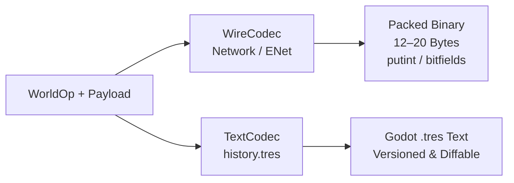

# ADR 0008: Hybrid Map Format (Git-Tracked Text History & Manifest with Compiled Binary Geometry Cache)

## Status

**Proposed** (supersedes earlier in-binary Merkle pack proposal).
Extends the native map-directory format defined in
[editor-and-commands.md §7](../editor-and-commands.md#7-map-format-reference-based-command-history-git-style)
and [vision.md §9](../vision.md#9-level-format).

---

## Context

In Sauerbraten Revival every world mutation — whether an octree cube edit or an
entity placement/modification — is a deterministic, serializable [`Command`](../../World/Commands/Command.cs)
processed through [`CommandSink`](../../World/Commands/CommandSink.cs) and encoded
by [`CommandCodec`](../../World/Commands/CommandCodec.cs).

Our earlier exploration evaluated building a self-contained Git-style Merkle octree
and commit chain inside binary Godot `.res` files (`history.res`). While conceptually
appealing, closer analysis against engine network performance and production workflows
revealed three fatal flaws:

1. **Re-inventing Git inside binary files actively fights Git.**
   Developers and modders already use Git for version control, collaboration, and
   branches. Packing Merkle object dictionaries and commit chains inside binary `.res`
   files means Git sees opaque binary churn on every editor save, preventing meaningful
   diffs and causing repository bloat.
2. **Network protocol bloat.**
   Cube 2 / Sauerbraten's coop-editing protocol is exceptionally lean:
   * ENet adds a 6-byte reliable message header (`ENetProtocolSendReliable`).
   * An edit message (`N_EDITF`, `N_EDITT`, `N_EDITM`, etc.) uses variable-length
     integers (`putint`): values between -126 and 127 occupy a single byte.
   * A full face edit or texture replacement over the wire is **under 20 bytes total**.
   Our initial in-memory command structs carried a 16-byte `CommandHeader` (`PeerId`,
   `Timestamp`, `Sequence`, `PayloadSize`), a 32-byte `SelectionPayload`, and game
   payloads, resulting in 56–64+ bytes per command. Fields like `PayloadSize` are
   static compile-time constants for each opcode and have no business being on the
   wire or duplicated on disk.
3. **Binary geometry bloat in version control.**
   Committing full uncompressed or binary octree snapshots (`world.res`) on every minor
   geometry tweak bloats a Git repository rapidly. Git requires human-readable text
   diffs to manage history efficiently without LFS.

We need a design that separates **authoritative versioned history (for Git)** from
**compiled runtime cache (for fast level load)** and **wire protocol (for low-latency networking)**.

---

## Decision

We adopt a **Hybrid Map Architecture**:
* **Git-tracked human-readable text** for the authoritative command history (`history.tres`)
  and resource manifest (`manifest.tres`).
* **Git-ignored binary cache** (`world.res`) for instantaneous $O(\text{nodes})$ runtime
  materialization at HEAD.
* **Decoupled codecs** separating compact wire transmission (`WireCodec`) from diffable text
  storage (`TextCodec`).

### 1. Map Directory Layout

```
res://resources/maps/<map_name>/
├── Level.tscn         # Godot Scene: Environment (Skybox, Sun, Fog), lighting, mode config
├── manifest.tres      # Text Resource: Materials (vslots), mapmodels, sounds, metadata (Git-tracked)
├── history.tres       # Text Resource: Authoritative versioned command log (Git-tracked, diffable)
└── world.res          # Binary Cache: Compacted HEAD geometry (Git-ignored, regenerated on load)
```

1. **`Level.tscn` (Scene Entry Point)**:
   Scene node holding external references to `history.tres` and `manifest.tres`. Hosts
   environment nodes (`WorldEnvironment` with skybox/ambient/fog, `DirectionalLight3D`
   for sun yaw/pitch/color), audio streams, and game mode logic.
2. **`manifest.tres` (Resource Manifest)**:
   Human-readable Godot `.tres` text resource mapping integer vslot/model/sound indices
   to engine asset paths and properties (diffuse, normal, glow, scale, rotation, offset,
   tint). Adding or tweaking a texture produces a clean 1-line Git diff.
3. **`history.tres` (Authoritative Versioned Command Log)**:
   Human-readable Godot `.tres` text resource recording the linear chain of `WorldOp`s.
   Carries a header (`version = 1`, `base = "res://resources/maps/empty_map"`).
   Contains the sequence of mutations required to reproduce the map from the base snapshot.
   Every edit produces readable diffs in Git (e.g. `EditFace`, `SetFaceTexture`, `AddEntity`).
4. **`world.res` (Compiled HEAD Geometry Cache)**:
   A fast, packed binary snapshot of the octree and entities at HEAD.
   * **Git-ignored**: Never committed to version control; avoids binary repo bloat.
   * **Fast load**: Deserializes directly into live `Cube` nodes in $O(\text{nodes})$,
     completely avoiding command replay during standard gameplay.
   * **Auto-regeneration**: If missing on checkout or out of sync with `history.tres`,
     the runtime replays `history.tres` once, writes the cached `world.res`, and proceeds.

---

### 2. Static Payload Schemas & Elimination of Redundant Metadata

* Every `WorldOp` has a **statically known layout and size** (except variable blocks
  like `ReplaceBlock`, which carries an explicit element count).
* Fields such as `PayloadSize`, `PeerId`, and `Timestamp` are **removed** from stored
  commands and wire packets:
  * `PayloadSize` is derived directly from the opcode.
  * `PeerId` is supplied by the transport session (ENet peer ID) or local editor context.
  * `Timestamp` is supplied by the network frame or sim clock.

---

### 3. Decoupled Codecs: `WireCodec` vs. `TextCodec`

To serve both low-latency multiplayer and Git-friendly text storage, we split the codec
into two specialized frontends:



#### A. Network Wire Codec (`WireCodec`)
* Optimized strictly for byte-level bandwidth and minimal latency over ENet.
* **Variable-length integer packing (`putint`)**: Directly ports Sauerbraten's proven
  integer compression (`tools.cpp:93`):
  * `[-126 .. 127]`: 1 byte.
  * `[-32768 .. 32767]`: 3 bytes (0x80 prefix + 2 bytes).
  * Larger: 5 bytes (0x81 prefix + 4 bytes).
* **Compact coordinate / selection packing**: Grid sizes, orientations, and corner
  offsets are packed into bitfields and variable ints.
* **Wire size target**: **12–20 bytes** per face/texture/material edit (matching Sauerbraten fidelity).

#### B. Storage Text Codec (`TextCodec`)
* Formats commands into readable Godot `.tres` text lines:
  ```
  version = 1
  base = "res://resources/maps/empty_map"
  commands = [
    "NewMap: scale=10",
    "DeleteCube: o=(512, 512, 128) s=(1, 1, 1) grid=8 orient=0",
    "EditFace: o=(512, 512, 128) s=(1, 1, 1) grid=8 orient=0 dir=1 mode=0",
    "SetFaceTexture: o=(512, 512, 128) s=(1, 1, 1) grid=8 orient=0 tex=4 flags=0",
    "AddEntity: id=1 type=1 pos=(512.0, 512.0, 514.0) a=(0, 0, 0, 0, 0)"
  ]
  ```
* Supports stable 64-bit entity IDs and fixed-point `DMF=16` coordinates.
* Easily inspected, edited in text editors, and diffed line-by-line in pull requests.

---

### 4. Determinism, Lossy Ops & the Remip Boundary

* Forward replay of editor commands (including `OctaEdit.Remip`) is 100% deterministic
  integer arithmetic.
* When `history.tres` is replayed to rebuild a missing `world.res` cache, it reproduces
  the exact octree and entity state.
* The compiled `world.res` cache ensures that players and level testers never pay the cost
  of replaying history on launch; the replay is an offline/first-run cache step only.

---

## Consequences

### Positive

1. **Git-Native Versioning**: Git diffs show the exact editor actions that changed
   between commits. No binary blobs committed to git.
2. **Lean Network Packets**: Stripping static metadata and adopting Sauerbraten-style
   variable-int packing brings wire packets down to **12–20 bytes**, fully compatible
   with competitive high-tickrate arena multiplayer.
3. **Instant Level Loading**: The local `world.res` cache provides $O(\text{nodes})$
   load performance during gameplay.
4. **No Custom VCS Complexity**: Deletes hundreds of lines of complex Merkle object
   packing, hash tables, and custom GC algorithms. Git is our VCS.
5. **Decoupled Architecture**: Network transport and disk persistence are no longer
   forced into an awkward one-size-fits-all binary struct layout.

### Trade-offs

1. **Cache Generation on Fresh Clone**: A freshly cloned repository will not have `world.res`
   and will spend a brief initial step replaying `history.tres` to generate the local cache.
2. **Text Serialization Overhead**: Parsing text commands is slower than reading a raw
   memory blit, which is why `world.res` exists as the local runtime cache.

---

## Key Source Files

- `World/Commands/Command.cs` — `WorldOp` definitions and unmanaged payload structs.
- `World/Commands/WireCodec.cs` — Low-latency variable-int binary network codec.
- `World/Commands/TextCodec.cs` — Git-friendly `.tres` text command serializer.
- `World/Runtime/Formats/Save/MapStore.cs` — Map directory save/load, cache compiler.
- `World/Runtime/Formats/Save/MapLevel.cs` — Runtime map scene loader.
- `resources/maps/empty_map/` — Canonical shipped base snapshot.
