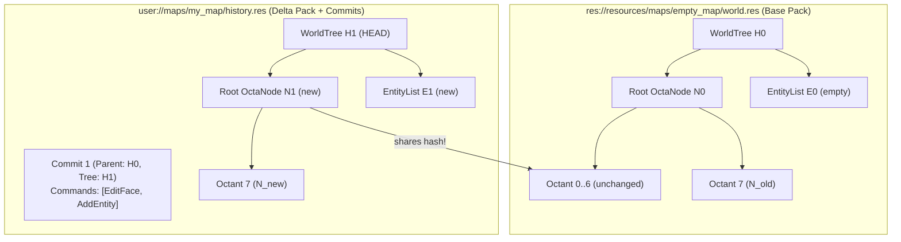

# ADR 0008: Reference-Based Map Format (Git-Style Merkle Octree, Object Pack & Commit History)

## Status

Accepted. Extends the native map-directory format defined in
[editor-and-commands.md §7](../editor-and-commands.md#7-map-format-reference-based-command-history-git-style)
and [vision.md §9](../vision.md#9-level-format).

---

## Context

In Sauerbraten Revival every world mutation — whether an octree cube edit or an
entity placement/modification — is a deterministic, serializable [`Command`](../../World/Commands/Command.cs)
processed through [`CommandSink`](../../World/Commands/CommandSink.cs) and encoded
by [`CommandCodec`](../../World/Commands/CommandCodec.cs).

When designing versioned maps ("like Git"), three insights shape the storage
model:

1. **Replaying the full command history on load is unnecessary, and `Remip` is not
   trivially invertible.**
   `OctaEdit.Remip` is 100% deterministic in the forward direction (pure integer
   arithmetic), but it is **lossy**: it collapses 8 children into 1 parent leaf
   (`DiscardChildren`), drops interior occluded child face textures, and rewrites
   `Visible`, `Merged`, and `CubeExt` across the tree. Trying to walk backward from
   `HEAD` purely by inverting commands cannot reconstruct the pre-remip octree
   structure without intermediate state.
2. **Storing a full `WorldSnapshot` per commit would make map files huge.**
   If every commit stored a full copy of the octree, 50 commits on a detailed map
   would multiply the file size by 50×.
3. **An octree *is already* a hierarchy of 8-child nodes (`Cube[8]`) — a natural
   Merkle tree.**
   Just as Git represents a directory tree as content-addressed `tree` and `blob`
   objects so that a commit only stores the nodes along the modified path, we can
   represent each `Cube[8]` octree node and the `MapEntity` list as
   **content-addressed, packable intermediate objects**.

This gives us all four properties at once:

- **Zero-copy base reference (`empty_map`)**: A canonical base map is dumped to
  disk once at `res://resources/maps/empty_map/`. Any map referencing it only
  stores objects that differ from the base pack.
- **Tiny commits via structural sharing**: Modifying a room in a map only creates
  new `OctaNode` objects along the path from the modified leaf to the root
  (at most `WorldScale` nodes, i.e., ~6–10 small `Cube[8]` objects!). All
  untouched octants and subtrees keep their existing hashes and are shared across
  commits and with `BaseRef`.
- **$O(1)$ checkout of `HEAD` or *any* commit (even across `Remip`!)**: Every
  commit's `TreeHash` points directly to its root `WorldTree` object in the pack.
  Loading `HEAD` or checking out any historical commit materializes the tree from
  its content-addressed objects directly — no command-chain replay required, and
  `Remip` is handled effortlessly.
- **Full command history preserved**: Each commit also records the `Command`s
  (geometry + entity ops) that produced it, providing a human/machine-auditable
  edit log, diffability, and replay stream.

Meanwhile, [`EmptyMap`](../../World/Editor/EmptyMap.cs) and
[`scenes/empty_map.tscn`](../../scenes/empty_map.tscn) remain as the self-contained
example of **programmatic** octree generation (and the future template for
procedural terrain generation demos), while [`scenes/editor_scene.tscn`](../../scenes/editor_scene.tscn)
uses the reference-based format via [`MapLevel`](../../World/Runtime/Formats/Save/MapLevel.cs).

---

## Decision

### 1. Packable, content-addressed Merkle Octree objects (`MapObjectPack`)

Every world state (octree + entities) decomposes into three packable,
content-addressed binary object types, each keyed by its 64-bit FNV-1a content
hash (`ulong`):

| Object Kind | Tag | Content | Typical Size |
| --- | --- | --- | --- |
| **`OctaNode`** | `1` | One `Cube[8]` octree node: each of the 8 cubes' `Faces[0..2]`, `Texture[0..5]`, optional `Material`, `Merged`, `Visible`, `CubeExt` surfaces, and — when `Children != null` — the **64-bit `ulong` hash of the child `OctaNode`** instead of inlining the child subtree. | ~130–200 bytes |
| **`EntityList`** | `2` | The ordered list of [`MapEntity`](../../World/Entities/MapEntity.cs) records (`Type`, `FixedPosition` at `DMF = 16`, `Attr1..5`). | 19 bytes × entity count |
| **`WorldTree`** | `3` | The root descriptor of a world state: `(int Scale, ulong RootOctaNodeHash, ulong EntityListHash)`. **Its hash is the commit's `TreeHash`.** | 25 bytes |

**Why this keeps maps small:**

- **Intra-tree and inter-commit deduplication**: All uniform subtrees (e.g. an
  all-empty `Cube[8]` or all-solid `Cube[8]`) hash to the *same* `OctaNode`
  object. Across commits, any octant or subtree that was not touched by an edit
  retains its exact `ulong` hash and is stored **once** in the pack.
- **Base-pack deduplication (`BaseRef`)**: Any object whose hash already exists in
  the referenced base pack (`res://resources/maps/empty_map/world.res`) is not
  rewritten into the child map's pack.
- **General-purpose packable objects**: Because `OctaNode`, `EntityList`, and
  `WorldTree` are self-contained, content-addressed binary blobs, the same pack
  mechanism can store intermediate snapshots, prefabs, and network delta chunks.

### 2. Canonical base map on disk (`res://resources/maps/empty_map/`)

We ship a canonical starting map directory at `res://resources/maps/empty_map/`:

```
res://resources/maps/empty_map/
├── Level.tscn            # MapLevel scene referencing world.res
├── world.res             # base WorldResource (Merkle object pack + HeadHash for the hollow room)
└── materials/            # empty (untextured default geometry, lit by radiance hints)
```

Its geometry matches the canonical editor starting room (`Octa.EmptyMap(10)` with
the interior room carved out via `OctaEdit.DeleteCube`). Because it lives in
`res://`, it is immutable at runtime and shared by reference across all maps that
start from an empty room.

### 3. Linear commit chain (`MapCommit`) & zero-copy checkouts

A map directory contains:

```
map/
├── Level.tscn            # MapLevel referencing world.res / history.res
├── world.res             # optional standalone/compacted object pack
├── history.res           # BaseRef + HeadHash + MapCommits[] + delta MapObjectPack
└── materials/            # optional resource manifest (manifest.res)
```

Each `MapCommit` in [`HistoryResource`](../../World/Runtime/Formats/Save/HistoryResource.cs)
records:

| Field | Type | Meaning |
| --- | --- | --- |
| `ParentHash` | `ulong` | The `TreeHash` of the preceding commit (or the `BaseRef` world's `TreeHash` for Commit 1). |
| `TreeHash` | `ulong` | **The commit hash**: the `WorldTree` hash (content hash of the root `OctaNode` + `EntityList`) at this commit. |
| `Commands` | `IReadOnlyList<Command>` | The ordered geometry and entity [`Command`](../../World/Commands/Command.cs)s applied in this commit. |

**How operations work:**

- **Zero-copy init (`MapStore.InitFromReference`)**: Initializes a new map with
  `BaseRef = "res://resources/maps/empty_map/world.res"`, `HeadHash = base.HeadHash`,
  0 commits, and 0 delta objects. Zero octree bytes are copied.
- **Commit (`MapStore.Commit`)**: decomposes the live `HEAD` octree + entities
  into `OctaNode`, `EntityList`, and `WorldTree` objects, stores only the newly
  created objects into the map's object pack (skipping any object already in the
  pack or in `BaseRef`), appends a `MapCommit(ParentHash, TreeHash, Commands)`,
  and updates `HeadHash = TreeHash`.
- **Load `HEAD` (`MapStore.Load`)**: resolves `HeadHash` directly from the object
  pack (+ `BaseRef` pack) and materializes the octree and entities in $O(1)$
  commits (no command replay).
- **Checkout any commit (`MapStore.Checkout(mapDir, targetTreeHash)`)**: looks up
  `targetTreeHash` in the object pack (+ `BaseRef` pack) and materializes that
  exact octree and entity state directly — working seamlessly across `Remip` and
  arbitrary edits without replaying commands! If an in-memory `Octa` is provided,
  unchanged subtrees can even be shared or skipped.
- **No merging**: History is a single linear chain of commits.

### 4. Entities in the command stream and Merkle tree

Entities are versioned through the exact same dual mechanism (commands +
content-addressed objects):

1. **State ownership (`IWorld.Entities`)**: [`IWorld`](../../World/Commands/IWorld.cs)
   (`OctaWorld`) owns both `Octa` and `List<MapEntity> Entities`.
2. **Entity `WorldOp`s**:
   - `WorldOp.AddEntity` (`30`): inserts a [`MapEntity`](../../World/Entities/MapEntity.cs)
     at `Index` with `(Type, FixedX, FixedY, FixedZ, Attr1..5)`.
   - `WorldOp.RemoveEntity` (`31`): removes the entity at `Index` (capturing the
     removed entity in `LogEntry` for in-session undo).
   - `WorldOp.EditEntity` (`32`): updates the entity at `Index` to new
     `(Type, FixedX, FixedY, FixedZ, Attr1..5)` (capturing the old state for undo).
3. **Deterministic fixed-point encoding**: On the wire and on disk, entity
   positions are `1/16`th-unit integers (`FixedPoint.DMF = 16`,
   `MapEntity.FixedPosition`). Zero floats exist in `EntityPayload` or
   `EntityList`.
4. **Merkle `EntityList` object**: At commit time, the entity list is packed as an
   `EntityList` object whose hash feeds into the commit's `WorldTree` (`TreeHash`).
   Commits that only touch cube geometry reuse the previous commit's `EntityList`
   hash with zero extra bytes.

---

## Architecture Overview



---

## Consequences

**Positive**

- **Tiny incremental commits**: Only modified octree branches (`OctaNode`s along
  the edit path) and changed `EntityList`s are written per commit; untouched
  subtrees are deduplicated by hash across commits and against `BaseRef`.
- **$O(1)$ load and checkout — even across `Remip`**: Loading `HEAD` or checking
  out any historical commit reconstructs the octree directly from its `WorldTree`
  and `OctaNode` objects without replaying commands or struggling to invert
  `Remip`.
- **Zero-copy new maps**: A fresh map referencing `empty_map` stores zero objects
  until its first commit.
- **Reusable packable objects**: The content-addressed `MapObjectPack` provides a
  clean foundation for prefabs, snapshot rings, and network delta sync.
- **Clear separation between asset and code**: `res://resources/maps/empty_map/`
  backs the editor (`scenes/editor_scene.tscn`), while `EmptyMap.cs` and
  `scenes/empty_map.tscn` remain the programmatic generation example for future
  procedural terrain demos.

**Trade-offs**

- Decomposing an octree into `OctaNode` objects hashes each internal node bottom-up
  on commit; because even a complex map like `church51` has only ~4,500 internal
  `Cube[8]` nodes, a full Merkle pass takes ~1–2 ms.
- No branching or three-way merge; history is strictly linear.

---

## Key Source Files

- `res://resources/maps/empty_map/` — shipped canonical base map (`world.res` + `Level.tscn`).
- `World/Runtime/Formats/Save/MapObjectPack.cs` — content-addressed Merkle octree (`OctaNode`, `EntityList`, `WorldTree`) pack/unpack and structural sharing.
- `World/Runtime/Formats/Save/HistoryResource.cs` — `MapCommit`, `BaseRef`, `HeadHash`, and delta `MapObjectPack` storage.
- `World/Runtime/Formats/Save/MapStore.cs` — `InitFromReference`, `Commit`, `Checkout`, `Load`, `SaveCompacted`, `ContentHash`.
- `World/Runtime/Formats/Save/MapLevel.cs` — `[Tool]` scene root loading `HEAD` from `World` / `History` and projecting entities + radiance.
- `World/Commands/` — `Command`, `CommandCodec`, `CommandLog`, `CommandSink`, `IWorld` (`OctaWorld` with `Octa` + `Entities`), `WorldOp` (`AddEntity`, `RemoveEntity`, `EditEntity`).
- `scenes/editor_scene.tscn` — editor scene wired to `MapLevel` referencing `res://resources/maps/empty_map/world.res`.
