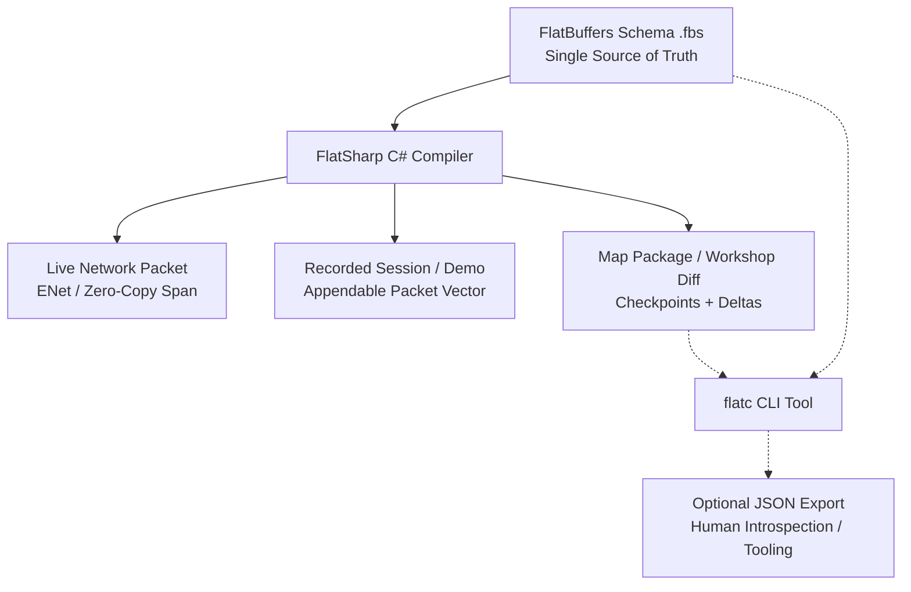
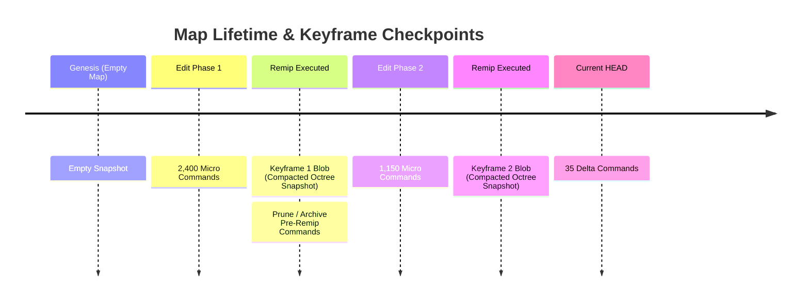
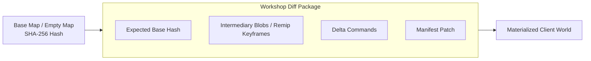

# ADR 0008: Map Architecture, Delta Packaging, and Wire Protocol via FlatSharp (FlatBuffers)

## Status

**Proposed** (Overhauls and supersedes the earlier hybrid Git-text `.tres` and manual integer-packing proposal).  
Extends the native map-directory format defined in [editor-and-commands.md §7](../editor-and-commands.md#7-map-format-reference-based-command-history-git-style) and [vision.md §9](../vision.md#9-level-format).

---

## Context & Motivation for Overhaul

Our previous revision of ADR 0008 attempted to balance Git diffability and network efficiency by splitting map storage into a human-readable Godot text command log (`history.tres`) and a low-latency variable-integer network codec (`WireCodec` via Sauerbraten's `putint`).

Upon closer practical evaluation against production requirements, both halves of that design proved fundamentally flawed:

### 1. The Human-Readable `.tres` Fallacy
* **3D Geometry Edits Do Not Diff Meaningfully in Git**: Real level-editing sessions generate tens of thousands of micro-operations (nudge brush, push face, paint texture, drag selection). A pull request containing 40,000 lines of coordinates like `EditFace: o=(512, 512, 128) s=(1, 1, 1) dir=1` is incomprehensible to human reviewers.
* **Non-Mergeable Spatial History**: Standard Git 3-way line merges cannot reconcile concurrent 3D spatial operations. Merging two branches of text commands blindly produces spatial collisions, invalid geometry, and broken octree states.
* **Format Impedance Mismatch**: Godot's text resource format (`.tres`) is engineered for inspector properties, materials, and small node graphs. Storing streaming command logs or high-density octree data in `.tres` creates massive file bloat, slow line-by-line regex/text parsing on launch, and excessive garbage collection pressure.

### 2. Manual Integer Packing is a Solved Problem
* Sauerbraten's original `putint` bitfield twiddling was written in the early 2000s for bandwidth-constrained dial-up connections.
* Hand-rolling custom variable-length integer codecs, bitfield packing, and manual byte-blitting in C# (`WireCodec` / `MemoryMarshal`) is error-prone, fragile to schema evolution, and duplicates effort already solved by modern, battle-tested serialization systems.

### 3. The `Remip` Barrier & Intermediate Binary Blobs
* In Cube 2 / Sauerbraten, `remip` (and `mpremip`) is an aggressive, lossy, structural geometry simplification operation (`OctaEdit.Remip`). It analyzes sibling cubes across mip levels, removes redundant internal divisions, and merges uniform geometry into parent nodes.
* **The Long-History Replay Problem**: If a map format relies purely on replaying a linear command log from genesis ($T_0$), replaying 100,000 edits on load is prohibitive. Furthermore, replaying thousands of micro-edits that were subsequently obliterated or merged by a `remip` is pure waste.
* **Undo & Checkpoint Boundaries**: Forward `remip` is derivation-only and destroys intermediate sub-cube history. Seeking across history, testing checkpoints, or rolling back requires actual geometric snapshots.
* **Conclusion**: We cannot treat map storage as an unbounded linear stream of micro-commands. We must support storing **intermediary binary octree blobs (keyframes/checkpoints)** at `remip` boundaries and major edit milestones.

---

## Decision

We adopt **[FlatSharp](https://github.com/jamescourtney/FlatSharp)** (the high-performance, idiomatic Google FlatBuffers implementation for C# / .NET) as the **single unified serialization foundation** for:
1. **Network Wire Protocol**: Low-latency, zero-copy coop-editing packets over ENet.
2. **Recorded Sessions & Replays**: Streaming command logs recorded directly to disk.
3. **Map Packages & Checkpoints**: Fast-loading binary packages with intermediary octree blobs.
4. **Steam Workshop Distribution**: Compact delta packages / diffs referencing base maps.



---

## 1. Why FlatSharp / FlatBuffers?

1. **Zero-Copy & Direct Span Access**: FlatSharp reads directly from `ReadOnlyMemory<byte>` or `ReadOnlySpan<byte>` without allocating heap objects for intermediate tables or byte arrays.
2. **Flexible-Sized Vectors**: First-class, zero-copy support for `vector<ubyte>` (binary octree blobs) and `vector<Command>` (command streams).
3. **Schema Evolution & Backward Compatibility**: FlatBuffers supports adding new fields, deprecating old ones, and evolving packet structures without breaking older clients or saved maps.
4. **Unified Codebase**: Network packets, recorded demos, map files, and workshop diffs share identical schemas and types. No duplicate codecs (`WireCodec` vs `TextCodec` vs `CommandCodec`).
5. **No Repository Bloat, Optional Introspection**: Binary files are maintained in the repository/distribution. When human inspection or debugging is needed, the standard `flatc` compiler converts binary FlatBuffers to and from JSON instantly (`flatc --json --raw-binary schema.fbs -- map.bin`). JSON is strictly an introspection artifact and is **not** committed to version control.

---

## 2. Solving `Remip`: Intermediary Binary Blobs & Keyframing

To solve the `remip` barrier and eliminate unbounded command replay, the map format adopts a **Keyframe + Delta** architecture:



### A. The Remip Boundary as a Checkpoint Trigger
* Whenever `OctaEdit.Remip` or `RemipAll` is executed, the entire octree geometry is structurally unified. This is the optimal moment to take an **intermediary binary blob (Keyframe)**.
* The keyframe stores the compact, serialized octree node hierarchy at that exact instant.
* Historical commands prior to the `remip` boundary are **squashed**: because `remip` permanently merged the cubes, players and level loaders do not need the preceding micro-steps.
* If a full audit trail or undo history is desired locally, it can be kept in a separate archive, but runtime loading only requires:
  $$\text{Target State} = \text{Latest Keyframe Blob} + \sum \text{Delta Commands since Keyframe}$$

### B. Octree Chunk Blobs
* In Sauerbraten, the world root consists of 8 primary subtrees (world chunks).
* Rather than snapshotting the entire world on minor edits, intermediary blobs can be stored per-chunk (`ChunkBlob`). When a `remip` or local edit occurs, only the affected chunk subtrees are blobbed, keeping keyframes tiny (a few kilobytes).

---

## 3. Map Package Directory Layout

A map remains an isolated directory of external resources, cleanly separated into engine presentation and binary FlatSharp data:

```
res://resources/maps/<map_name>/
├── Level.tscn              # Godot Scene: Skybox, Sun yaw/pitch, fog, mode rules, sound triggers
├── manifest.tres           # Godot Resource: Material/vslot bindings & model paths (engine asset links)
├── map.bin                 # FlatSharp Package: Header, Keyframe Octree Blobs, Entities, Deltas
└── (optional) debug.json   # Generated on-demand via `flatc --json` (Git-ignored)
```

1. **`Level.tscn`**: Shipped Godot scene providing scene-tree nodes: `WorldEnvironment`, `DirectionalLight3D`, audio streams, spawn points, and game mode logic. References `map.bin` and `manifest.tres`.
2. **`manifest.tres`**: Text resource for Godot engine asset references (texture paths, materials, GLTF model paths). This stays in `.tres` because Godot's editor needs to manage asset dependencies and `.uid` tracking directly.
3. **`map.bin`**: The authoritative binary map package compiled via FlatSharp. Contains the latest base keyframe, intermediate blobs, entities, and any pending delta commands.
4. **No Git-tracked `.tres` command logs**: Deleted entirely. Clean, fast binary loading replaces thousand-line command text logs.

---

## 4. Steam Workshop & Delta Diff Packages

The FlatSharp schema directly supports **delta diff packaging** for Steam Workshop uploads and downloads:



### How Workshop Packaging Works:
1. **Delta Packages**:
   * When modifying an existing map (e.g., `church51` or `empty_map`), the author does not need to distribute the entire base world asset collection.
   * The package includes:
     - `base_map_hash`: SHA-256 hash of the parent map or base snapshot.
     - `intermediary_blobs`: Intermediary binary blobs capturing geometry changed across `remip`s.
     - `commands`: Vector of `WorldCommand`s applied on top of the latest blob.
     - `manifest_delta`: Texture and model additions.
2. **Standalone Compilation**:
   * For maps built from scratch or for clients without the base map, the editor can compile the package into a **Standalone Map Package** containing the full keyframe blob and all assets.
3. **Bandwidth Efficiency**:
   * Workshop updates are tiny: changing a hallway and running `remip` produces a diff package of only a few kilobytes (the modified chunk blobs + delta commands).

---

## 5. Unified Networking, Recording, and Replays

Because the wire protocol and storage format share the same FlatSharp schema:
1. **Zero-Copy Network Serialization**:
   * When an editor client edits a face or places an entity, the `WorldCommand` table is serialized directly into an ENet outgoing buffer span.
   * The server validates and broadcasts the span directly to peers.
2. **Live Session Recording**:
   * An edit session or competitive match replay is simply an append-only stream of FlatBuffer packets:
     ```
     [Magic: 4B][Header: MapInfo][Vector<TimestampedPacket>]
     ```
   * Recording coop-edit sessions requires no special encoding pipeline—packets from the network are dumped straight to disk.
3. **Client Catch-Up**:
   * When a new peer joins an active coop-edit session:
     1. The server serializes the current world state as a **Keyframe Blob** (`OctreeBlob`).
     2. Followed by any commands in the current un-remipped transaction buffer.
     3. The client receives the blob, blits it directly into `Cube` nodes in $O(\text{nodes})$, and joins the tick loop with zero replay delay.

---

## 6. FlatBuffers Schema Specification (`schema.fbs`)

Below is the foundational FlatBuffers schema defining the wire protocol, keyframe blobs, and map packages:

```flatbuffers
namespace SauerbratenRevival.Format;

enum WorldOp : ubyte {
    None = 0,
    DeleteCube = 1,
    EditFace = 2,
    SetFaceTexture = 3,
    ReplaceTexture = 4,
    SetFaceMaterial = 5,
    FlipCube = 6,
    RotateCube = 7,
    Remip = 20,
    NewMap = 30,
    AddEntity = 40,
    RemoveEntity = 41,
    EditEntity = 42,
    ReplaceBlock = 50
}

struct Vec3i {
    x: int32;
    y: int32;
    z: int32;
}

struct Vec3f {
    x: float32;
    y: float32;
    z: float32;
}

struct SelectionBox {
    origin: Vec3i;
    size: Vec3i;
    grid: int32;
    orient: int32;
}

table EditFaceCmd {
    sel: SelectionBox;
    dir: int32;
    mode: int32;
    stride: int32;
}

table SetTextureCmd {
    sel: SelectionBox;
    texture_id: int32;
    flags: int32;
}

table DeleteCubeCmd {
    sel: SelectionBox;
}

table RemipCmd {
    mip_vis: bool;
}

table EntityCmd {
    entity_id: uint64;
    type: int32;
    pos: Vec3f;
    attr1: int32;
    attr2: int32;
    attr3: int32;
    attr4: int32;
    attr5: int32;
}

union CommandPayload {
    EditFaceCmd,
    SetTextureCmd,
    DeleteCubeCmd,
    RemipCmd,
    EntityCmd
}

table WorldCommand {
    sequence: uint64;
    peer_id: int32;
    timestamp: uint32;
    op: WorldOp;
    payload: CommandPayload;
}

table OctreeBlob {
    keyframe_index: uint32;
    chunk_index: int32;         // -1 if full world, 0..7 for root octants
    world_size: int32;
    uncompressed_size: uint32;
    data: [ubyte];              // Compact binary octree node blit
}

table MapPackage {
    format_version: uint32 = 1;
    map_name: string;
    author: string;
    base_map_hash: [ubyte];     // 32-byte SHA-256 if diff package, empty if standalone
    
    keyframes: [OctreeBlob];    // Intermediary blobs generated at remip / milestones
    deltas: [WorldCommand];     // Commands applied since the latest keyframe
    entities: [EntityCmd];      // Active world entities
}

table NetworkPacket {
    packet_id: uint32;
    commands: [WorldCommand];
}

root_type MapPackage;
```

---

## 7. Migration & Implementation Strategy

1. **Add `FlatSharp` Package**:
   * Add `FlatSharp.Runtime` and `FlatSharp.Compiler` via NuGet to `SauerbratenRevival.csproj`.
   * Compile `schema.fbs` as part of the C# build process, generating strongly-typed, zero-allocation classes.
2. **Deprecate Manual Bit-Packing**:
   * Retire manual integer-packing in `CommandCodec.cs` / `WireCodec.cs`.
   * Map commands directly to FlatSharp generated payloads.
3. **Implement Keyframing in `CommandSink` / `MapStore`**:
   * Integrate snapshot extraction with `OctaEdit.Remip`: when `remip` completes, serialize the octree root to an `OctreeBlob`.
   * Clear or archive pre-remip commands in active transaction history.
4. **Level Loading**:
   * `MapStore.LoadWorld()`: Reads `map.bin`, materializes the latest `OctreeBlob` in $O(\text{nodes})$, and replays only the trailing delta commands.
   * Eliminates slow history parsing and avoids replaying redundant geometric operations.
5. **Tooling**:
   * Provide a lightweight helper script / CLI option:
     ```sh
     dotnet run -- --dump-json resources/maps/church51/map.bin
     ```
     which calls `flatc` to emit readable JSON for debugging when requested.

---

## Consequences

### Positive
* **Zero Duplication**: One schema (`schema.fbs`) powers the network wire, recorded sessions, map packages, and Steam Workshop diffs.
* **Solves the Remip Wall**: Intermediary binary blobs allow `remip` to freely optimize geometry without breaking history or requiring massive command re-simulations.
* **Extreme Performance**: FlatSharp zero-copy deserialization enables near-instant level loading and allocation-free network packet parsing.
* **No Repository Bloat**: Git tracks clean, compact binary packages instead of multi-megabyte `.tres` text logs containing tens of thousands of coordinate lines.
* **Workshop-Ready**: Built-in delta packaging against base map hashes makes mod distribution lightweight and scalable.
* **On-Demand Introspection**: Developers can inspect binary packages as JSON using `flatc` whenever needed, without polluting version control.

### Trade-offs
* **Binary Files in Git**: Map packages (`map.bin`) are binary. However, because they store compact keyframes and squashed deltas rather than uncompressed raw dumps, file sizes remain tiny (typically tens to hundreds of kilobytes).
* **FlatSharp Schema Compilation**: Adds `FlatSharp` NuGet dependency and schema generation to the build pipeline.

---

## Key Source Files

- `World/Schema/schema.fbs` — Authoritative FlatBuffers schema definition.
- `World/Commands/Command.cs` — In-engine command definitions and interfaces.
- `World/Runtime/Formats/Save/MapStore.cs` — Map package loading, keyframe extraction, and delta application.
- `World/Runtime/Formats/Save/MapPackage.cs` — High-level wrapper over FlatSharp `MapPackage`.
- `World/Network/NetMessage.cs` — Network transmission using FlatSharp spans over ENet.
