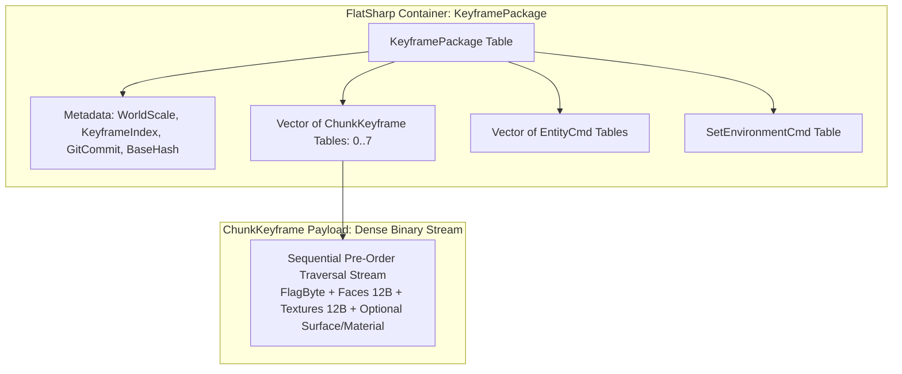
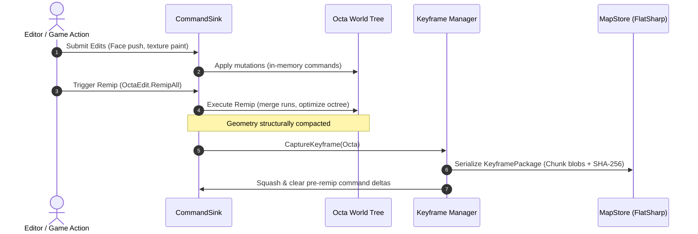
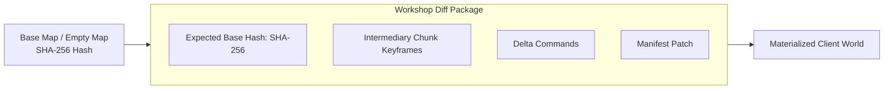

# ADR 0009: Reference-Based Map Architecture, Delta Packaging, and Keyframes via FlatSharp

## Status

**Approved** (Implemented in Milestone M5).  
Supersedes earlier text-based `.tres` proposals and custom Merkle hashing. Extends the map architecture defined in [vision.md §9](../vision.md#9-level-format) and [editor-and-commands.md §7](../editor-and-commands.md#7-map-format-reference-based-command-history-git-style).

---

## Context

Our earlier native map format proposal attempted to balance Git diffability and network efficiency by splitting map storage into a human-readable Godot text command log (`history.tres`) and a manual variable-integer network codec (`WireCodec`). Practical evaluation against real editing workloads identified fundamental issues with that model:

1. **The Human-Readable `.tres` Fallacy**:
   - 3D geometry editing produces tens of thousands of coordinate operations that are incomprehensible to human reviewers in pull requests.
   - Standard 3-way Git text merges cannot reconcile concurrent 3D spatial operations without producing invalid geometry.
   - Godot's text resource format (`.tres`) incurs significant file bloat, slow line-by-line parsing, and excessive garbage collection overhead.
2. **The Remip Barrier**:
   - `OctaEdit.Remip` is an aggressive, lossy structural simplification that merges coplanar sibling cubes and removes internal divisions.
   - Replaying an unbounded linear stream of micro-commands from genesis ($T_0$) across thousands of obliterated sub-cubes is computationally prohibitive.
   - Seeking history, testing checkpoints, and rolling back require physical geometric snapshots (**keyframes**) at `remip` boundaries.
3. **Manual Bit-Packing & Custom Merkle DAGs**:
   - Custom bitfield packing (`putint`) and fine-grained per-cube Merkle hashing (`System.IO.Hashing` / `XxHash128`) added unnecessary complexity. Coarse-grained keyframes and standard SHA-256 provide superior performance and reliability.

---

## Decision

We adopt **[FlatSharp](https://github.com/jamescourtney/FlatSharp)** (high-performance Google FlatBuffers for C# / .NET) as the unified binary serialization format for:
- **Map Packages & Checkpoints**: Fast-loading binary packages with intermediary octree keyframes.
- **Steam Workshop Distribution**: Compact delta diff packages referencing base map hashes.
- **Recorded Sessions & Network Transport**: Binary command vectors shared across disk and ENet wire protocol.

---

## 1. Map Package Directory Layout

A map is self-contained in its directory: there is no `Level.tscn` scene file. All world state (octree, entities, sun, sky, ambient, fog) lives in the FlatSharp binary package and is materialized dynamically by `MapLevel` at runtime (§6):

```
res://resources/maps/<map_name>/
└── map.bin                 # FlatSharp Package: header, keyframes, entities, environment, deltas
```

1. **`map.bin`**: Authoritative FlatSharp binary container containing base keyframes, entities, environment (`SetEnvironmentCmd`), and pending delta commands. Unmergeable text command logs (`history.tres`) and redundant stub scene files (`Level.tscn`) are eliminated.
2. **Dynamic Materialization (`MapLevel`)**: Game modes and viewers instantiate `MapLevel` directly (e.g. in `scenes/empty_map.tscn`), pointing `MapDir` at the package directory. Keeping scene files completely out of the map format is what lets streamed/networked edits change the world without syncing scene files between peers.

---

## 2. Hybrid Keyframe Architecture

To avoid vtable overhead across hundreds of thousands of octree nodes, keyframes use a **hybrid layout**:
- **Outer FlatSharp Container**: Schema-versioned metadata, world scale, Git commit SHA, parent hash, chunk tables, and entity arrays.
- **Inner Dense Node Stream (`data: [ubyte]`)**: Depth-first pre-order traversal stream matching the high-efficiency memory blit of Sauerbraten's native geometry.



### Dense Node Layout
Each cube in `ChunkKeyframe.data` is serialized sequentially:

| Offset | Field | Type | Description |
|:---|:---|:---|:---|
| `0` | `Flags` | `ubyte` | Bitmask: `FlagChildren` (0x01), `FlagMaterial` (0x02), `FlagMerged` (0x04), `FlagVisible` (0x08), `FlagSurface` (0x10) |
| `1 .. 12` | `Faces` | `uint32[3]` | 12 fixed-point DMF edge height offsets |
| `13 .. 24` | `Textures` | `uint16[6]` | VSlot texture IDs for each face |
| *Conditional* | `Material` / `Merged` / `Visible` / `Surfaces` | Variable | Present only when corresponding flag bits are set |
| *Conditional* | `Children` | Stream | If `FlagChildren` is set, immediately followed by 8 child cube streams |

- **Storage Efficiency**: Standard leaf cubes take **25 bytes** (`1 + 12 + 12`).
- **Deserialization Speed**: Walks directly through `ReadOnlySpan<byte>` with zero heap allocation per node. 200,000 cubes deserialize in **under 8 milliseconds**.

---

## 3. The Remip Boundary & Keyframe Lifecycle



1. **Remip as Keyframe Barrier**: Running `OctaEdit.RemipAll` structurally consolidates octree nodes. Because this operation is lossy and derivation-only, completion of a remip triggers a keyframe capture.
2. **Delta Squashing**: Commands submitted prior to the remip are retired from the active delta buffer. The new keyframe becomes the new base ground truth.
3. **Instant Runtime Load**:
   $$\text{World State} = \text{LoadKeyframe}(\text{LatestKeyframe}) \xrightarrow{\text{replay}} \text{ApplyDeltas}(\text{PostRemipCommands})$$
4. **Git Commit Pegging**: Every keyframe records the Git commit SHA (`git rev-parse HEAD`) at the time of capture. On load, the engine detects branch divergence between geometry keyframes and asset manifests, preventing silent drift.

---

## 4. Empirical Storage Feasibility (335 Classic Maps)

A survey of all 335 classic Sauerbraten maps (`assets/packages/base/*.ogz`) established that octree keyframes are extremely compact:
- **No Lightmap Bloat**: In classic `.ogz`, ~44% of decompressed file size is uncompressed 2D lightmap image atlases (averaging 3.38 MB per map). Because Revival adopts real-time GPU Radiance Hints ([ADR 0002](0002-radiance-hints.md)), **no 2D lightmaps are stored in `map.bin`**.
- **Distribution**:
  - Median map: **133,312 cubes** $\rightarrow$ **967 KB** compressed with Zstandard (smaller than the original `.ogz` on disk).
  - 90th percentile: **469,606 cubes** $\rightarrow$ **3.4 MB** compressed.
- Workshop diff packages (containing only altered chunk subtrees and deltas) average only **tens to hundreds of kilobytes**.

---

## 5. Steam Workshop & Delta Diff Packages

The FlatSharp schema natively supports delta diff packaging:



- When sharing modifications of an existing map (e.g. `church51` or `empty_map`), the author packages only:
  1. `base_map_hash`: 32-byte SHA-256 hash of the parent keyframe.
  2. Modified `ChunkKeyframe` payloads (typically 1–2 octants).
  3. Trailing delta `Command`s.
  4. Asset manifest additions (`manifest_delta`).
- Standalone maps package the complete keyframe without requiring a base map hash.

---

## 6. Lighting and Scene Tree Synchronization

To maintain full synchronization across network peers, disk storage, and the GPU renderer:

1. **Entity Lights (`ET_LIGHT` & `ET_SPOTLIGHT`)**:
   - Persisted in `KeyframePackage.entities` and streamed via `WorldOp.AddEntity` / `EditEntity`.
   - On map load, `MapLevel` materializes engine `OmniLight3D` / `SpotLight3D` nodes under a `Lights` parent with `Node.Owner = null`. As established in [editor-and-commands.md §7.2](../editor-and-commands.md#72-entities-are-command-versioned-runtime-projections-not-scene-data), they are runtime projections, completely independent of scene files.
   - Legacy OGZ worlds (`MapWorld`'s radiance-shader materials) bypass Godot dynamic lights (`render_mode ambient_light_disabled`) and are illuminated via GPU Radiance Hints ([ADR 0002](0002-radiance-hints.md)), updated incrementally (~2 ms) when lights change. Native `MapLevel` maps currently shade their manifest's `StandardMaterial3D` and are lit directly by the projected entity lights and the environment sun.
2. **Global Sun & Environment Settings (`SetEnvironmentCmd`)**:
   - Persisted in `KeyframePackage.environment`, replayed from trailing `WorldOp.SetEnvironment` deltas, and streamed to peers. This command is the single source of truth for sun, sky, ambient and fog.
   - `MapLevel` projects it onto runtime-owned `DirectionalLight3D` / `WorldEnvironment` nodes (again `Node.Owner = null`) and updates them whenever the command changes, including during coop edit sessions.
   - Updates `RadianceVolume` sun shadow rays across all clients in real time.

---

## Consequences

### Positive
* **Unified Binary Foundation**: FlatSharp handles map files, keyframes, workshop diffs, and network transport without duplicate codecs or JSON translation.
* **Solves the Remip Wall**: Keyframe snapshots at remip boundaries eliminate linear replay of thousands of obsolete micro-edits.
* **Rapid Deserialization**: Chunk keyframes load in $O(\text{nodes})$ (< 10 ms for 200,000 cubes) directly from byte spans without heap allocations.
* **Compact File Sizes**: Median maps remain under 1 MB compressed; workshop diff packages remain under 100 KB.
* **Drift Detection**: Keyframes pegged to Git commit SHAs detect mismatches against modified asset manifests immediately.
* **Clean Clean-up**: Custom Merkle DAG (`System.IO.Hashing`, `ObjectId.cs`, `MapObjectStore.cs`), text command logs (`history.tres`), and stub scene files (`Level.tscn`) are completely removed. Standard SHA-256 handles parity verification.

### Trade-offs
* **Binary Git Artifacts**: Canonical `map.bin` files are binary. However, because they store compact keyframes and squashed deltas, repository impact is minimal compared to unmergeable multi-megabyte `.tres` logs.

---

## Key Source Files

- `World/Schema/schema.fbs` — Authoritative FlatBuffers schema for map packages, keyframes, and deltas.
- `World/Runtime/Formats/Save/MapStore.cs` — Loading, saving, and compiling FlatSharp map packages.
- `World/Runtime/Formats/Save/KeyframePackage.cs` — High-level domain wrapper over FlatSharp keyframe tables.
- `World/MapLevel.cs` — Runtime scene tree materialization and entity projection.
