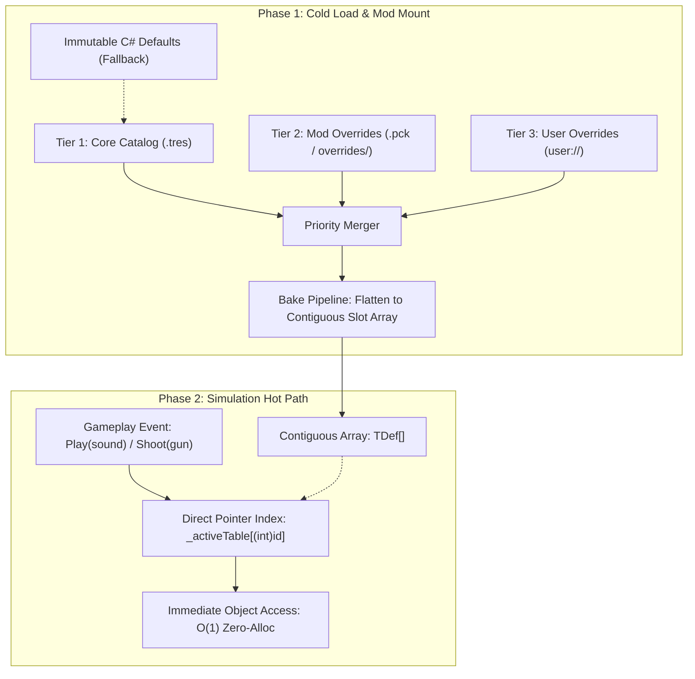

# ADR 0010: Resource-Based Modding Architecture and Pre-Baked Lookup Tables

## Status

**Proposed / Accepted**  
Extends the modding model defined in [vision.md §12](../vision.md#12-modding--workshop) and formalizes the unified resource catalogue pattern established across [WeaponCatalog](../../World/Weapons/WeaponCatalog.cs), [GameModeCatalog](../../World/Game/GameModeCatalog.cs), and [GameAudio](../../World/Audio/GameAudio.cs).

---

## Context

In classic *Cube 2: Sauerbraten*, engine parameters, weapon stats, sounds, and game modes were split across hardcoded C++ tables (`game.h`, `fpsgame.cpp`), config scripts (`data/sounds.cfg`), and CubeScript execution.

For *Sauerbraten Revival*:
1. **No CubeScript**: Per [vision.md §3](../vision.md#3-non-goals-what-we-are-not-doing), CubeScript is explicitly not ported. Configuration and modding must be native to Godot (.NET / GDScript / Resources).
2. **Comprehensive Moddability**: Gameplay-facing content—audio, weapons, player models, and game modes—must be easily authored by developers and customizable by modders via Steam Workshop packs or local folders.
3. **Extreme Hot-Path Performance**: Arena FPS simulation ticks (100 Hz fixed physics steps) and audio dispatches cannot tolerate garbage collector pressure, string allocations, or dictionary hash collisions. A weapon firing at 10 rounds/sec, spatial audio recalculations, and physics queries require direct memory access speeds.

Previous hardcoded tables (e.g. `GameAudio.HardcodedSounds`) provided $O(1)$ static array indexing but were completely rigid and inaccessible to modders. Conversely, naive dictionary or resource lookup on every gameplay frame is unacceptable for high-tickrate arena multiplayer.

---

## Decision

We adopt a **Unified Resource-Based Modding Architecture with Pre-Baked Flat Lookup Tables**:

1. **Godot Typed Resources (`.tres`) as the Authoring Format**:
   - Every configurable game object is modeled as a typed `Resource` (`[Tool] [GlobalClass]`).
   - Core defaults ship as committed `.tres` files in `res://resources/<category>/` (e.g. `res://resources/audio/core_sounds.tres`, `res://resources/weapons/`, `res://resources/gamemodes/`).
   - Designers can inspect and adjust balance directly in the Godot Editor without touching C#.
2. **Three-Tier Priority Cascade**:
   Content resolves across three cascading layers:
   - **Tier 1 (Core Base)**: Canonical `.tres` files shipping with the game (backed by immutable C# structs as a zero-failure fallback).
   - **Tier 2 (Mod Overrides & Additions)**: Loaded from mounted `.pck` resource packs (`ProjectSettings.LoadResourcePack`) or mod override directories (`res://resources/<category>/overrides/`).
   - **Tier 3 (User Overrides)**: Local player customizations from `user://<category>/overrides/` or `user://settings.cfg`.
3. **Two-Phase Lifecycle: "Bake at Load, Index at Runtime"**:
   - **Phase 1: Cold Load / Reload**:
     - Scans Tier 1, Tier 2, and Tier 3 sources.
     - Resolves logical identifiers into dense, contiguous integer indices ($0, 1, \dots, N-1$).
     - Assembles and bakes the final state into a contiguous, flat array (`TDef[]`).
     - Atomically publishes the array reference (`volatile TDef[] _activeTable`).
   - **Phase 2: Hot Path Playback & Simulation**:
     - Gameplay code accesses entries exclusively by integer ID:
       $$\text{Get}(id) \implies \_activeTable[(int)id]$$
     - Post-load lookup compiles to a single boundary check and direct pointer offset. Zero allocations, zero hashing, zero string operations.



---

## 1. Concrete System Patterns

The exact same architectural pattern is applied uniformly across the engine:

### A. Game Audio (`World/Audio/GameAudio.cs`)
- **Resource**: `SoundCatalogResource` containing `SoundDefinition` rows with optional `SoundSlotResource` alternates (`altsound`).
- **Core Catalog**: `res://resources/audio/core_sounds.tres` (70 classic engine sounds).
- **Overrides**: `res://resources/audio/overrides/*.tres` and `user://audio/overrides/*.tres`.
- **Hot Path**:
  ```csharp
  public static SoundConfig? GetConfig(GameSound sound)
  {
      int index = (int)sound;
      var table = All;
      if ((uint)index >= (uint)table.Length) return null;
      return table[index];
  }
  ```

### B. Weapons (`World/Weapons/WeaponCatalog.cs`)
- **Resource**: `WeaponInfo : Resource` (e.g. `rifle.tres`, `shotgun.tres`).
- **Core Catalog**: `res://resources/weapons/<name>.tres` (12 classic guns and projectile definitions).
- **Overrides**: Mod directories overlaying weapon stats or model bindings.
- **Hot Path**:
  ```csharp
  public static WeaponInfo Get(Gun gun) => All[(int)gun];
  ```

### C. Game Modes (`World/Game/GameModeCatalog.cs`)
- **Resource**: `GameModeInfo : Resource` (e.g. `ctf.tres`, `insta.tres`).
- **Core Catalog**: `res://resources/gamemodes/<id>.tres` (20 standard modes).
- **Overrides**: Custom community modes with custom rules, mode flags, and script attachments.

### D. Player Models & Cosmetics (Future Implementation)
- **Resource**: `PlayerModelInfo : Resource` specifying glb meshes, animation map bindings, and team skin variants.
- **Hot Path**: `ModelCatalog.Get(PlayerModelId id) => _models[(int)id]`.

---

## 2. Dynamic and Mod-Added Entries

For built-in items, identifiers map directly to fixed, stable enums (`GameSound`, `Gun`).  
For mod-added assets that extend beyond the built-in enum counts:
1. **Dynamic Registration**: Mod definitions missing a fixed enum ID or assigned `None` receive dynamically assigned dense integer IDs ($N, N+1, \dots$).
2. **Name Resolution Seam**: Modded entities, weapons, or scripts query by string name **only once** at spawn/load time:
   ```csharp
   int customId = GameAudio.ResolveId("plasma_blast");
   ```
3. **Runtime Execution**: The cached `customId` is passed during game simulation, indexing directly into `_activeTable[customId]`.

---

## 3. Hot-Reloading & Multiplayer Determinism

1. **Atomic Hot-Swap**: Calling `Reload()` builds the new table off-thread or at a scene boundary and swaps the volatile array pointer atomically. Ongoing frames never read a partially initialized state.
2. **Map & Server Authority**: In multiplayer, the server dictates authoritative gameplay parameters (weapon damage, fire rates). Clients load server-approved weapon resources during connection handshake. Client-side audio and visual models remain local to respect user cosmetics.

---

## 4. Verification and Ground Truth

1. **Fidelity Unit Tests**: Tests in `test/GameAudioTest.cs` and `test/WeaponCatalogTest.cs` assert that the deserialized `.tres` definitions match the SVN r6889 reference tables with zero deviation.
2. **Fallback Resilience**: In headless testing environments or corrupted installations, the catalogues fall back cleanly to `Defaults` without crashing the game engine.
