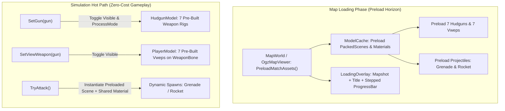

# ADR 0011: Model Preloading, Zero-Cost Weapon Switching, and Scene Caching

## Status

**Accepted**  
Extends the character and asset architecture in [ADR 0004](0004-character-animation.md) and [ADR 0010](0010-resource-modding.md). Addresses runtime frame stutter and $18\text{ ms}$ `_PhysicsProcess` spikes caused by mid-game model loading and node tree reconstruction.

---

## Context

In high-tickrate arena multiplayer ($100\text{ Hz}$ fixed physics steps), simulation ticks cannot tolerate disk I/O, managed memory allocations, or GPU buffer reallocations. Profiling of weapon switching (`SetGun`, `SetViewWeapon`) and projectile firing (`TryAttack` for grenades and rockets) revealed major frame hitches and latency spikes:

1. **Transient `PackedScene` References & Repeated Disk Parsing**:
   [`ModelInstance.TryLoadModel()`](../../World/Models/ModelInstance.cs) loads glTF scenes via `ResourceLoader.Load<PackedScene>(path)` into local variables without holding strong references.
   - Godot's internal `ResourceCache` is weak; once all strong references drop, cached scenes are purged.
   - For non-skeletal models (`KeepSkeleton == false`, such as `BounceBody` grenades, items, and mapmodels), `scene.Free()` drops the instantiated tree immediately after copying mesh references. Subsequent spawns (e.g. firing another grenade) hit disk and re-parse the GLB inside `_PhysicsProcess`.
2. **Node-Tree & `Skeleton3D` Destruction on Every Weapon Switch**:
   When switching weapons, [`HudgunModel.SetGun()`](../../World/Models/HudgunModel.cs) called `part.Free()` on hands and weapon nodes, followed by `packed.Instantiate()` and `AddChild()`. This:
   - Allocated $230\text{--}320\text{ KB}$ on the managed heap per switch.
   - Forced Godot's `RenderingServer` to reallocate GPU skinning buffers and uniform sets.
   - Rebound `AnimationPlayer` tracks and created new `BoneAttachment3D` nodes on the main thread.
3. **Missing Skin and Material Sharing**:
   [`PlayerModel.AttachViewWeapon()`](../../World/Models/PlayerModel.cs) rebuilt `ShaderMaterial` instances from scratch without a shared `_skinCache`, duplicating materials and triggering shader re-evaluations.
4. **Third-Person View Weapon Re-Attachment**:
   [`PlayerModel.SetViewWeapon()`](../../World/Models/PlayerModel.cs) freed the existing `PlayerViewWeapon` and repeatedly created redundant `BoneAttachment3D` nodes under the skeleton.

### How Cube 2: Sauerbraten Solved This

Original Sauerbraten (`r6889`) avoided mid-match loading hitches through its `preloadmodel` subsystem:
- During map load ([`worldio.cpp:1258-1270`](/Users/fohlen/Downloads/sauerbraten-code-r6889/src/engine/worldio.cpp)), the engine calls:
  - `preloadusedmapmodels(true)`
  - `game::preload()`: enqueues all 7 first-person hudguns, 7 third-person view weapons (`vwep/*`), projectiles (`projectiles/*`), player models, and sounds ([`fpsgame/render.cpp:520-560`](/Users/fohlen/Downloads/sauerbraten-code-r6889/src/fpsgame/render.cpp)).
  - `flushpreloadedmodels()`: processes the queue, loads meshes into VBOs, and advances `loadprogress`.
- The game displays a dedicated loading screen with a map shot screenshot, map name, mode, and progress bar (`renderbackground("loading...", mapshot, mname, game::getmapinfo())`).
- During gameplay, weapon switching is a simple pointer swap with zero allocations.

---

## Decision

We adopt a **Two-Tier Preloading Architecture** combining persistent CPU/GPU scene caching with pre-built weapon banks on player rigs:

### 1. Central Model and Scene Cache (`ModelCache`)
- Implement `ModelCache` to maintain persistent, strong references to loaded `PackedScene` assets across the match lifecycle.
- Hold a shared, persistent `_skinCache` (`Dictionary<string, Material>`) so `ModelSkin.Build()` never instantiates duplicate materials for the same texture/skin definition.
- Pre-warm projectile visuals (`projectiles_grenade.glb`, `projectiles_rocket.glb`) and standard projectile materials at map load.

### 2. Zero-Cost First-Person Weapon Bank (`HudgunModel`)
- Pre-build and instantiate all 7 weapons (`fist`, `shotg`, `chaing`, `rl`, `rifle`, `gl`, `pistol`) when `HudgunModel.Configure()` is called during player spawn.
- Store the instantiated subtrees in an internal dictionary:
  `Dictionary<string, WeaponSubtree> _weapons`
- Inactive weapons are set to:
  `Visible = false; ProcessMode = ProcessModeEnum.Disabled;`
- In `SetGun(string gun)`:
  - Deactivate previous weapon: `old.Visible = false; old.ProcessMode = ProcessModeEnum.Disabled;`
  - Activate selected weapon: `current.Visible = true; current.ProcessMode = ProcessModeEnum.Inherit;`
  - Restart idle animation on the active weapon rig.
- **Cost**: 0 managed heap allocations, 0 disk I/O, 0 `Skeleton3D` buffer allocations, $<0.01\text{ ms}$ execution time.

### 3. Zero-Cost Third-Person ViewWeapon Bank (`PlayerModel`)
- The `BoneAttachment3D` anchor (`"WeaponBone"`) is created **once** when the body skeleton is initialized.
- Pre-build or retain the 7 [`PlayerViewWeapon`](../../World/Models/PlayerViewWeapon.cs) children under `"WeaponBone"`, reusing the shared `_skinCache`.
- `SetViewWeapon(string? weaponName)` toggles visibility (`Visible = (name == weaponName)`) without freeing or recreating nodes.

### 4. Zero-Hitch Dynamic Spawns (`BounceBody` & `WeaponEffectsRenderer`)
- In [`BounceBody.Setup()`](../../World/Weapons/BounceBody.cs):
  - Replace direct calls to `ResourceLoader.Load<PackedScene>()` with cached scene instantiation from `ModelCache`.
  - Share the grenade `StandardMaterial3D` rather than allocating a new instance per spawned grenade.
- In [`WeaponEffectsRenderer`](../../World/Effects/WeaponEffectsRenderer.cs):
  - Pre-warm the rocket mesh and skin material during map load rather than waiting for the first rocket fired.

### 5. Map Loading UX & Stepped Progress Bar
- Implement a dedicated loading scene [`scenes/map_load.tscn`](../../scenes/map_load.tscn) backed by [`scripts/MapLoad.cs`](../../scripts/MapLoad.cs):
  - **Backdrop**: Map screenshot (`assets/packages/base/<map>.jpg` or metadata catalogue).
  - **Information**: Map name, game mode, map title, and author.
  - **Stepped Progress Bar** (5 sequential callbacks adding $+20\%$ each):
    1. Parsing Octree & Entities ($+20\% \to 20\%$)
    2. Radiance Hints & Lighting ($+20\% \to 40\%$)
    3. Meshing Geometry & Materials ($+20\% \to 60\%$)
    4. Preloading Weapons, Models & Projectiles ($+20\% \to 80\%$)
    5. Spawning Player & Match Start ($+20\% \to 100\%$)
- Between steps, the loader yields a frame (`await ToSignal(GetTree(), SceneTree.SignalName.ProcessFrame);`) ensuring Godot renders smooth UI updates and never blocks the window manager.
- Upon completion, `ResumeGame()` dismisses `map_load.tscn`, smoothly opening directly into interactive gameplay.

---

## Memory & Performance Analysis

| Asset Group | Count | Total Disk / RAM Size | Preload Timing | Runtime Switch Cost |
| :--- | :--- | :--- | :--- | :--- |
| **View Weapons (`vwep_*`)** | 7 models | $\sim 200\text{ KB}$ | Map load ($\sim 10\text{ ms}$) | $<0.005\text{ ms}$ (Visibility toggle) |
| **Hudguns (Part0 + Part1)** | 7 rigs | $\sim 3.5\text{--}4.5\text{ MB}$ / playermodel | Map load ($\sim 40\text{ ms}$) | $<0.01\text{ ms}$ (Visibility + ProcessMode) |
| **Projectiles (Grenade/Rocket)** | 2 models | $\sim 32\text{ KB}$ | Map load ($<5\text{ ms}$) | $0\text{ ms}$ disk hit, instant spawn |
| **Materials & Skins** | Shared dictionary | $<500\text{ KB}$ | Map load | 0 allocations on switch |

**Total RAM footprint**: $\sim 5\text{--}6\text{ MB}$ per active local player rig.  
**Simulation benefit**: Completely eliminates the $17.9\text{ ms}$ physics frame drop when firing grenades or switching weapons.

---

## Consequences

### Positive
- **Stable 100 Hz Physics**: Weapon switches and projectile spawns happen strictly in CPU RAM without triggering disk I/O, managed GC pressure, or main-thread GPU buffer creation.
- **Sauerbraten Parity**: Faithfully replicates Cube 2's `preloadmodel` and `renderbackground` flow.
- **Robust Multi-Instance Support**: The same model cache seamlessly handles multiple players and bots without duplicating underlying `PackedScene` assets.

### Neutral / Trade-offs
- Map initialization takes $\sim 50\text{--}100\text{ ms}$ longer during the loading screen to pre-build the weapon bank. This is masked by the loading screen and well worth the mid-game smoothness.
- `PlayerViewWeaponTest` and inspector workflows now interact with a persistent weapon bank rather than expecting nodes to be freed immediately upon deselect.
