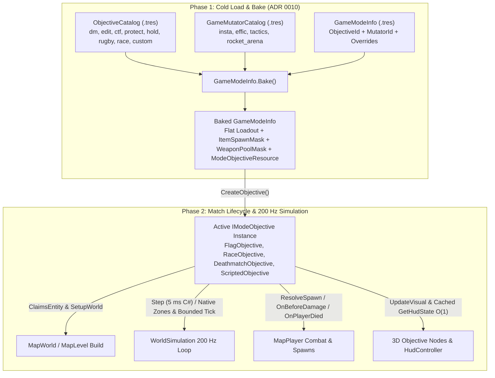

# ADR 0012: Composable Data-Driven Game Modes, Mutators, and Modular Objectives

## Status

**Proposed**  
Extends [ADR 0010 (Resource-Based Modding)](0010-resource-modding.md), [ADR 0008 (Deterministic Command Logic)](0008-command-logic.md), and [authority-and-latency.md](../authority-and-latency.md). Supersedes the legacy `ModeFlags` (`M_INSTA`, `M_EFFICIENCY`, `M_TACTICS`, `M_NOITEMS`, `M_NOAMMO`, `M_CTF`, `M_PROTECT`, `M_HOLD`, etc.) bitmask dispatch across [`World/Game/`](../../World/Game/), [`World/Runtime/`](../../World/Runtime/), [`World/Weapons/`](../../World/Weapons/), and [`World/Hud/`](../../World/Hud/).

---

## Context

### 1. Lessons from Cube 2 (`r6889`) and Community Server Mods

In original *Cube 2: Sauerbraten* (`fpsgame/game.h`), game modes were represented as an integer index into a fixed `gamemodes[]` table, where each entry combined bitflags from `M_TEAM`, `M_NOITEMS`, `M_NOAMMO`, `M_INSTA`, `M_EFFICIENCY`, `M_TACTICS`, `M_CAPTURE`, `M_REGEN`, `M_CTF`, `M_PROTECT`, `M_HOLD`, `M_EDIT`, `M_LOBBY`, and `M_COLLECT`.

A comparative analysis of the reference engine alongside four major community server modifications (**QServ2020**, **Remod**, **SuckerServ/Hopmod**, and **SpaghettiMod**) highlights three structural flaws in the original design:

1. **Client-Server "Split-Brain" Hardcoding**:
   Both client and server binaries hardcoded `if/else` ladders on `m_insta`, `m_efficiency`, `m_tactics`, and `m_noitems` across spawn loadouts (`fpsstate::spawnstate`), item pickups (`canspawnitem`), weapon switching (`nextweapon`), and HUD rendering (`ammobargunvisible`, `drawhudicons`).
2. **Protocol Masquerading & Packet Exploits**:
   Because adding a new mode index broke unmodified clients, server mods (**SpaghettiMod**, **SuckerServ**) had to masquerade custom modes (e.g., *Rocket Arena*, *Rugby*, *Hide & Seek*) as `efficiency` or `capture` (`M_NOITEMS`), intercept `spawnstate` in Lua to zero out forbidden weapon ammo arrays so client weapon cycling would skip them, and abuse territory-capture `N_BASEREGEN` or crafted `N_SPAWNSTATE` packets to mutate live player inventory mid-life.
3. **Hardcoded Objective Wiring & Combinatorial Mode Explosion**:
   Objectives (`ctf.h`, `capture.h`, `collect.h`) were wired into `MapWorld` / `client.cpp` via hardcoded `if (m_ctf)` / `if (m_capture)` branches, while loadouts (`M_INSTA`, `M_EFFICIENCY`, `M_TACTICS`) were baked into the same bitfield ($5 \text{ objectives} \times 3 \text{ loadouts} + 5 \text{ special modes} = 20 \text{ modes}$). New objectives (like *Racing*, *Prop Hunt*, or *King of the Hill*) could not plug into the world build, physics step, or HUD without editing every engine subsystem.

### 2. Current Codebase Audit (`Sauerbraten Revival`)

In `Sauerbraten Revival`, [`GameModeInfo`](../../World/Game/GameModeInfo.cs) and [`GameModeCatalog`](../../World/Game/GameModeCatalog.cs) replaced the integer mode index with `.tres` resources keyed by a string `Id`. However, `GameModeInfo` still delegates all behavior to the ported [`ModeFlags`](../../World/Game/ModeFlags.cs) bitmask (`Flags`), leaving hardcoded mode and flag branching across nine subsystems:

| Subsystem | File & Lines | Current `ModeFlags` / Hardcoded Coupling | Limitation |
| :--- | :--- | :--- | :--- |
| **Spawn Loadouts** | [`PlayerState.cs:302-372`](../../World/Game/PlayerState.cs#L302-L372) | 6-branch `if/else` ladder on `Insta`, `Regen & Capture`, `Tactics`, `Efficiency`, `Ctf \| Collect`, and `else`. | Cannot define custom starting health, armour, weapons, or ammo in `.tres` without C# edits. |
| **World Pickups** | [`ItemManager.cs:69-100`](../../World/Game/Items/ItemManager.cs#L69-L100) | Hardcoded checks on `ModeFlags.NoItems` and `ModeFlags.NoAmmo`. | Cannot whitelist specific items (e.g., Quad-only, Rockets-only) or scale respawn timers per mode. |
| **HUD Status & Ammo Bar** | [`HudController.cs:186-217, 785-805, 1012-1066`](../../World/Hud/HudController.cs#L186-L217), [`StatusBarRenderer.cs:56-59, 132-138`](../../World/Hud/StatusBarRenderer.cs#L132-L138) | Checks `IsInsta` and `IsEfficiency` for health color and ammo bar layout; directly queries `Player.Flags` and `IsHoldMode` for objective icons/scores. | HUD cannot display custom objectives (*Racing* laps/checkpoints, *Collect* skulls) without new hardcoded branches in `HudController`. |
| **World Build & Simulation** | [`MapWorld.cs:380-415, 502`](../../World/Runtime/Formats/Ogz/MapWorld.cs#L380-L415), [`WorldSimulation.cs:64`](../../World/Runtime/WorldSimulation.cs#L64) | Hardcodes `FlagManager` instantiation, `if (Mode.Has(ModeFlags.Ctf))`, `isHold`, and `_flagNodes` visual updates directly in `MapWorld` and `WorldSimulation`. | Flags are special-cased into the world container; *Racing*, *Capture*, *Prop Hunt*, and modded objectives cannot share the lifecycle seam. |
| **Player Objective Hooks** | [`MapPlayer.cs:198, 1270, 1348, 1627`](../../World/Game/Players/MapPlayer.cs#L1627) | Directly holds `FlagManager? Flags`, calls `CheckFlags(LastMillis)` in `Step`, and calls `Flags.OnPlayerDied` in `Die`. | Player class is tightly coupled to CTF flags instead of a generic `IModeObjective`. |
| **Flag State Machine** | [`FlagManager.cs:247-447`](../../World/Game/Ctf/FlagManager.cs#L247-L447), [`FlagNode.cs:67`](../../World/Game/Ctf/FlagNode.cs#L67) | Branches on `mode.Has(ModeFlags.Hold)` and `mode.Has(ModeFlags.Protect)`. | Flag rules (placement, scoring, return, friendly pass for *Rugby*) are not configurable as data. |
| **Combat & Splash Math** | [`WeaponExplosion.cs:50-56`](../../World/Weapons/WeaponExplosion.cs#L50-L56), [`MapPlayer.cs:978-979`](../../World/Game/Players/MapPlayer.cs#L978-L979) | Hardcodes `ExpSelfDamDiv = 2` ($0.5\times$), `ExpSelfPush = 2.5f`, finite ammo deduction (`Ammo[gun]--`), and `SpawnWaitMillis = 500`. | Cannot tune rocket-jump self-damage/impulse, knockback, infinite ammo, or friendly fire per mode. |
| **Mode Entities & Pools** | [`ModeEntityBuilder.cs:118`](../../World/Game/ModeEntityBuilder.cs#L118), [`MapListCatalog.cs:125-147`](../../World/Game/MapListCatalog.cs#L125-L147) | Hardcodes `CaptureListModes` string set and `ModeFlags.Capture`/`Hold`/`Ctf` checks. | Map lists cannot declare which modes they serve in data; entity claiming is hardcoded to `Flag` and `Base`. |
| **Catalog Cascade** | [`GameModeCatalog.cs:129-155`](../../World/Game/GameModeCatalog.cs#L129-L155) | Single-directory scan without `ModOverrideDir` or `UserOverrideDir`. | Does not yet implement the [ADR 0010](0010-resource-modding.md) 3-tier override cascade. |

---

## Decision

We replace `ModeFlags` and hardcoded `FlagManager` wiring with a **Composable Game Mode, Mutator, and Modular Objective Architecture**:

1. **First-Class Modular Objectives (`ModeObjectiveResource` & `IModeObjective`)**:
   - Objectives are not a closed enum. They are authored as `ModeObjectiveResource` assets (`res://resources/objectives/<id>.tres`) managed by `ObjectiveCatalog` using the [ADR 0010](0010-resource-modding.md) 3-tier override cascade.
   - Each `ModeObjectiveResource` instantiates a runtime `IModeObjective` controller for the active match.
   - **Everything—built-in objectives (`ctf`, `dm`, `edit`) and upcoming/modded objectives (`rugby`, `race`, `prop_hunt`, `capture`, `protect`, `hold`, and Workshop GDScript objectives)—plugs into the exact same `IModeObjective` lifecycle** across `MapWorld`, `WorldSimulation`, `MapPlayer`, `ModeEntityBuilder`, and `HudController`.
   - Complex/future modes (such as Rugby friendly-fire flag passing, Racing checkpoint progression, and territory Capture) will be implemented as dedicated full feature milestones per [features.md](../features.md); no incomplete stub implementations are retained in the base catalog.
2. **Composable Loadout & Combat Mutators (`GameMutator`)**:
   - Reusable loadout, item-filter, and combat-modifier presets (`insta`, `effic`, `tactics`) live in `res://resources/mutators/<id>.tres` under `GameMutatorCatalog`.
   - A `GameModeInfo` (`res://resources/gamemodes/<id>.tres`) binds an `ObjectiveId` (e.g. `"ctf"`, `"dm"`, `"edit"`) with an optional `MutatorId` (e.g. `"insta"`, `"effic"`, `"tactics"`) and optional inline overrides.
   - At load time (`GameModeInfo.Bake()`), the mutator and objective defaults are flattened onto `GameModeInfo` and `WeaponPoolMask` is precomputed, guaranteeing $O(1)$ zero-allocation reads on the 200 Hz simulation hot path.
3. **Data-Driven HUD via `ObjectiveHudState` & `WeaponPoolMask`**:
   - `HudController` never queries `FlagManager` or `ModeFlags`. It reads `world.Objective.GetHudState(localPlayer, nowMillis)` for top match scores and the bottom status-bar objective icon/counter (`RedFlag`, `BlueFlag`, `NeutralFlag` + hold timer, `Token` + skull count, or race lap/checkpoint counter).
   - Health color scales relative to `mode.SpawnHealth` (eliminating `IsInsta`), and the ammo bar reads `mode.WeaponPoolMask` (eliminating `IsInsta` and `IsEfficiency`).
4. **Inverted Map-Pool Dependency (`MapList.Modes`)**:
   - `GameModeInfo` has zero dependency on `MapList`, so modes can be distributed or synced standalone. [`MapList`](../../World/Game/MapList.cs) declares `[Export] public string[] Modes`, with an automatic fallback to `Objective.DefaultMapPool` in `MapListCatalog.ForMode`.



---

## 1. Modular Objective System (`World/Game/Objectives/`)

### 1.1 Runtime Contract: `IModeObjective` & `ObjectiveHudState`

Every match objective—built-in or modded—implements `IModeObjective`. `IGameWorld` exposes `IModeObjective? Objective { get; }` as the single seam used by `MapWorld`, `MapLevel`, `WorldSimulation`, `MapPlayer`, `ModeEntityBuilder`, and `HudController`:

```csharp
using System.Collections.Generic;
using Godot;
using SauerbratenRevival.World.Entities;
using SauerbratenRevival.World.Game.Players;
using SauerbratenRevival.World.Hud;
using SauerbratenRevival.World.Runtime;
using SauerbratenRevival.World.Weapons;

namespace SauerbratenRevival.World.Game.Objectives;

/// <summary>
/// Zero-allocation HUD snapshot returned by <see cref="IModeObjective.GetHudState"/>.
/// Drives the top-screen match score display and the bottom status-bar objective indicator.
/// </summary>
public readonly record struct ObjectiveHudState(
    int PrimaryScore = int.MinValue,
    int SecondaryScore = int.MinValue,
    bool PrimaryIsFriendly = true,
    HudIcon? StatusIcon = null,
    int StatusCounter = -1);

/// <summary>
/// Runtime state machine for a match objective (Deathmatch, Edit, Flags, Capture, Racing, Prop Hunt, or GDScript).
/// Instantiated once per match from a <see cref="ModeObjectiveResource"/>.
/// </summary>
public interface IModeObjective
{
    /// <summary>Definition resource that created this objective instance.</summary>
    ModeObjectiveResource Definition { get; }

    /// <summary>
    /// Returns true if this objective claims ownership of the map entity <paramref name="e"/>
    /// (preventing <see cref="ModeEntityBuilder"/> from rendering a static placeholder for it).
    /// </summary>
    bool ClaimsEntity(MapEntity e) => false;

    /// <summary>
    /// Called during world build (<see cref="IMapSource.Build"/>) to initialize objective state
    /// from map entities and attach dynamic 3D nodes (e.g. FlagNodes, BaseNodes, Checkpoints) under <paramref name="objectiveRoot"/>.
    /// </summary>
    void SetupWorld(IGameWorld world, IReadOnlyList<MapEntity> entities, Node3D objectiveRoot) { }

    /// <summary>
    /// Called once per 5 ms physics substep by <see cref="WorldSimulation.Step"/>.
    /// Advances objective timers (flag drop resets, hold countdowns, capture ticks, race timers, dynamic world commands).
    /// </summary>
    void Step(IGameWorld world, int stepMillis, int nowMillis) { }

    /// <summary>
    /// Called once per 5 ms physics substep for each alive player (<see cref="MapPlayer.Step"/>).
    /// Handles proximity triggers (flag pickups/scores, base capture zones, race checkpoints).
    /// </summary>
    void StepPlayer(MapPlayer player, int nowMillis) { }

    /// <summary>
    /// Called once per render frame (<c>_Process</c>) to interpolate visual objective nodes.
    /// </summary>
    void UpdateVisual(IGameWorld world, int lastMillis) { }

    /// <summary>
    /// Optional override for where <paramref name="player"/> spawns (e.g. last reached checkpoint in Racing).
    /// Returns null to use standard map <c>ET_PLAYERSTART</c> resolution.
    /// </summary>
    (Vector3 FeetPos, float Yaw)? ResolveSpawn(MapPlayer player) => null;

    /// <summary>Called after <paramref name="player"/> respawns and receives their mode loadout.</summary>
    void OnPlayerSpawn(MapPlayer player) { }

    /// <summary>
    /// Pre-damage hook invoked before hitscan or explosion damage/push is applied.
    /// Return <c>false</c> to cancel standard damage (e.g. friendly rifle shot passing the flag in Rugby).
    /// </summary>
    bool OnBeforeDamage(
        MapPlayer? attacker,
        MapPlayer victim,
        Gun gun,
        ref int damage,
        ref Vector3 pushVel,
        int nowMillis) => true;

    /// <summary>
    /// Called when <paramref name="victim"/> dies. Handles flag drops, hold penalties, skull drops, or frag scoring.
    /// </summary>
    void OnPlayerDied(MapPlayer victim, MapPlayer? killer, Gun gun, int nowMillis) { }

    /// <summary>Returns the current score and bottom status-bar indicator for <paramref name="localPlayer"/>.</summary>
    ObjectiveHudState GetHudState(MapPlayer localPlayer, int nowMillis) => default;
}
```

### 1.2 Authoring Contract: `ModeObjectiveResource` & `ObjectiveCatalog`

`ModeObjectiveResource` is the abstract base `Resource` (`res://resources/objectives/<id>.tres`) that mods can override or extend:

```csharp
using Godot;

namespace SauerbratenRevival.World.Game.Objectives;

[Tool]
[GlobalClass]
public abstract partial class ModeObjectiveResource : Resource
{
    [Export] public string Id { get; set; } = "";
    [Export] public string Name { get; set; } = "";

    /// <summary>Whether this objective uses teams by default (can be overridden by GameModeInfo.TeamPlay).</summary>
    [Export] public bool DefaultTeamPlay { get; set; } = false;

    /// <summary>Whether this objective boots into the interactive octree editor.</summary>
    [Export] public bool IsEditMode { get; set; } = false;

    /// <summary>Default map list pool used when no MapList explicitly lists the mode's Id.</summary>
    [Export] public MapListId DefaultMapPool { get; set; } = MapListId.Dm;

    /// <summary>Default starting armour for this objective when no mutator overrides it (25 in DM, 50 in CTF/Hold/Protect).</summary>
    [Export] public int DefaultSpawnArmour { get; set; } = 25;

    /// <summary>Instantiates the runtime state machine for a match.</summary>
    public abstract IModeObjective CreateInstance(GameModeInfo mode);
}
```

### 1.3 Built-In Modular Objective Implementations

The initial architecture ships with the foundational built-in objectives, with future modes (`protect`, `hold`, `rugby`, `race`, `capture`, `collect`) scheduled for subsequent milestones per [features.md](../features.md):

#### A. `FlagObjectiveResource` & `FlagObjective` (Powers `ctf`)

`FlagObjectiveResource` configures team-based flag gameplay without hardcoded `ModeFlags`:

```csharp
public enum FlagPlacementMode
{
    MapTeamFlags = 0,      // Spawns team 1 & 2 flags at ET_FLAG entities (CTF)
    DynamicHoldSpawns = 1, // Uses ET_BASE entities as spawn points for neutral flags (Hold)
}

public enum FlagScoreRule
{
    RelayToFriendlyBase = 0, // Carry enemy flag to home base while own flag is home (CTF)
    TouchEnemyFlag = 1,      // Touch enemy flag to score immediately (Protect)
    HoldTimer = 2,           // Hold flag for HoldSeconds to score (Hold)
}

public enum FlagReturnRule
{
    TouchDropped = 0,   // Touch dropped friendly flag to return; auto-reset after ResetDelayMillis (CTF)
    DropInsideBase = 1, // Drop inside own base to return; timeout deducts 1 point (Protect)
    RandomRespawn = 2,  // Timeout respawns flag at a new hold spawn (Hold)
}

[Tool]
[GlobalClass]
public partial class FlagObjectiveResource : ModeObjectiveResource
{
    [Export] public FlagPlacementMode Placement { get; set; } = FlagPlacementMode.MapTeamFlags;
    [Export] public FlagScoreRule ScoreRule { get; set; } = FlagScoreRule.RelayToFriendlyBase;
    [Export] public FlagReturnRule ReturnRule { get; set; } = FlagReturnRule.TouchDropped;
    [Export] public int ResetDelayMillis { get; set; } = 10000;
    [Export] public int InvisDelayMillis { get; set; } = 20000;
    [Export] public int HoldSeconds { get; set; } = 20;
    [Export] public int HoldDeathPenaltySeconds { get; set; } = 5;

    public override IModeObjective CreateInstance(GameModeInfo mode) => new FlagObjective(this, mode);
}
```

How `FlagObjective` plugs into `IModeObjective`:
- `ClaimsEntity(e)`: Returns `true` for `EntityType.Flag`.
- `SetupWorld`: Populates `FlagManager` from `ET_FLAG` entities and attaches `FlagNode` children under `objectiveRoot`.
- `Step` / `StepPlayer`: Advances `FlagManager.Update` and runs player flag proximity pickup/return/capture checks (`CheckFlags`).
- `OnPlayerDied`: Calls `Flags.OnPlayerDied`.
- `GetHudState`: Returns team scores (`Score1`, `Score2`), carrier `StatusIcon` (`BlueFlag`, `RedFlag`), and `StatusCounter`.

#### B. `DeathmatchObjectiveResource` & `EditObjectiveResource`

- **`DeathmatchObjectiveResource` (`dm.tres`)**: Standard frag/team-frag tallying (`OnPlayerDied` increments killer/team score; `GetHudState` returns player/team frag scores).
- **`EditObjectiveResource` (`edit.tres`)**: Sets `IsEditMode = true` so `Main` / `OgzMapViewer` spawns the player in `CsEditing` float state with `EditorController` bound to `world.Sink`.

#### C. `ScriptedObjectiveResource` (For Workshop & GDScript Mods)

Allows any modder to define a brand-new objective (e.g. *Prop Hunt*, *Zombie Outbreak*, *King of the Hill*, *Bomb Defusal*) in GDScript without dragging GDScript invocation or Variant marshalling onto the 200 Hz simulation hot path:

1. **Native Spatial Trigger Zones**: `ObjectiveContext` in C# provides native spatial trigger zones (`add_sphere_zone`, `add_cylinder_zone`, `add_box_zone`) backed by squared-distance calculations and per-zone occupancy tracking supporting arbitrary player IDs (with strict 0–63 validation documented for 64-bit single-bit masks), updating per-team occupant counts in $O(1)$. Player removal and live team transitions are synchronized so zone team counts never remain stale. GDScript is notified **only on transition** via `on_zone_event`, eliminating per-player polling across the Variant bridge.
2. **Bounded, Opt-In Objective Tick (`TickIntervalMillis`)**: Rules requiring periodic logic execute at a configurable rate (default 10 Hz / 100 ms) via `on_objective_tick`, leaving 95% of 5 ms physics substeps allocation-free and C#-only.
3. **Push-Based HUD & Spawn Overrides**: Scores and HUD indicators are pushed into `ObjectiveContext` (`set_team_score`, `set_player_status`), allowing `GetHudState` at 144+ FPS to be a zero-allocation, $O(1)$ C# struct read without querying scripts or allocating `Dictionary` objects.
4. **Pre-Allocated Synchronous Combat Hook (`ObjectiveDamageContext`)**: When `on_damage` is implemented, a single reusable `ObjectiveDamageContext : RefCounted` instance is passed with zone query helpers (`is_victim_in_zone`), eliminating per-hit dictionary allocations.

```csharp
[Tool]
[GlobalClass]
public partial class ScriptedObjectiveResource : ModeObjectiveResource
{
    /// <summary>GDScript implementing setup_world, on_zone_event, on_objective_tick, on_damage, on_player_died.</summary>
    [Export] public Script? ObjectiveScript { get; set; }

    /// <summary>Period (ms) for bounded on_objective_tick calls. Defaults to 100 ms (10 Hz). &lt;= 0 disables ticking.</summary>
    [Export] public int TickIntervalMillis { get; set; } = 100;

    public override IModeObjective CreateInstance(GameModeInfo mode) => new ScriptedObjective(this, mode);
}
```

The GDScript contract is event-driven and bounded:
| GDScript Method | Signature | Description |
| --- | --- | --- |
| `claims_entity` | `(entity: MapEntity) -> bool` | Receives entity data (`entity.Type`, `entity.Position`, etc.); returns `true` to claim ownership. |
| `setup_world` | `(ctx: ObjectiveContext, entities: Array, root: Node3D) -> void` | Initializes zones (`ctx.add_sphere_zone`), spawn overrides, initial scores, and attaches dynamic nodes. |
| `on_zone_event` | `(ctx: ObjectiveContext, zone_id: int, player_id: int, entered: bool, now_millis: int) -> void` | **Transition event**: called only when a player enters or exits a registered trigger zone. |
| `on_objective_tick` | `(ctx: ObjectiveContext, tick_millis: int, now_millis: int) -> void` | **Bounded update**: called periodically at `TickIntervalMillis` (e.g. 10 Hz) for periodic scoring or timers. |
| `update_visual` | `(ctx: ObjectiveContext, last_millis: int) -> void` | Called once per render frame (`_Process`) for visual node animation. |
| `on_player_spawn` | `(ctx: ObjectiveContext, player_id: int) -> void` | Called after a player respawns. |
| `on_damage` | `(ctx: ObjectiveContext, dmg: ObjectiveDamageContext) -> void` | Synchronous combat hook. Mutates `dmg.damage`, `dmg.push`, or sets `dmg.cancelled = true` (zero allocs). |
| `on_player_died` | `(ctx: ObjectiveContext, victim_id: int, killer_id: int, gun: int, now_millis: int) -> void` | Called when a player dies. |

---

## 2. Mutators, Loadouts & `GameModeInfo`

### 2.1 `ItemSpawnMask` Bitfield (`World/Game/Items/ItemSpawnMask.cs`)

Replaces `ModeFlags.NoItems` and `ModeFlags.NoAmmo` with an exact per-`ItemType` bitmask (`1 << (int)ItemType`):

```csharp
using System;

namespace SauerbratenRevival.World.Game.Items;

[Flags]
public enum ItemSpawnMask
{
    None         = 0,
    Shells       = 1 << (int)ItemType.Shells,       // 1 << 0
    Bullets      = 1 << (int)ItemType.Bullets,      // 1 << 1
    Rockets      = 1 << (int)ItemType.Rockets,      // 1 << 2
    RifleRounds  = 1 << (int)ItemType.RifleRounds,  // 1 << 3
    Grenades     = 1 << (int)ItemType.Grenades,     // 1 << 4
    Cartridges   = 1 << (int)ItemType.Cartridges,   // 1 << 5
    Health       = 1 << (int)ItemType.Health,       // 1 << 6
    HealthBoost  = 1 << (int)ItemType.HealthBoost,  // 1 << 7
    GreenArmour  = 1 << (int)ItemType.GreenArmour,  // 1 << 8
    YellowArmour = 1 << (int)ItemType.YellowArmour, // 1 << 9
    QuadDamage   = 1 << (int)ItemType.QuadDamage,   // 1 << 10

    Ammo         = Shells | Bullets | Rockets | RifleRounds | Grenades | Cartridges,
    Armour       = GreenArmour | YellowArmour,
    Powerups     = HealthBoost | QuadDamage,
    NonAmmo      = Health | Armour | Powerups, // Classic M_NOAMMO (capture)
    All          = Ammo | NonAmmo,             // Classic standard item modes
}
```

### 2.2 `GameMutator` Resource (`World/Game/GameMutator.cs`)

Encapsulates a reusable loadout, item filter, and combat rule preset (`insta`, `effic`, `tactics`, `capture_loadout`, `regen_loadout`, `rocket_arena`) in `res://resources/mutators/<id>.tres`:

```csharp
using Godot;
using SauerbratenRevival.World.Game.Items;
using SauerbratenRevival.World.Weapons;

namespace SauerbratenRevival.World.Game;

[Tool]
[GlobalClass]
public partial class GameMutator : Resource
{
    [Export] public string Id { get; set; } = "";
    [Export] public string Name { get; set; } = "";

    // --- Spawn Loadout ---
    [Export] public int SpawnHealth { get; set; } = 100;
    [Export] public int MaxHealth { get; set; } = 100;
    [Export] public int SpawnArmour { get; set; } = 0;
    [Export] public ArmourType SpawnArmourType { get; set; } = ArmourType.Blue;
    [Export] public Gun SpawnGun { get; set; } = Gun.Pistol;
    [Export] public int[] SpawnAmmo { get; set; } = { 1, 0, 0, 0, 0, 0, 0 };
    [Export] public int RandomGunsCount { get; set; } = 0;
    [Export] public int RandomGunsAmmoScale { get; set; } = 1;

    // --- World Pickups ---
    [Export] public ItemSpawnMask AllowedItems { get; set; } = ItemSpawnMask.None;
    [Export] public float ItemRespawnScale { get; set; } = 1.0f;

    // --- Combat Modifiers ---
    [Export] public bool InfiniteAmmo { get; set; } = false;
    [Export] public float DamageScale { get; set; } = 1.0f;
    [Export] public float SelfDamageScale { get; set; } = 0.5f; // 1 / EXP_SELFDAMDIV
    [Export] public float SelfPushScale { get; set; } = 2.5f;   // EXP_SELFPUSH
    [Export] public float HitPushScale { get; set; } = 1.0f;
    [Export] public float FriendlyFireScale { get; set; } = 0.0f;
}
```

### 2.3 Refactored `GameModeInfo` Resource (`World/Game/GameModeInfo.cs`)

`GameModeInfo` binds an `ObjectiveId` (`"dm"`, `"edit"`, `"ctf"`, `"protect"`, `"hold"`, `"capture"`, `"rugby"`, `"race"`) with an optional `Mutator` preset ID (`"insta"`, `"effic"`, `"tactics"`) or inline properties:

```csharp
using System.Numerics;
using Godot;
using SauerbratenRevival.World.Game.Items;
using SauerbratenRevival.World.Game.Objectives;
using SauerbratenRevival.World.Weapons;

namespace SauerbratenRevival.World.Game;

[Tool]
[GlobalClass]
public partial class GameModeInfo : Resource
{
    [Export] public string Id { get; set; } = "";
    [Export] public string Name { get; set; } = "";

    /// <summary>Objective ID resolved via <see cref="ObjectiveCatalog"/> (e.g. "dm", "edit", "ctf", "protect", "hold", "capture", "rugby", "race").</summary>
    [Export] public string ObjectiveId { get; set; } = "dm";

    /// <summary>Optional mutator preset ID resolved via <see cref="GameMutatorCatalog"/> (e.g. "insta", "effic", "tactics").</summary>
    [Export] public string Mutator { get; set; } = "";

    [Export] public bool TeamPlay { get; set; } = false;

    // --- Spawn Loadout (resolved in Bake) ---
    [Export] public int SpawnHealth { get; set; } = 100;
    [Export] public int MaxHealth { get; set; } = 100;
    [Export] public int SpawnArmour { get; set; } = 25;
    [Export] public ArmourType SpawnArmourType { get; set; } = ArmourType.Blue;
    [Export] public Gun SpawnGun { get; set; } = Gun.Pistol;
    [Export] public int[] SpawnAmmo { get; set; } = { 1, 0, 0, 0, 0, 1, 40 };
    [Export] public int RandomGunsCount { get; set; } = 0;
    [Export] public int RandomGunsAmmoScale { get; set; } = 1;

    // --- World Pickups ---
    [Export] public ItemSpawnMask AllowedItems { get; set; } = ItemSpawnMask.All;
    [Export] public float ItemRespawnScale { get; set; } = 1.0f;

    // --- Combat & Match Lifecycle ---
    [Export] public bool InfiniteAmmo { get; set; } = false;
    [Export] public float DamageScale { get; set; } = 1.0f;
    [Export] public float SelfDamageScale { get; set; } = 0.5f;
    [Export] public float SelfPushScale { get; set; } = 2.5f;
    [Export] public float HitPushScale { get; set; } = 1.0f;
    [Export] public float FriendlyFireScale { get; set; } = 0.0f;
    [Export] public int RespawnDelayMillis { get; set; } = 500;
    [Export] public int ScoreLimit { get; set; } = 0;
    [Export] public int MatchDurationSeconds { get; set; } = 600;

    // --- Pre-Baked Runtime Properties (Computed in Bake, O(1) Hot Path) ---

    /// <summary>Resolved objective resource definition.</summary>
    public ModeObjectiveResource Objective { get; private set; } = null!;

    /// <summary>Bitmask (1 &lt;&lt; Gun) of player guns (SG..Pistol) obtainable in this mode.</summary>
    public int WeaponPoolMask { get; private set; } = 0b111_1110;

    /// <summary>Number of player guns (SG..Pistol) in <see cref="WeaponPoolMask"/>.</summary>
    public int WeaponPoolCount => BitOperations.PopCount((uint)WeaponPoolMask);

    /// <summary>True when this mode's objective boots into the interactive world editor.</summary>
    public bool IsEdit => Objective?.IsEditMode ?? (ObjectiveId == "edit");

    /// <summary>Instantiates a fresh runtime objective controller for a match.</summary>
    public IModeObjective CreateObjective() =>
        (Objective ?? ObjectiveCatalog.Get(ObjectiveId)).CreateInstance(this);

    /// <summary>O(1) bitwise check for whether a map item entity type is allowed to spawn.</summary>
    public bool CanSpawnItem(ItemType type) =>
        type >= ItemType.Shells && type <= ItemType.QuadDamage &&
        (AllowedItems & (ItemSpawnMask)(1 << (int)type)) != 0;
}
```

### 2.4 Explicit Override & Merge Policy (`ModeOverrideMask`)

To enable game modes to compose reusable mutator presets with custom inline overrides (such as an instagib mode with custom `SpawnHealth` or `DamageScale`), `GameModeInfo` implements an explicit 3-stage override and merge cascade evaluated during `Bake()`:

1. **Stage 1 (Objective Defaults)**:
   The underlying objective resource (`ModeObjectiveResource`) supplies baseline defaults (such as `DefaultSpawnArmour`, e.g. 50 in CTF, 25 in DM) when no mutator is bound.
2. **Stage 2 (Mutator Preset)**:
   If a `Mutator` preset ID is specified, its loadout and combat fields serve as the baseline template (e.g. `insta` sets `SpawnHealth = 1`, `SpawnGun = Rifle`, `SpawnArmour = 0`, `AllowedItems = None`).
3. **Stage 3 (Mode-Level Inline Overrides)**:
   Any loadout or combat fields explicitly defined or assigned on the mode (tracked via the `ModeOverrideMask` bitfield) override the mutator preset. The mutator only populates fields that have **not** been explicitly flagged on the mode.

```csharp
[Flags]
public enum ModeOverrideMask : uint
{
    None                = 0,
    SpawnHealth         = 1 << 0,
    MaxHealth           = 1 << 1,
    SpawnArmour         = 1 << 2,
    SpawnArmourType     = 1 << 3,
    SpawnGun            = 1 << 4,
    SpawnAmmo           = 1 << 5,
    RandomGunsCount     = 1 << 6,
    RandomGunsAmmoScale = 1 << 7,
    AllowedItems        = 1 << 8,
    ItemRespawnScale    = 1 << 9,
    InfiniteAmmo        = 1 << 10,
    DamageScale         = 1 << 11,
    SelfDamageScale     = 1 << 12,
    SelfPushScale       = 1 << 13,
    HitPushScale        = 1 << 14,
    FriendlyFireScale   = 1 << 15,
    All                 = 0xFFFF,
}
```

Whenever an overridable property setter is invoked (either via C# object initializers or deserialized from a `.tres` resource), `GameModeInfo` automatically sets the corresponding bit in `Overrides`. Mod authors can also inspect `HasOverride(mask)` or invoke `ClearOverrides()` to reset the mode back to pure mutator inheritance.

---

## 3. Built-In Modes and Catalogs

### 3.1 Built-In `ModeObjectiveResource` Assets (`res://resources/objectives/`)

| Objective `Id` | Resource Type | Key Parameters | `DefaultSpawnArmour` | `DefaultMapPool` |
| :--- | :--- | :--- | :---: | :---: |
| `dm` | `DeathmatchObjectiveResource` | `FragLimit = 0` | `25` (`Blue`) | `Dm` |
| `edit` | `EditObjectiveResource` | `IsEditMode = true` | `25` (`Blue`) | `Dm` |
| `ctf` | `FlagObjectiveResource` | `MapTeamFlags`, `RelayToFriendlyBase`, `TouchDropped`, `Reset = 10s` | `50` (`Blue`) | `Ctf` |

*(Note: Modes such as `rugby`, `race`, `protect`, `hold`, `capture`, and `collect` will be authored when their respective gameplay systems land).*

### 3.2 Built-In `GameMutator` Presets (`res://resources/mutators/`)

| Mutator `Id` | `SpawnHealth` / `Max` | `SpawnArmour` | `SpawnGun` | `SpawnAmmo` (`Fist, SG, CG, RL, RI, GL, PI`) | `RandomGuns` (`Count`, `Scale`) | `AllowedItems` |
| :--- | :---: | :---: | :---: | :--- | :---: | :---: |
| `insta` | `1 / 100` | `0` (`Blue`) | `Rifle` | `[1, 0, 0, 0, 100, 0, 0]` | `0, 1` | `None` |
| `effic` | `100 / 100` | `100` (`Green`) | `Chaingun` | `[1, 20, 20, 10, 10, 20, 0]` | `0, 1` | `None` |
| `tactics` | `100 / 100` | `100` (`Green`) | `Pistol` | `[1, 0, 0, 0, 0, 1, 40]` | `2, 2` | `None` |

### 3.3 Active Built-In Game Modes (`res://resources/gamemodes/`)

| Mode `Id` | `Name` | `ObjectiveId` | `TeamPlay` | `Mutator` |
| :--- | :--- | :--- | :---: | :--- |
| `ffa` | `"ffa"` | `"dm"` | `false` | `""` *(uses `dm` base: 25 Blue, PI=40, GL=1, All)* |
| `coop_edit` | `"coop edit"` | `"edit"` | `false` | `""` |
| `teamplay` | `"teamplay"` | `"dm"` | `true` | `""` |
| `insta` | `"instagib"` | `"dm"` | `false` | `"insta"` |
| `instateam` | `"insta team"` | `"dm"` | `true` | `"insta"` |
| `effic` | `"efficiency"` | `"dm"` | `false` | `"effic"` |
| `efficteam` | `"effic team"` | `"dm"` | `true` | `"effic"` |
| `tactics` | `"tactics"` | `"dm"` | `false` | `"tactics"` |
| `tactics_team` | `"tac team"` | `"dm"` | `true` | `"tactics"` |
| `ctf` | `"ctf"` | `"ctf"` | `true` | `""` *(uses `ctf` base: 50 Blue, PI=40, GL=1, All)* |
| `insta_ctf` | `"insta ctf"` | `"ctf"` | `true` | `"insta"` |
| `effic_ctf` | `"effic ctf"` | `"ctf"` | `true` | `"effic"` |

### 3.4 Mode-to-Pool Binding on `MapList` (`res://resources/maplists/`)

[`MapList`](../../World/Game/MapList.cs) declares `[Export] public string[] Modes`:

| MapList (`Id`) | `Name` | `Modes` (`PackedStringArray`) |
| :--- | :--- | :--- |
| `dm.tres` (`Dm`) | `"ffa"` | `["ffa", "coop_edit", "teamplay", "insta", "instateam", "effic", "efficteam", "tactics", "tactics_team"]` |
| `capture.tres` (`Capture`) | `"capture"` | `[]` *(inactive until capture mode lands)* |
| `ctf.tres` (`Ctf`) | `"ctf"` | `["ctf", "insta_ctf", "effic_ctf"]` |

If a mode is not explicitly listed in any `MapList.Modes`, `MapListCatalog.ForMode(mode)` falls back to `mode.Objective.DefaultMapPool`.

---

## 4. Subsystem Refactoring Specifications

### 4.1 World Build, Entity Claiming & Simulation (`MapWorld`, `ModeEntityBuilder`, `WorldSimulation`)

1. **`ModeEntityBuilder.AppliesToMode`**:
   Instead of hardcoding `EntityType.Flag => false` and `EntityType.Base => mode.Has(ModeFlags.Capture)`, `ModeEntityBuilder` asks the active objective whether it claims the entity:
   ```csharp
   public static bool AppliesToMode(MapEntity e, IModeObjective? objective) =>
       objective == null || !objective.ClaimsEntity(e);
   ```
2. **`MapWorld.BuildAsync`**:
   Replaces the hardcoded `if (Mode.Has(ModeFlags.Ctf))` block (`MapWorld.cs:380-415`) with:
   ```csharp
   Objective = Mode?.CreateObjective();
   AddChild(ModeEntityBuilder.Build(map, catalogue, modelCatalog, textures, Objective));
   var objectiveRoot = new Node3D { Name = "ObjectiveEntities" };
   Objective?.SetupWorld(this, map.Entities, objectiveRoot);
   AddChild(objectiveRoot);
   ```
   *(For backwards compatibility with existing CTF tests, `MapWorld.Flags` delegates to `(Objective as FlagObjective)?.Flags ?? _fallbackFlags`.)*
3. **`WorldSimulation.Step` & `MapWorld._Process`**:
   - In `WorldSimulation.Step`: `world.Objective?.Step(world, Phys.PhysFrameTime, nowMillis);`
   - In `MapPlayer.Step`: `Objective?.StepPlayer(this, LastMillis);`
   - In `MapWorld._Process`: `Objective?.UpdateVisual(this, lastMillis);`

### 4.2 Branchless Spawn Loadout (`World/Game/PlayerState.cs`)

[`PlayerState.SpawnStateInternal`](../../World/Game/PlayerState.cs#L302-L372) replaces the 70-line `ModeFlags` `if/else` ladder with a single branchless loadout pass:

```csharp
private void SpawnStateInternal(GameModeInfo mode, Random? rng = null)
{
    MaxHealth = mode.MaxHealth;
    _health = mode.SpawnHealth;
    ArmourType = mode.SpawnArmourType;
    _armour = mode.SpawnArmour;
    _gunSelect = (int)mode.SpawnGun;

    int count = Math.Min(Ammo.Length, mode.SpawnAmmo.Length);
    for (int i = 0; i < count; i++)
        Ammo[i] = mode.SpawnAmmo[i];
    for (int i = count; i < Ammo.Length; i++)
        Ammo[i] = 0;

    if (mode.RandomGunsCount > 0)
    {
        rng ??= Random.Shared;
        int gun1 = rng.Next((int)Gun.Shotgun, (int)Gun.GrenadeLauncher + 1);
        _gunSelect = gun1;
        AddBaseAmmo(gun1, mode.RandomGunsAmmoScale);

        if (mode.RandomGunsCount > 1)
        {
            int gun2;
            do
            {
                gun2 = rng.Next((int)Gun.Shotgun, (int)Gun.GrenadeLauncher + 1);
            } while (gun2 == gun1);
            AddBaseAmmo(gun2, mode.RandomGunsAmmoScale);
        }
    }
}

private void AddBaseAmmo(int gun, int k)
{
    ItemInfo stat = ItemCatalog.ForGun((Gun)gun);
    Ammo[gun] += stat.Add * k;
}
```

### 4.3 World Pickup Spawning (`World/Game/Items/ItemManager.cs`)

[`ItemManager.CanSpawnItem`](../../World/Game/Items/ItemManager.cs#L69-L75) replaces `ModeFlags.NoItems` and `ModeFlags.NoAmmo` with `mode.CanSpawnItem`:

```csharp
public static bool CanSpawnItem(int entityType, GameModeInfo mode)
{
    ItemType itemType = ItemCatalog.FromEntityType(entityType);
    return mode.CanSpawnItem(itemType);
}
```

### 4.4 Data-Driven HUD (`World/Hud/HudController.cs` & `StatusBarRenderer.cs`)

1. **Objective Status & Scores (`HudController.cs`)**:
   Instead of reading `Player.Flags` and `IsHoldMode`, `HudController` reads `ObjectiveHudState hudState = Player.Objective?.GetHudState(Player, Player.LastMillis) ?? default`:
   - `Score1 = hudState.PrimaryScore`, `Score2 = hudState.SecondaryScore`, `Score1IsPlayer = hudState.PrimaryIsFriendly`.
   - If `hudState.StatusIcon.HasValue`, `_flagIcon` displays `CreateAtlasTexture(hudState.StatusIcon.Value)` and `_flagLabel` displays `hudState.StatusCounter` when `hudState.StatusCounter >= 0`.
2. **Health Color (`StatusBarRenderer.GetHealthColor`)**:
   Suppresses low-health red coloring when `mode.SpawnHealth <= 25`, so 1-HP modes (`insta`) automatically render white without an `IsInsta` boolean.
3. **Ammo Bar Strip (`StatusBarRenderer.LayoutAmmoBar` & `IsAmmoBarGunVisible`)**:
   Accepts `int weaponPoolMask`. Hides the multi-weapon strip when `BitOperations.PopCount((uint)weaponPoolMask) <= 1` and checks `(weaponPoolMask & (1 << gun)) != 0` when `hideEmpty == false`.

---

## 5. Concrete Modding Examples

### Example 1: Defining a Custom Flag Objective Variant — "fast_ctf" (`res://resources/objectives/fast_ctf.tres`)

Requires **zero new C# or GDScript code**—it configures `FlagObjectiveResource` with a shorter reset delay and higher starting armour:

```ini
[gd_resource type="Resource" script_class="FlagObjectiveResource" format=3]

[ext_resource type="Script" path="res://World/Game/Objectives/FlagObjectiveResource.cs" id="1_flag_obj"]

[resource]
script = ExtResource("1_flag_obj")
Id = "fast_ctf"
Name = "fast ctf"
DefaultTeamPlay = true
DefaultMapPool = 2
DefaultSpawnArmour = 100
Placement = 0
ScoreRule = 0
ReturnRule = 0
ResetDelayMillis = 5000
```

And `res://resources/gamemodes/fast_ctf.tres` pairs `"fast_ctf"` with the `"insta"` mutator:

```ini
[gd_resource type="Resource" script_class="GameModeInfo" format=3]

[ext_resource type="Script" path="res://World/Game/GameModeInfo.cs" id="1_mode"]

[resource]
script = ExtResource("1_mode")
Id = "fast_ctf"
Name = "fast ctf"
ObjectiveId = "fast_ctf"
TeamPlay = true
Mutator = "insta"
```

### Example 2: Defining a Custom GDScript Objective — "King of the Hill" (`koth.tres` + `koth_objective.gd`)

A Workshop modder creates `res://resources/objectives/overrides/koth.tres` (`ScriptedObjectiveResource`) pointing to `koth_objective.gd`:

```gdscript
extends RefCounted

const HILL_ZONE := 0
var scores := [0, 0]

func claims_entity(entity) -> bool:
    return entity.Type == 24 # EntityType.Base

func setup_world(ctx, entities, root) -> void:
    ctx.clear_zones()
    for e in entities:
        if e.Type == 24:
            # Register native sphere trigger (zone_id = 0, radius = 64.0)
            ctx.add_sphere_zone(HILL_ZONE, e.Position, 64.0)
            break
    ctx.set_default_spawn_override(Vector3(10, 20, 30), 180.0)
    ctx.set_team_score(1, 0)
    ctx.set_team_score(2, 0)

# Fired only when a player crosses the zone boundary (0 calls/sec steady state)
func on_zone_event(ctx, zone_id: int, player_id: int, entered: bool, now_millis: int) -> void:
    if zone_id == HILL_ZONE:
        var team: int = ctx.get_player_team(player_id)
        var current_score: int = scores[team - 1] if team >= 1 and team <= 2 else 0
        if entered:
            ctx.set_player_status(player_id, 3, current_score) # HudIcon.Health = 3
        else:
            ctx.clear_player_status(player_id)

# Fired at bounded rate (e.g. 10 Hz) rather than 200 Hz
func on_objective_tick(ctx, tick_millis: int, now_millis: int) -> void:
    for team in [1, 2]:
        if ctx.get_zone_team_count(HILL_ZONE, team) > 0:
            scores[team - 1] += 1
            ctx.set_team_score(team, scores[team - 1])

# Synchronous pre-damage hook using pre-allocated ObjectiveDamageContext (0 allocs)
func on_damage(ctx, dmg) -> void:
    # Friendly fire canceled
    if dmg.attacker_id >= 0 and dmg.attacker_team == dmg.victim_team:
        dmg.cancelled = true
        return
    # Players defending the hill receive 50% damage and have knockback push neutralized
    if dmg.is_victim_in_zone(HILL_ZONE):
        dmg.damage = int(dmg.damage * 0.5)
        dmg.push = Vector3.ZERO

func on_player_died(ctx, victim_id: int, killer_id: int, gun: int, now_millis: int) -> void:
    pass
```

---

## 6. Network, Demo & Workshop Synchronization (`schema.fbs`)

A key architectural question is: **Does a client need to download `.tres` files or a Steam Workshop `.pck` just to join a server running a custom mode or objective?**

**No—not unless the mod introduces new client-side assets (models/textures/sounds) or client-predicted scripts.** Because `.tres` is only the local authoring format ([ADR 0010](0010-resource-modding.md)) and our wire protocol is **FlatBuffers ([`World/Schema/schema.fbs`](../../World/Schema/schema.fbs), [ADR 0008](0008-command-logic.md))**, multiplayer synchronization operates in three tiers:

### Tier 1: Zero-Download Inline Sync for Data Modes & Parameterized Objectives (`GameModeSyncCmd`)
When a server runs any mode built from `GameModeInfo`, `GameMutator`, and a built-in `ModeObjectiveResource` (`Deathmatch`, `Edit`, `FlagObjective`, `CaptureObjective`, `RaceObjective`—including custom modes like *Rocket Arena*, *Rugby*, *One-Flag CTF*, or *Fast Hold*), the server serializes the baked parameters into a ~64-byte `GameModeSyncCmd` in `schema.fbs` on connection:

```fbs
table FlagObjectiveParams {
    placement: ubyte;               // FlagPlacementMode
    score_rule: ubyte;              // FlagScoreRule
    return_rule: ubyte;             // FlagReturnRule
    reset_delay_millis: int32 = 10000;
    invis_delay_millis: int32 = 20000;
    hold_seconds: int32 = 20;
    pass_on_friendly_hit: bool = false;
}

table RaceObjectiveParams {
    laps: int32 = 1;
    respawn_at_checkpoint: bool = true;
    checkpoint_radius: float32 = 20.0;
}

table GameModeSyncCmd {
    mode_id: string;
    mode_name: string;
    objective_kind: ubyte;          // 0=DM, 1=Edit, 2=Flag, 3=Capture, 4=Collect, 5=Race, 6=ServerScripted
    team_play: bool;
    spawn_health: int32 = 100;
    max_health: int32 = 100;
    spawn_armour: int32 = 25;
    spawn_armour_type: ubyte = 0;
    spawn_gun: ubyte = 6;
    spawn_ammo: [int32];
    allowed_items: uint16 = 2047;   // ItemSpawnMask
    infinite_ammo: bool = false;
    damage_scale: float32 = 1.0;
    self_damage_scale: float32 = 0.5;
    self_push_scale: float32 = 2.5;
    hit_push_scale: float32 = 1.0;
    flag_params: FlagObjectiveParams;
    race_params: RaceObjectiveParams;
}
```
An unmodified vanilla client receives `GameModeSyncCmd`, constructs the runtime `GameModeInfo` and `IModeObjective` in memory, and plays immediately with **zero Workshop downloads**.

### Tier 2: Zero-Download Server-Scripted Objectives (`ObjectiveHudSyncCmd` + `WorldCommand` Stream)
Because our architecture is **server-authoritative** ([authority-and-latency.md](../authority-and-latency.md)) and `HudController` is driven strictly by `ObjectiveHudState` (two integers for scores + an optional `HudIcon` enum and counter), even a server running a custom server-side `ScriptedObjectiveResource` (e.g., *King of the Hill*, *Infection*, or *Crumbling Floor Survival*) requires **no client download** as long as it uses built-in assets:
- World geometry changes replicate via standard `DeleteCubeCmd` / `ReplaceBlockCmd` commands.
- Mid-life inventory changes replicate via extended `PlayerSpawnCmd` (`armour_type`, `max_health`, `ammo: [int32]`).
- Custom objective scores and status-bar indicators replicate via a compact 12-byte `ObjectiveHudSyncCmd`:
  ```fbs
  table ObjectiveHudSyncCmd {
      primary_score: int32;
      secondary_score: int32;
      primary_is_friendly: bool = true;
      status_icon: byte = -1;       // HudIcon (0..15, or -1 if none)
      status_counter: int32 = -1;
  }
  ```

### Tier 3: On-Demand Workshop `.pck` Download for Custom Assets & Client Scripts
A `.pck` download is only required when a server mounts a mod pack containing new client assets (custom `.glb` models, skins, sounds, maps) or client-executed scripts:
- The server's session handshake includes `required_mods: [ModPackageRef]` (`{ workshop_id: uint64, content_hash: [ubyte] }`).
- If the client lacks a required pack, the client triggers `SteamUGC.DownloadItem(workshop_id)` during the [`map_load.tscn`](../../scenes/map_load.tscn) loading screen, mounts the `.pck` via `ProjectSettings.LoadResourcePack()`, and calls `Reload()` on the [ADR 0010](0010-resource-modding.md) catalogs before spawning.

---

## 7. Staged Implementation Plan

Work proceeds in discrete, reviewable stages per [AGENTS.md](../../AGENTS.md):

1. **Stage 1 — Modular Objectives, Mutators & Mode Catalogs**:
   - Introduce `IModeObjective`, `ObjectiveHudState`, `ModeObjectiveResource`, `ObjectiveCatalog`, `DeathmatchObjectiveResource`, `EditObjectiveResource`, `FlagObjectiveResource` (`FlagObjective`), and `ScriptedObjectiveResource`.
   - Introduce `ItemSpawnMask`, `GameMutator`, and `GameMutatorCatalog`.
   - Extend `GameModeInfo` with `ObjectiveId`, `Mutator`, declarative loadout/item/combat properties, and `Bake()`.
   - Upgrade `GameModeCatalog` to the [ADR 0010](0010-resource-modding.md) 3-tier cascade (`ResourceDir`, `ModOverrideDir`, `UserOverrideDir`) and author `.tres` files under `res://resources/objectives/`, `res://resources/mutators/`, and `res://resources/gamemodes/`.
2. **Stage 2 — Decouple `PlayerState`, `ItemManager`, and `HudController`**:
   - Replace the `ModeFlags` `if/else` ladder in `PlayerState.SpawnStateInternal` with the branchless loadout algorithm.
   - Replace `ModeFlags.NoItems`/`NoAmmo` in `ItemManager` with `ItemSpawnMask`.
   - Wire `HudController` and `StatusBarRenderer` to `IModeObjective.GetHudState`, `SpawnHealth`, and `WeaponPoolMask` (removing `IsInsta`, `IsEfficiency`, `IsHoldMode`, and direct `Player.Flags` coupling).
3. **Stage 3 — Wire `IModeObjective` Across World/Player, Combat Math & Remove `ModeFlags`**:
   - Wire `IGameWorld.Objective` into `MapWorld`, `MapLevel`, `EmptyMap`, `WorldSimulation`, `ModeEntityBuilder`, and `MapPlayer`.
   - Wire `InfiniteAmmo`, `SelfDamageScale`, `SelfPushScale`, `HitPushScale`, and `Objective.OnBeforeDamage` into `MapPlayer`, `WeaponHitscan`, and `WeaponExplosion`.
   - Add `Modes` to `MapList`, remove `CaptureListModes` from `MapListCatalog`, retire `ModeFlags`, and update unit tests (`PlayerStateTest`, `FlagManagerTest`, `ItemPickupTest`, `MapListCatalogTest`, `GameModeCatalogTest`, `ObjectiveCatalogTest`).

---

## Consequences

### Positive
- **Unified Objective Pipeline**: All active match objectives (`ctf`, `dm`, `edit`, and future `rugby`, `race`, `prop_hunt`, `capture` or Workshop GDScript objectives) share one `IModeObjective` lifecycle (`ClaimsEntity`, `SetupWorld`, `Step`, `StepPlayer`, `UpdateVisual`, `ResolveSpawn`, `OnBeforeDamage`, `OnPlayerDied`, `GetHudState`).
- **Zero Hardcoded Loadout or Mode Branches**: `INSTA`, `EFFIC`, `TACTICS`, `NOITEMS`, `NOAMMO`, and `CTF` are completely superseded by composable `ModeObjectiveResource` and `GameMutator` data.
- **200 Hz Hot-Path Performance**: Pre-baking `GameMutator` overlays and `WeaponPoolMask` at load time preserves $O(1)$ zero-allocation reads on every physics tick, and `ObjectiveHudState` is a stack-allocated value type.
- **No Stub Bloat**: Non-MVP / post-MVP modes (`rugby`, `race`, `collect`, `protect`, `capture`) remain cleanly omitted from base resource catalogs until their full mechanics are scheduled and implemented.

### Neutral / Trade-offs
- Existing tests in `test/PlayerStateTest.cs` and `test/ItemPickupTest.cs` that directly assert `ModeFlags` bit positions will be updated to assert the baked `Objective`, `TeamPlay`, `AllowedItems`, `WeaponPoolMask`, and spawn loadout fields.
