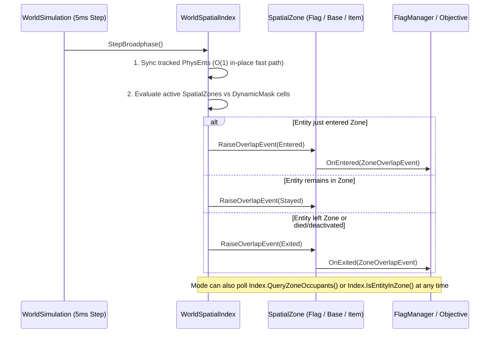

# ADR 0012: Unified World Spatial Index, Zones, and Objective Primitives

## Status

**Proposed**  
Establishes a unified, zero-allocation spatial index (`WorldSpatialIndex`) and volumetric trigger primitive (`SpatialZone`) across `World/Spatial/` and `World/Physics/`, superseding bespoke per-subsystem spatial lookups and forming the foundation for zone-based game mode objectives (CTF, Protect, Hold, Rugby, Prop Hunt, Racing).

---

## Context

### 1. Codebase Survey of Existing Spatial & Proximity Logic

A survey of the *Sauerbraten Revival* codebase revealed six separate spatial or proximity mechanisms operating independently across physics, combat, lighting, and game modes:

| Subsystem | Location | Current Mechanism | Limitations |
| :--- | :--- | :--- | :--- |
| **1. Map Model Collisions** | [`OctaPhysics.MmCollide`](../../World/Physics/OctaPhysics.cs) | Bespoke 2D XY grid (`_mmGrid`, 64-unit cells) of `List<MapModelCollider>?[]` with per-object `LastQueryStamp`. | Coupled to `MapModelCollider`; no dynamic removal/disable (`RemoveEntity` / `EditEntity`); heap-allocated `List<T>` per bucket; no cell Z-bounds or category masks. |
| **2. Dynamic Entity Collisions** | [`OctaPhysics.CheckDynentCache`](../../World/Physics/OctaPhysics.cs) | Port of Cube 2's 1024-bucket 2D hash table (`dynentcache`, 128-unit cells). | Rebuilt from scratch every 5 ms substep (`ClearDynentCache` + `UpdateDynentCache`); hash collisions alias distant cells (`(x ^ y)`); only indexes `PhysEnt`. |
| **3. CTF Flags & Bases** | [`FlagManager`](../../World/Game/Ctf/FlagManager.cs), [`MapPlayer.CheckFlags`](../../World/Game/Players/MapPlayer.cs) | Linear scan of `_flags` twice per 5 ms player step (`FlagRadius = 16`); hardcoded `InsideBase` cylinder check (`BaseRadius = 64`, `BaseHeight = 24`); manual `Combat.FlagPickup` bitmask to track enter/exit edges. | Ad-hoc per-mode distance math; manual bitmask edge tracking; cannot generalize to multi-objective modes (Rugby, Racing, Prop Hunt) or editor-placed zones. |
| **4. Rockets & Explosions** | [`RocketProjectile.Advance`](../../World/Weapons/RocketProjectile.cs), [`WeaponExplosion`](../../World/Weapons/WeaponExplosion.cs) | Linear $O(N)$ scan over `IReadOnlyList<IExplosionTarget>` per 5 ms step per rocket, plus linear scan on detonation (`Reject` + `ProjDist`). | Scales $O(\text{Projectiles} \times \text{Targets})$ every 5 ms tick; requires callers to pass explicit candidate arrays around. |
| **5. Hitscan Rays** | [`WeaponHitscan.IntersectClosest`](../../World/Weapons/WeaponHitscan.cs) | Linear $O(N)$ scan over all `candidates` per ray (up to 20 rays per shotgun blast). | Every pellet tests every entity in the map regardless of ray direction or range. |
| **6. Items & Map Triggers** | [`ItemManager.CheckPickups`](../../World/Game/Items/ItemManager.cs), [`MapPlayer`](../../World/Game/Players/MapPlayer.cs) | Linear $O(N)$ scan over all `_items` (radius 12), `JumpPads` (radius 12), and `Teleports` (radius 16) every 5 ms player step. | Maps with 80–150 items and triggers perform hundreds of distance checks per player per 5 ms substep. |
| **7. Entity Lights** | [`LightSpatialIndex`](../../World/Lighting/LightSpatialIndex.cs) | Static 3D grid (`_cells`, 128-unit cells) built once during radiance baking. | Read-only bake structure; not suitable for dynamic runtime entities. |

---

### 2. Design Requirements

To unify these subsystems and power future **Zones** and **Objectives**, our spatial index must satisfy five requirements:

1. **Dual Lifecycle Support (Cheap Static Init + $O(1)$ Dynamic Updates)**:
   - *Static objects* (map models, CTF base zones, item pickup zones, teleporters, jump pads) are registered once at map load and mutated only on coop-edit entity commands.
   - *Dynamic entities* (players, monsters, grenades/bouncers, rockets, dropped flags) move at **200 Hz** (every 5 ms fixed step). Updating a moving entity must not reallocate or rebuild the index when the entity stays within the same spatial cell (~99% of ticks).
2. **Three Execution & Consumption Models**:
   - **Once-per-frame / once-per-tick Broad-Pass (`StepBroadphase`)**: Batch-synchronizes tracked dynamic entities and evaluates zone overlaps in a single cache-friendly pass.
   - **Event-Based Notifications (`Entered`, `Stayed`, `Exited`)**: Automatically tracks state transitions when dynamic entities enter, remain in, or leave a `SpatialZone` (eliminating manual bitmasks like `Combat.FlagPickup`).
   - **Polling-Based Queries**: Zero-allocation on-demand queries (`QueryAabb`, `QueryRadius`, `QuerySegment`, `QueryPointZones`, `QueryZoneOccupants`, `IsEntityInZone`) callable at any point during physics, weapon simulation, or game mode ticks.
3. **Zero Heap Allocations on the Hot Path**:
   - Per [ADR 0010](0010-resource-modding.md) and [ADR 0011](0011-model-preloading.md), 200 Hz simulation steps cannot allocate `List<T>`, closures, or boxed enumerators.
4. **Strict Determinism & Engine Collision Parity**:
   - Server-authoritative networking and A3 replay verification require deterministic candidate ordering and exact geometric parity with Sauerbraten's `mmcollide`, `plcollide`, `checkitems`, and `insidebase`.
5. **First-Class "Zones" as Building Blocks for Objectives**:
   - Support spheres (item pickup radius, flag touch radius), upright cylinders (CTF base radius + height), AABBs, and yaw-rotated OBBs (racing gates, rugby goals, hill zones).

---

### 3. Evaluation of Spatial Index Candidates

| Candidate | Static Init | Dynamic Move (200 Hz) | Memory & Cache Locality | Determinism & Fit |
| :--- | :--- | :--- | :--- | :--- |
| **A. Flat 2D XY Grid + Inline 3D AABB & Category Masks (Chosen)** | $O(1)$ per cell overlapped | **$O(1)$ in-place AABB write** (99% of ticks); relinks only on 64-unit boundary crossing | **4–16 KB grid directory fits in L1 cache**; contiguous `SpatialEntry[]` struct array | 100% deterministic; exact match for bounded $2^N$ Sauerbraten worlds |
| **B. Full 3D Uniform Grid** | $O(1)$ per 3D cell | Frequent Z-cell crossings while jumping/falling | $64^3 = 262,144$ cells ($\sim 4\text{ MB}$) at `WorldSize = 4096`; >95% empty air/rock | Poor cache locality due to sparse 3D cell table |
| **C. Octree-Embedded (`CubeExt.ents` / `octaentities`)** | Tree descent to `octaentsize` | Expensive tree walk & dynamic `CubeExt` allocation on movement | Pointer chasing across `Cube[]` nodes; couples gameplay zones to geometry remip/edits | Remip (`DiscardChildren`) destroys and rebuilds `CubeExt` nodes |
| **D. Dynamic Fat-AABB BVH Tree** | $O(N \log N)$ tree build | Tree rotations & refits; $O(\log N)$ branchy traversal per query | Pointer/index tree walk ($10\text{--}14$ hops per query) vs $O(1)$ bit-shift lookup | Higher constant factor than direct grid indexing on bounded maps |
| **E. Spatial Hash Table (`dynentcache`)** | $O(N)$ lazy scan | Cleared & rebuilt every 5 ms step | Hash collisions (`(x^y)`) merge unrelated world regions into the same bucket | Unsuitable for persistent static objects + zones |

#### Why a 2D XY Grid with Inline 3D Z-Intervals Beats a 3D Grid in Sauerbraten
Sauerbraten worlds have known, finite power-of-two bounds ($[0, \text{WorldSize})^3$, typically $1024$ to $4096$). At a 64-unit cell size (`cellShift = 6`):
- A 2D XY grid is $16 \times 16$ ($256$ cells) to $64 \times 64$ ($4,096$ cells) — small enough to stay hot in **L1/L2 CPU cache**.
- Each `GridCell` stores `StaticMinZ..StaticMaxZ` and aggregated `SpatialCategory` bitmasks (`StaticMask`, `DynamicMask`).
- Each `SpatialEntry` in the contiguous `_entries[]` struct array stores its full 3D `Min` and `Max` inline.
- Consequently, a query prunes empty or non-matching XY cells in **one bitwise instruction**, prunes vertical Z-layers at the cell header, and checks exact 3D Z-intervals (`e.Min.Z..e.Max.Z`) sequentially in L1 cache — achieving **3D spatial pruning with a 2D memory footprint**.

---

## Decision

We implement [`WorldSpatialIndex`](../../World/Spatial/WorldSpatialIndex.cs), [`SpatialZone`](../../World/Spatial/SpatialZone.cs), and [`SpatialEntry`](../../World/Spatial/SpatialTypes.cs) in `World/Spatial/`:

```mermaid
flowchart TD
    subgraph Storage["Contiguous Data-Oriented Storage (WorldSpatialIndex)"]
        Entries["Flat Struct Table: SpatialEntry[]\n(Id, Category, Shape, Active, Origin, 3D Min/Max, CellSpan)"]
        Stamps["Flat Dedup Array: uint[] _visitStamps"]
        Grid["2D XY Grid Directory: GridCell[dim * dim]\n(StaticMask, DynamicMask, StaticMinZ/MaxZ, StaticIds[], DynamicIds[])"]
    end

    subgraph Producers["Static Init & 200 Hz Dynamic Producers"]
        StaticReg["Static Init (Map Load / Editor Cmd)\nMapModels, BaseZones, ItemZones, Triggers"] -->|RegisterStatic / RegisterZone| Entries
        DynReg["Dynamic Entities (Players, Bouncers, Flags)\nRegisterPhysEnt / UpdatePosition"] -->|99% Ticks: O(1) In-Place AABB Update\n1% Ticks: Cell Boundary Relink| Entries
        Entries --> Grid
    end

    subgraph Consumers["Broad-Pass, Event-Driven & Polling Consumers"]
        BroadPass["StepBroadphase() (Once per Tick)\n1. Sync Tracked PhysEnts\n2. Diff Zone Overlaps"]
        Events["Event-Based Dispatch\nZoneEntered / ZoneStayed / ZoneExited\n(Per-Zone & Global Events)"]
        Polling["Zero-Alloc Polling Queries\nCollideMapModels, QueryZoneOccupants,\nQueryPointZones, QueryRadius, QuerySegment"]

        Grid --> BroadPass
        BroadPass --> Events
        Grid --> Polling
        Stamps -.-> Polling
    end
```

### 1. Contiguous `SpatialEntry` Table & `SpatialCategory` Bitmasks
- Every registered item receives a dense `SpatialHandle(int Id)` indexing into `SpatialEntry[] _entries` (with an intrusive free-list for $O(1)$ slot recycling on removal).
- `SpatialCategory` is a `[Flags] uint` bitmask (`MapModel`, `Geometry`, `Player`, `Monster`, `Bouncer`, `Projectile`, `FlagZone`, `BaseZone`, `ItemZone`, `TriggerZone`, plus composite masks `Actors`, `DynamicBodies`, `Zones`).
- Every `GridCell` maintains `StaticMask` and `DynamicMask`. If `((cell.StaticMask | cell.DynamicMask) & queryMask) == 0`, the cell is skipped immediately.

### 2. Dual Static & Dynamic Cell Lists with $O(1)$ Incremental Updates
- **Static Layer (`cell.StaticIds`, `cell.StaticMinZ..StaticMaxZ`)**:
  - Populated at map build; preserves deterministic entity registration order.
  - Supports $O(1)$ `SetActive(handle, bool)` toggling (e.g. despawned items) and `Remove(handle)` for coop-edit entity deletion.
- **Dynamic Layer (`cell.DynamicIds`, cached `CellMinX..CellMaxY`)**:
  - Each `SpatialEntry` caches the quantized cell rectangle `(CellMinX, CellMinY, CellMaxX, CellMaxY)` it currently occupies.
  - At $100\text{ u/s}$ player speed, a 5 ms physics step moves $0.5\text{ units}$ — meaning an entity crosses a 64-unit cell boundaryless than once every ~128 ticks.
  - When `UpdateBounds` / `UpdatePhysEnt` runs and `newCellSpan == oldCellSpan`, **only the struct fields in `_entries[id]` are updated** (`InPlaceUpdates++`), performing zero cell array modifications.

### 3. Broad-Pass Execution (`StepBroadphase`) + Event-Based & Polling-Based Zone Logic



- **Broad-Pass (`StepBroadphase`)**:
  1. Iterates `_trackedDynamicIds` and syncs each bound `PhysEnt` (`O`, `Radius`, `EyeHeight`, `AboveEye`, `Yaw`, and `Active = (State == CsAlive)`).
  2. Evaluates registered `SpatialZone`s against overlapping dynamic cells using double-buffered `OverlapPair(ZoneId, EntityId)` arrays (`_prevOverlaps`, `_currOverlaps`).
  3. Emits deterministic `ZoneEntered`, `ZoneStayed`, and `ZoneExited` events both on the specific `SpatialZone` instance and globally on `WorldSpatialIndex`.
  4. Automatically emits `ZoneExited` if an overlapping player dies (`State != CsAlive`), if a zone is deactivated (`SetActive(false)`), or if either entry is removed (`Remove`).
- **Polling API**:
  - `QueryZoneOccupants(zoneHandle, entityMask, Span<int> results)`: Returns all active dynamic entities currently inside a zone.
  - `QueryPointZones(point, zoneMask, Span<int> results)` & `QueryEntityZones(entityHandle, zoneMask, Span<int> results)`: Returns all active zones containing a point or entity.
  - `IsEntityInZone(zoneHandle, entityHandle)`: Direct boolean check (e.g. `FlagManager.InsideBase`).
  - `QueryAabb`, `QueryRadius`, `QuerySegment`: Broad-phase queries writing into caller-provided `Span<int>` buffers.

### 4. `SpatialZone` Shapes & Trigger Modes for Objectives
`SpatialZone` supports four narrow-phase shapes and three entity trigger modes:
- **Shapes**:
  - `Sphere`: `point.DistanceSquaredTo(center) < R²` (strict inequality matching `entities.cpp:334 checkitems` and `ctf.h:994` flag pickup radius $16$).
  - `Cylinder`: `dx² + dy² <= R² && |dz| <= H` (inclusive inequality matching `ctf.h:154 insidebase` with $R=64, H=24$).
  - `Aabb` & `Obb`: Axis-aligned and yaw-rotated 3D boxes for checkpoints, hills, and goal volumes.
- **Trigger Modes (`SpatialZoneTriggerMode`)**:
  - `FeetPoint` (default): Tests `entry.FeetPos` (`(O.X, O.Y, O.Z - EyeHeight)`), matching Sauerbraten's exact pickup/flag/base convention.
  - `OriginPoint`: Tests `entry.Origin` (`O`).
  - `BodyBounds`: Tests full 3D bounding box overlap `[Min, Max]`.

---

## Staged Rollout Plan

### Stage 1: Spatial Index Core & Map Model Collision POC *(This Commit)*
- [x] Implement `SpatialTypes`, `SpatialZone`, and `WorldSpatialIndex` in `World/Spatial/`.
- [x] Replace `OctaPhysics._mmGrid` with `OctaPhysics.Spatial` (`WorldSpatialIndex`), powering `AddMapModel`, `RemoveMapModel`, `ClearMapModels`, and `MmCollide`.
- [x] Verify parity across existing `MapModelCollisionTest`, `A3ReplayTest`, and new `WorldSpatialIndexTest` (covering static/dynamic lifecycle, $O(1)$ in-place updates, `StepBroadphase` enter/stay/exit events, movable flag zones, and projectile queries).

### Stage 2: Dynamic Entities, Projectiles & Hitscan Integration *(Next)*
- [ ] Register players, monsters, and bouncers in `OctaPhysics.Spatial` and call `Spatial.StepBroadphase()` from `WorldSimulation.Step`.
- [ ] Supersede `OctaPhysics._dynEntCache` (`PlCollide`, `OverlapsDynent`) with `Spatial`.
- [ ] Wire `RocketProjectile.Advance`, `WeaponExplosion.ResolveExplosion`, and `WeaponHitscan.Fire` to query candidate targets from `Spatial` (`QuerySegment`, `QueryRadius`).

### Stage 3: Item Pickups & Map Triggers *(Subsequent)*
- [ ] Register `Item` pickup spheres (`ItemZone`, radius 12, toggled via `SetActive(item.Spawned)`), `Teleport` spheres (`TriggerZone`, radius 16), and `JumpPad` spheres (`TriggerZone`, radius 12) in `Spatial`.
- [ ] Replace linear scans in `ItemManager.CheckPickups`, `MapPlayer.CheckJumpPads`, and `MapPlayer.CheckTeleports` with `Spatial` zone queries/events.

### Stage 4: CTF & Composable Game Mode Objectives *(Subsequent)*
- [ ] Back `FlagManager` bases (`BaseZone` cylinder $64 \times 24$) and flags (`FlagZone` sphere $16$, dynamically repositioned on drop and deactivated when carried) with `SpatialZone`s.
- [ ] Build composable `Objective` definitions on top of `SpatialZone` events (`Entered`, `Stayed`, `Exited`) and polling to power CTF, Protect, Hold, Rugby, Prop Hunt, and Racing checkpoints.

---

## Consequences

### Positive
- **Single Spatial Authority**: Eliminates duplicated grid/hash/linear-scan code across physics, weapons, items, triggers, and game modes.
- **Zero-Allocation 200 Hz Hot Path**: Flat struct arrays, stack-allocated `Span<int>` query buffers, and $O(1)$ in-place sub-cell updates keep GC pressure at zero.
- **Unified Event + Polling Ergonomics**: Game modes can subscribe declaratively to `zone.Entered` / `zone.Exited` or poll `QueryZoneOccupants` / `IsEntityInZone` as needed.
- **Live Coop-Edit Ready**: Static map models and zones can now be added, moved, toggled, or removed in $O(1)$ when editor commands mutate entities.

### Trade-offs & Open Questions for Refinement
- **Cell Size Tuning (`DefaultCellShift = 6`, 64 units)**: 64 units matches both the previous map model grid and Sauerbraten's `octaentsize = 64`. Very large radius queries (e.g. spawn rating at $400\text{ u}$) span multiple cells ($13 \times 13$), though still faster than raycasting all entities; we can evaluate whether a coarse secondary mask is ever needed.
- **Geometry Queries**: World cube geometry (`Octa`) remains in the native octree for `OctaCollide` and `OctaRaycast`, while `SpatialCategory.Geometry` in `WorldSpatialIndex` indexes dynamic/scripted geometry brushes and destructible props.
