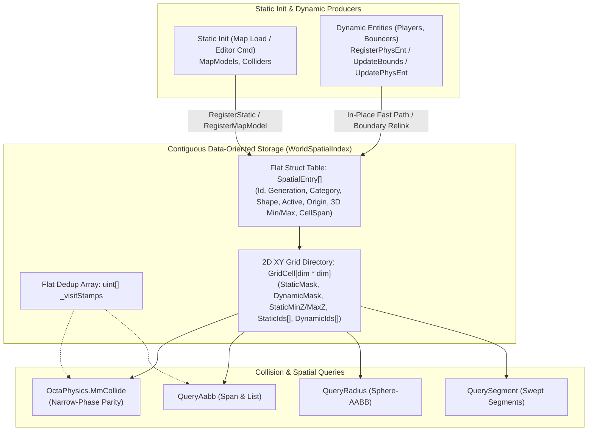

# ADR 0012: Unified World Spatial Index and Zone System

## Status

**Proposed**  
Establishes a unified, zero-allocation spatial index (`WorldSpatialIndex`) in `World/Spatial/` and `World/Physics/`, superseding bespoke per-subsystem spatial lookups and forming the foundation for map model collisions (MR 2) and subsequent zone-based game mode objectives (MR 3+).

---

## Context

### 1. Codebase Survey of Existing Spatial & Proximity Logic

A survey of the *Sauerbraten Revival* codebase revealed six separate spatial or proximity mechanisms operating independently across physics, combat, lighting, and game modes:

| Subsystem | Location | Current Mechanism | Limitations |
| :--- | :--- | :--- | :--- |
| **1. Map Model Collisions** | [`OctaPhysics.MmCollide`](../../World/Physics/OctaPhysics.cs) | Bespoke 2D XY grid (`_mmGrid`, 64-unit cells) of `List<MapModelCollider>?[]` with per-object `LastQueryStamp`. | Coupled to `MapModelCollider`; no dynamic removal/disable (`RemoveEntity` / `EditEntity`); heap-allocated `List<T>` per bucket; no cell Z-bounds or category masks. |
| **2. Dynamic Entity Collisions** | [`OctaPhysics.CheckDynentCache`](../../World/Physics/OctaPhysics.cs) | Port of Cube 2's 1024-bucket 2D hash table (`dynentcache`, 128-unit cells). | Rebuilt from scratch every 5 ms substep (`ClearDynentCache` + `UpdateDynentCache`); hash collisions alias distant cells (`(x ^ y)`); only indexes `PhysEnt`. |
| **3. CTF Flags & Bases** | [`FlagManager`](../../World/Game/Ctf/FlagManager.cs), [`MapPlayer.CheckFlags`](../../World/Game/Players/MapPlayer.cs) | Linear scan of `_flags` twice per 5 ms player step (`FlagRadius = 16`); hardcoded `InsideBase` cylinder check (`BaseRadius = 64`, `BaseHeight = 24`); manual `Combat.FlagPickup` bitmask to track enter/exit edges. | Ad-hoc per-mode distance math; manual bitmask edge tracking; cannot generalize to multi-objective modes (Rugby, Racing, Prop Hunt) or editor-placed zones. |
| **4. Rockets & Explosions** | [`RocketProjectile.Advance`](../../World/Weapons/RocketProjectile.cs), [`WeaponExplosion`](../../World/Weapons/WeaponExplosion.cs) | Linear $O(N)$ scan over `IReadOnlyList<IExplosionTarget>` per 5 ms step per rocket, plus linear scan on detonation (`Reject` + `ProjDist`). | Scales $O(\text{Projectiles} \times \text{Targets})$ every 5 ms tick; requires callers to pass explicit candidate arrays around. |
| **5. Hitscan Rays** | [`WeaponHitscan.IntersectClosest`](../../World/Weapons/WeaponHitscan.cs) | Linear $O(N)$ scan over all `candidates` per ray (up to 20 rays per shotgun blast). | Every pellet tests every entity in the map regardless of ray direction or range. |
| **6. Items & Map Triggers** | [`ItemManager.CheckPickups`](../../World/Game/Items/ItemManager.cs), [`MapPlayer`](../../World/Game/Players/MapPlayer.cs) | Linear $O(N)$ scan over all `_items` (radius 12), `JumpPads` (radius 12), and `Teleports` (radius 16) every 5 ms player step. | Maps with 80–150 items and triggers perform hundreds of distance checks per player per 5 ms substep. |
| **7. Entity Lights** | [`LightSpatialIndex`](../../World/Lighting/LightSpatialIndex.cs) | Static 3D grid (`_cells`, 128-unit cells) built once during radiance baking. | Read-only bake structure; not suitable for dynamic runtime entities. |

---

### 2. Design Requirements & Phased Delivery

To deliver this architecture safely without bloated merge requests, the implementation is divided into incremental phases:

- **MR 2 (This MR): Index Foundation and Map Model Collision**:
  - `WorldSpatialIndex` core with static/dynamic registration, removal, activation toggles, bounds updates, and categories.
  - Generational handles (`SpatialHandle(int Id, uint Generation)`) to prevent recycled slot aliasing.
  - Explicit query overflow handling (`SpatialQueryResult`) and unbounded `List<T>` query adapters.
  - Supersede `OctaPhysics._mmGrid` with `WorldSpatialIndex.CollideMapModels`, preserving narrow-phase collision behavior.
  - Comprehensive unit test suite and benchmarks validating parity, zero allocations, and query throughput.
- **MR 3: Zones and Overlap Transitions**:
  - `SpatialZone` primitive (Sphere, Cylinder, AABB, OBB) and trigger modes (`FeetPos`, `Origin`, `BodyBounds`).
  - Broad-phase overlap evaluation with non-quadratic pair reconciliation.
  - Broad-phase scaling benchmarks under increasing player, zone, and overlap counts before powering game objectives.
- **MR 4: Dynamic Entities & Combat Queries**:
  - Wire dynamic entity collision into `OctaPhysics` (`PlCollide`), superseding `_dynEntCache`.
  - Wire rockets, grenades, and hitscan to query candidate targets via `Spatial.QuerySegment` and `Spatial.QueryRadius`.
- **MR 5: Items & Triggers**:
  - Index item pickups (`ItemZone`) and triggers (`TriggerZone`), eliminating linear distance polling.
- **MR 6: Game Mode Objectives**:
  - Base and flag objectives for CTF, Protect, Hold, Rugby, Prop Hunt, and Racing.

---

### 3. Evaluation of Spatial Index Candidates

| Candidate | Static Init | Dynamic Move (200 Hz) | Memory & Cache Locality | Determinism & Fit |
| :--- | :--- | :--- | :--- | :--- |
| **A. Flat 2D XY Grid + Inline 3D AABB & Category Masks (Chosen)** | $O(1)$ per cell overlapped | **$O(1)$ in-place AABB write** when within same cell; relinks only on 64-unit boundary crossing | **4–16 KB grid directory fits in L1 cache**; contiguous `SpatialEntry[]` struct array | 100% deterministic; exact match for bounded $2^N$ Sauerbraten worlds |
| **B. Full 3D Uniform Grid** | $O(1)$ per 3D cell | Frequent Z-cell crossings while jumping/falling | $64^3 = 262,144$ cells ($\sim 4\text{ MB}$) at `WorldSize = 4096`; >95% empty air/rock | Poor cache locality due to sparse 3D cell table |
| **C. Octree-Embedded (`CubeExt.ents` / `octaentities`)** | Tree descent to `octaentsize` | Expensive tree walk & dynamic `CubeExt` allocation on movement | Pointer chasing across `Cube[]` nodes; couples gameplay zones to geometry remip/edits | Remip (`DiscardChildren`) destroys and rebuilds `CubeExt` nodes |
| **D. Dynamic Fat-AABB BVH Tree** | $O(N \log N)$ tree build | Tree rotations & refits; $O(\log N)$ branchy traversal per query | Pointer/index tree walk ($10\text{--}14$ hops per query) vs $O(1)$ bit-shift lookup | Higher constant factor than direct grid indexing on bounded maps |
| **E. Spatial Hash Table (`dynentcache`)** | $O(N)$ lazy scan | Cleared & rebuilt every 5 ms step | Hash collisions (`(x^y)`) merge unrelated world regions into the same bucket | Unsuitable for persistent static objects + zones |

#### Why a 2D XY Grid with Inline 3D Z-Intervals Beats a 3D Grid in Sauerbraten
Sauerbraten worlds have known, finite power-of-two bounds ($[0, \text{WorldSize})^3$, typically $1024$ to $4096$). At a 64-unit cell size (`cellShift = 6`):
- A 2D XY grid is $16 \times 16$ ($256$ cells) to $64 \times 64$ ($4,096$ cells) — small enough to stay hot in **L1/L2 CPU cache**.
- Each `GridCell` stores `StaticMinZ..StaticMaxZ` and aggregated `SpatialCategory` bitmasks (`StaticMask`, `DynamicMask`).
- Each `SpatialEntry` in the contiguous `_entries[]` struct array stores its full 3D `Min` and `Max` inline.
- Consequently, a query prunes empty or non-matching XY cells in **one bitwise instruction**, prunes vertical Z-layers at the cell header, and checks exact 3D Z-intervals (`e.Min.Z..e.Max.Z`) sequentially in L1 cache — achieving **3D spatial pruning with a 2D memory footprint**.

---

## Decision (MR 2 Scope)

We implement [`WorldSpatialIndex`](../../World/Spatial/WorldSpatialIndex.cs) and [`SpatialEntry`](../../World/Spatial/SpatialTypes.cs) in `World/Spatial/`:

### 1. Generational Handles (`SpatialHandle`)
To prevent recycled slot aliasing (where an invalid/stale handle held by a caller could accidentally manipulate a new entity that took over the freed slot):
- `SpatialHandle` is defined as `readonly record struct SpatialHandle(int Id, uint Generation)`.
- When an entry is removed, `_entries[id].Generation` is incremented and `Allocated = false`.
- `IsValid(SpatialHandle handle)` verifies `entry.Allocated && entry.Generation == handle.Generation`.
- Stale handles immediately fail validation and safely no-op on all mutation methods (`UpdateBounds`, `SetActive`, `Remove`).

### 2. Explicit Query Overflow Handling (`SpatialQueryResult`)
Fixed-size stackalloc buffers risk silent truncation in dense world clusters. We address this with explicit semantics:
- `SpatialQueryResult` returns both `Count` (items written) and `TotalMatches` (actual matching entries found).
- `IsTruncated => TotalMatches > Count` alerts callers when the provided buffer was insufficient, allowing them to rent a buffer of `TotalMatches` capacity and retry.
- Complementary `List<int>` overloads (`QueryAabb`, `QueryRadius`, `QuerySegment`) grow unbounded and never truncate.
- `QueryRadius` directly iterates candidate cells without intermediate candidate stack buffers.

### 3. Update Semantics & Lifecycle
- Static objects are registered once at map load via `RegisterMapModel` / `RegisterStatic`.
- Dynamic entities are registered via `RegisterDynamic` or `RegisterPhysEnt`.
- When an entity moves:
  - If its quantized cell span `(CellMinX, CellMinY, CellMaxX, CellMaxY)` has not changed, `UpdateBounds` updates `Origin`, `Min`, and `Max` in-place in $O(1)$ (`InPlaceUpdates++`) without modifying grid cell arrays.
  - If its quantized cell span changed, it unlinks from old cells and links to new cells (`BoundaryCrossings++`).
- Entities can be enabled or disabled in $O(1)$ via `SetActive(handle, bool)` without unlinking from cells (useful for item respawn timers or collision toggles).

---

## Measured Performance & Benchmark Verification

The test suite includes [`MapModelSpatialBenchmark.cs`](../../test/MapModelSpatialBenchmark.cs), which asserts:
1. **Exact Parity Assertion**: 100% identical collision decisions (`hitLegacy == hitSpatial`) against the legacy grid across 5,000 queries per scale for both box and ellipse colliders.
2. **Zero Heap Allocations Assertion**: Asserts 0 bytes allocated during collision queries and dynamic updates after JIT warmup.

Timing figures below are **indicative local measurements** from a synthetic test run on Apple Silicon ($2048 \times 2048$ world, 5,000 queries, seed 42) and demonstrate comparable-to-improved query work without regression, rather than a rigid hardware-independent performance contract:

| Collider Count | Legacy Grid (ms) | `WorldSpatialIndex` (ms) | Indicative Ratio | Parity Matches (Asserted) | Heap Allocations (Asserted) |
| :--- | :--- | :--- | :--- | :--- | :--- |
| **50 colliders** | ~0.31 ms | ~0.21 ms | ~1.48x | 5,000 / 5,000 (100%) | **0 bytes** (Legacy: 0 bytes) |
| **250 colliders** | ~0.56 ms | ~0.45 ms | ~1.25x | 5,000 / 5,000 (100%) | **0 bytes** (Legacy: 0 bytes) |
| **1,000 colliders** | ~1.32 ms | ~1.05 ms | ~1.26x | 5,000 / 5,000 (100%) | **0 bytes** (Legacy: 0 bytes) |
| **2,500 colliders** | ~2.82 ms | ~2.23 ms | ~1.26x | 5,000 / 5,000 (100%) | **0 bytes** (Legacy: 0 bytes) |

- **Dynamic In-Place Updates**: Local test executed 50,000 sub-cell movements inside the same cell in ~3.7 ms with 0 bytes allocated, verifying the intended zero-allocation $O(1)$ fast path.
