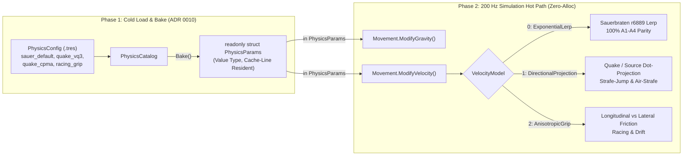

# ADR 0013: Declarative Physics Modding, Pre-Baked `PhysicsParams`, and Algebraic Velocity Models

## Status

**Proposed**  
Builds on [ADR 0003: Movement Physics Port & Differential Verification](0003-movement-verification.md), [ADR 0010: Resource-Based Modding Architecture](0010-resource-modding.md), and [ADR 0012: Composable Game Mode, Mutator & Objective Architecture](0012-gamemode-modding.md). Formalizes the `PhysicsConfig` resource envisioned in [vision.md §5 & §12](../vision.md#5-target-architecture).

---

## Context

In *Sauerbraten Revival*, player movement and octree collision run at a fixed **200 Hz** (`Phys.PhysFrameTime = 5 ms`) with `MoveRes = 10` collision substeps per tick (2,000 substep evaluations per second per player). Currently, all movement and collision parameters are hardcoded constants in [`World/Physics/OctaPhysics.cs`](../../World/Physics/OctaPhysics.cs) (`Phys.Gravity`, `Phys.JumpVel`, `Phys.StairHeight`, `Phys.FloorZ`, `Phys.SlopeZ`, `Phys.WallZ`) and [`World/Physics/Velocity.cs`](../../World/Physics/Velocity.cs) (`MaxSpeed = 100`, `1.3f` forward/air multipliers, `fric = 6 / 30 / 20`).

We want game modes, mutators, and sandbox servers to customize movement physics—ranging from **Low-Gravity Instagib** and **Racing** ([features.md](../features.md)) to **Quake 3 (VQ3) strafe-jumping**, **QuakeWorld / Source air-strafing (bunnyhopping)**, and **CPMA movement**—while satisfying three strict constraints:

1. **100.0% Reference Fidelity Baseline**: When using the default profile (`sauer_default`), the floating-point instruction sequence in [`Movement.ModifyVelocity`](../../World/Physics/Velocity.cs#L50-L96), [`Movement.ModifyGravity`](../../World/Physics/Velocity.cs#L99-L118), and [`OctaPhysics.Move`](../../World/Physics/OctaPhysics.cs#L773-L836) must remain bit-for-bit identical to SVN r6889 and pass all [ADR 0003](0003-movement-verification.md) A1–A4 differential replay tests.
2. **$O(1)$ Zero-Allocation Hot Path**: The 200 Hz physics loop cannot execute GDScript callbacks, virtual method dispatches, dictionary lookups, or heap allocations.
3. **Zero-Download Client-Side Prediction**: Per [authority-and-latency.md](../authority-and-latency.md), client-side prediction requires the client and server to run the exact same movement step. If custom physics required downloading and executing custom script code, servers could not run custom movement rules without forcing a Steam Workshop `.pck` download.

### Why Sauerbraten Cannot Quake-Strafe-Jump Without Changing the Velocity Function

Simply exposing `Gravity`, `MaxSpeed`, and `Friction` as floats on Sauerbraten's existing movement equation is **insufficient** to produce Quake strafe-jumping or Source air-strafing. Looking at [`Movement.ModifyVelocity` (`World/Physics/Velocity.cs:83-96`)](../../World/Physics/Velocity.cs#L83-L96):

1. **Convex Exponential Lerp Bounds Speed**:
   In Sauerbraten, given current velocity $\mathbf{v}$, unit wish direction $\hat{\mathbf{m}}$, target speed $s$, target vector $\mathbf{d} = \hat{\mathbf{m}} \cdot s$, and retention factor $t = (1 - 1/\text{fric})^{\text{curtime}/20.0}$, velocity updates via:
   $$\mathbf{v}_{\text{new}} = \mathbf{d} + (\mathbf{v} - \mathbf{d}) \cdot t = (1 - t)\mathbf{d} + t\mathbf{v}$$
   Because this is a convex combination of $\mathbf{v}$ and $\mathbf{d}$, the triangle inequality guarantees:
   $$\|\mathbf{v}_{\text{new}}\| \le (1 - t)\|\mathbf{d}\| + t\|\mathbf{v}\| \le \max(\|\mathbf{d}\|, \|\mathbf{v}\|)$$
   Turning in mid-air damps the component of $\mathbf{v}$ perpendicular to $\mathbf{d}$ by $t$ rather than adding orthogonal momentum.
2. **Jump-Tick Ground Friction (`Velocity.cs:61-95`)**:
   When a player jumps on [line 64](../../World/Physics/Velocity.cs#L64) (`pl.Vel.Z = Max(pl.Vel.Z, JumpVel)`), `pl.PhysState` remains `PhysFloor` (`>= PhysSlope`) until `OctaPhysics.Move()` runs later in the frame. Consequently, [line 93](../../World/Physics/Velocity.cs#L93) still selects `GroundFriction` (`6.0`) on the jump tick itself, stripping ~4% of horizontal speed on every hop.
3. **Vertical Jump Impulse Damping (`Velocity.cs:64, 95`)**:
   Because `JumpVel` is written into `pl.Vel.Z` (while gravity accumulates separately in `pl.Falling.Z`) and `d.Z == 0` when airborne, the 3D vector lerp on [line 95](../../World/Physics/Velocity.cs#L95) also decays `pl.Vel.Z` by $t$ every airborne tick.

---

## Decision

We introduce a declarative, data-driven physics architecture with **no custom script execution in the physics loop**:

1. **`PhysicsConfig : Resource` (`res://resources/physics/<id>.tres`)**:
   - Authored in the Godot Inspector and loaded through `PhysicsCatalog` using the [ADR 0010](0010-resource-modding.md) 3-tier override cascade (`ResourceCascade`).
   - Referenced by ID (`string PhysicsId`) from `GameModeInfo` and `GameMutator` ([ADR 0012](0012-gamemode-modding.md)), or applied dynamically per-entity.
2. **Pre-Baked `readonly struct PhysicsParams`**:
   - At load time, `PhysicsConfig.Bake()` flattens all constants into a compact, stack/inline value type (`PhysicsParams`) stored directly on `OctaPhysics.Params` and passed by `in PhysicsParams` readonly reference into `Movement.ModifyVelocity` and `Movement.ModifyGravity`.
3. **Selectable Algebraic `VelocityModel` Enum**:
   - Instead of scripting custom physics, `PhysicsParams` selects from three compiled, branch-predictable algebraic velocity integration models:
     - `VelocityModel.ExponentialLerp` (`0`): Classic Sauerbraten SVN r6889 full-vector exponential interpolation.
     - `VelocityModel.DirectionalProjection` (`1`): Quake / Source / CPMA directional dot-product projection onto the wish direction $\hat{\mathbf{m}}$, unlocking VQ3 strafe-jumping, QW/Source air-strafing, and CPMA air control.
     - `VelocityModel.AnisotropicGrip` (`2`): Racing / Kart / Drift decomposition into longitudinal heading $\hat{\mathbf{h}}$ and lateral $\hat{\mathbf{h}}_\perp$ with independent rolling resistance and cornering grip.
4. **Zero-Download Wire Synchronization (`schema.fbs`)**:
   - Because `PhysicsParams` is a fixed set of numbers and flags (~52 bytes), it serializes inline inside `GameModeSyncCmd`. Unmodified clients predict any server's custom movement rules locally at 200 Hz with **zero Workshop downloads**.



---

## 1. Mathematical Models (`VelocityModel`)

Given a 5 ms step ($\Delta t = \text{curtime} / 1000$), current velocity $\mathbf{v} = \text{pl.Vel}$, unit wish direction $\hat{\mathbf{m}}$, and base wish speed:
$$s = \text{MaxSpeed} \times (\text{isPureForward} ? \text{ForwardSpeedMult} : 1.0) \times (\text{isAirborne} ? \text{AirSpeedMult} : 1.0)$$

### Model 0: `ExponentialLerp` (Sauerbraten SVN r6889 Default)
Used when `Model == VelocityModel.ExponentialLerp`:
$$\mathbf{d} = \hat{\mathbf{m}} \cdot s, \qquad t = \left(1 - \frac{1}{\text{fric}}\right)^{\text{curtime} / 20.0}$$
$$\mathbf{v}' = \mathbf{d} + (\mathbf{v} - \mathbf{d}) \cdot t$$
- When `DampVerticalVelInAir == true` (default), this applies to all 3 components $(X, Y, Z)$, matching `physics.cpp:1639` bit-for-bit.
- When `DampVerticalVelInAir == false` and airborne (`!floating && !water && pl.PhysState < Phys.PhysSlope`), `Vel.Z` is preserved untouched.

### Model 1: `DirectionalProjection` (Quake / Source / CPMA Strafe-Jumping)
Used when `Model == VelocityModel.DirectionalProjection`:

1. **Friction Pass (Before Acceleration)**:
   - Select inverse friction $\text{fric}$ (`GroundFriction` on ground, `AirFriction` in air, `WaterFriction` in water).
   - If $\text{fric} > 0$, compute retention $t = (1 - 1/\text{fric})^{\text{curtime}/20.0}$ and damp horizontal velocity (or 3D velocity if floating/water):
     $$\mathbf{v}_{xy} \leftarrow \mathbf{v}_{xy} \cdot t$$
   - Setting `AirFriction = 0` (or $\le 0$) yields $t_{\text{air}} = 1.0$ (**zero air friction decay**, matching Quake/Source).
2. **Directional Dot-Product Projection Pass**:
   - If $\hat{\mathbf{m}} \ne \mathbf{0}$:
     - Determine effective wish speed cap $s_{\text{cap}}$ and acceleration rate $a$:
       - **Grounded / Water / Floating**: $s_{\text{cap}} = s$, $a = \text{GroundAccel}$.
       - **Airborne**:
         - If `AirControlSpeedCap > 0` and pure strafe input (`pl.Move == 0 && pl.Strafe != 0`), use $s_{\text{cap}} = \min(s, \text{AirControlSpeedCap})$ and $a = \text{AirStrafeAccel}$ (enables CPMA hybrid VQ3 + QW air-strafing).
         - Otherwise use $s_{\text{cap}} = \min(s, \text{AirWishSpeedCap})$ and $a = \text{AirAccel}$.
     - Project current velocity onto $\hat{\mathbf{m}}$:
       $$v_{\parallel} = \mathbf{v}_{xy} \cdot \hat{\mathbf{m}}_{xy}$$
     - Compute speed deficit along $\hat{\mathbf{m}}$:
       $$\text{addSpeed} = s_{\text{cap}} - v_{\parallel}$$
     - If $\text{addSpeed} > 0$:
       $$\text{accelStep} = \min(\text{addSpeed}, a \cdot s \cdot \Delta t)$$
       $$\mathbf{v}_{xy}' = \mathbf{v}_{xy} + \text{accelStep} \cdot \hat{\mathbf{m}}_{xy}$$

> [!TIP]
> **How `DirectionalProjection` Unlocks Every Classic Arena Strafe Style:**
> - **Quake 3 (VQ3) Strafe-Jumping**: `AirWishSpeedCap = 100`, `AirAccel = 1.0`, `AirFriction = 0`. Holding diagonal (`Move != 0 && Strafe != 0`) and turning smoothly keeps $\mathbf{v}_{xy} \cdot \hat{\mathbf{m}}_{xy} < 100$, accelerating indefinitely along a shallow arc.
> - **QuakeWorld / Source / Counter-Strike Air-Strafing**: `AirWishSpeedCap = 15`, `AirAccel = 10.0`, `AirFriction = 0`. Even a low $s_{\text{cap}} = 15$ allows high-rate orthogonal acceleration (`10 * 100 * 0.005 = 5.0 u/tick`), letting players carve tight mid-air turns using only `A`/`D` + mouse look.
> - **CPMA (Challenge ProMode Arena)**: `AirWishSpeedCap = 100`, `AirAccel = 1.0` (for diagonal VQ3 strafe-jumps) combined with `AirControlSpeedCap = 15`, `AirStrafeAccel = 7.0` (for `A`/`D`-only tight air turns).

### Model 2: `AnisotropicGrip` (Racing / Kart / Drift)
Used when `Model == VelocityModel.AnisotropicGrip`:
1. Compute horizontal heading unit vector $\hat{\mathbf{h}} = (-\sin(\text{yaw}), \cos(\text{yaw}), 0)$ and lateral right vector $\hat{\mathbf{h}}_\perp = (\cos(\text{yaw}), \sin(\text{yaw}), 0)$.
2. Decompose horizontal velocity $\mathbf{v}_{xy}$ into longitudinal speed $v_{\text{long}} = \mathbf{v}_{xy} \cdot \hat{\mathbf{h}}$ and lateral slip $v_{\text{lat}} = \mathbf{v}_{xy} \cdot \hat{\mathbf{h}}_\perp$.
3. Apply separate retention factors:
   - Longitudinal retention $t_{\text{long}}$ using `GroundFriction` (or `AirFriction` when airborne).
   - Lateral cornering retention $t_{\text{lat}}$ using `LateralFriction` on ground (low `LateralFriction` = tight tire grip; high `LateralFriction` = ice/drifting).
4. Reconstruct $\mathbf{v}_{xy} = (v_{\text{long}} \cdot t_{\text{long}})\hat{\mathbf{h}} + (v_{\text{lat}} \cdot t_{\text{lat}})\hat{\mathbf{h}}_\perp$ and apply thrust toward $\mathbf{d}_{xy}$ with rate `GroundAccel`.

---

## 2. Runtime Data Model (`World/Physics/PhysicsConfig.cs`)

### 2.1 `VelocityModel` & `PhysicsParams` (Value Type)

```csharp
namespace SauerbratenRevival.World.Physics;

public enum VelocityModel : byte
{
    /// <summary>Classic Sauerbraten SVN r6889 full-vector exponential lerp.</summary>
    ExponentialLerp = 0,

    /// <summary>Quake / Source / CPMA directional dot-product projection onto wishdir.</summary>
    DirectionalProjection = 1,

    /// <summary>Racing / Drift decomposition into longitudinal rolling friction and lateral grip.</summary>
    AnisotropicGrip = 2,
}

/// <summary>
/// Pre-baked, zero-allocation value type consumed directly by the 200 Hz physics loop.
/// <see cref="Default"/> reproduces Sauerbraten SVN r6889 bit-for-bit.
/// </summary>
public readonly struct PhysicsParams
{
    // --- Core Sauerbraten r6889 Constants ---
    public readonly float Gravity;                // 200.0f (physics.cpp:478)
    public readonly float JumpVel;                // 125.0f (physics.cpp:477)
    public readonly float MaxSpeed;               // 100.0f (ents.h:91)
    public readonly float ForwardSpeedMult;       // 1.3f   (physics.cpp:1637)
    public readonly float AirSpeedMult;           // 1.3f   (physics.cpp:1637)
    public readonly float GroundFriction;         // 6.0f   (physics.cpp:1638)
    public readonly float AirFriction;            // 30.0f  (physics.cpp:1638; <= 0 means no air decay)
    public readonly float WaterFriction;          // 20.0f  (physics.cpp:1638)
    public readonly float SlopeGravityFriction;   // 6.0f   (physics.cpp:1666)
    public readonly float WaterGravityFriction;   // 2.0f   (physics.cpp:1666)
    public readonly float WaterEntryDamp;         // 8.0f   (physics.cpp:1602)
    public readonly float WaterJumpDamp;          // 8.0f   (physics.cpp:1606)
    public readonly float WaterSpeedScale;        // 0.5f   (physics.cpp:1693)
    public readonly float StairHeight;            // 4.1f   (physics.cpp:473)
    public readonly float FloorZ;                 // 0.867f (physics.cpp:474)
    public readonly float SlopeZ;                 // 0.5f   (physics.cpp:475)
    public readonly float WallZ;                  // 0.2f   (physics.cpp:476)
    public readonly int MoveRes;                  // 10     (fps.cpp:264)

    // --- Velocity Integration & Strafe-Jumping Extensions ---
    public readonly VelocityModel Model;          // ExponentialLerp (0)
    public readonly float GroundAccel;            // 10.0f  (DirectionalProjection / AnisotropicGrip)
    public readonly float AirAccel;               // 1.0f   (VQ3 = 1.0f, QW/Source = 10.0f)
    public readonly float AirWishSpeedCap;        // 100.0f (VQ3 = 100.0f, QW/Source = 15.0f)
    public readonly float AirControlSpeedCap;     // 0.0f   (CPMA A/D-only wish cap, e.g. 15.0f; 0 = disabled)
    public readonly float AirStrafeAccel;         // 7.0f   (CPMA A/D-only air accel)
    public readonly float LateralFriction;        // 2.0f   (AnisotropicGrip cornering friction)
    public readonly bool AutoJump;                // false  (true = hold jump to bunnyhop on landing frame)
    public readonly bool JumpEntersFallState;     // false  (true = transition to PhysFall on jump to skip 1-tick ground friction)
    public readonly bool DampVerticalVelInAir;    // true   (false = preserve Vel.Z during air velocity updates)

    public static readonly PhysicsParams Default = new(
        gravity: Phys.Gravity,
        jumpVel: Phys.JumpVel,
        maxSpeed: 100.0f,
        forwardSpeedMult: 1.3f,
        airSpeedMult: 1.3f,
        groundFriction: 6.0f,
        airFriction: 30.0f,
        waterFriction: 20.0f,
        slopeGravityFriction: 6.0f,
        waterGravityFriction: 2.0f,
        waterEntryDamp: 8.0f,
        waterJumpDamp: 8.0f,
        waterSpeedScale: 0.5f,
        stairHeight: Phys.StairHeight,
        floorZ: Phys.FloorZ,
        slopeZ: Phys.SlopeZ,
        waterZ: Phys.WallZ,
        moveRes: Phys.MoveRes,
        model: VelocityModel.ExponentialLerp,
        groundAccel: 10.0f,
        airAccel: 1.0f,
        airWishSpeedCap: 100.0f,
        airControlSpeedCap: 0.0f,
        airStrafeAccel: 7.0f,
        lateralFriction: 2.0f,
        autoJump: false,
        jumpEntersFallState: false,
        dampVerticalVelInAir: true);
    // (Constructor omitted for brevity)
}
```

### 2.2 `PhysicsConfig : Resource` & `PhysicsCatalog`

```csharp
[Tool]
[GlobalClass]
public partial class PhysicsConfig : Resource
{
    [Export] public string Id { get; set; } = "sauer_default";
    [Export] public string DisplayName { get; set; } = "Sauerbraten Classic";

    [ExportGroup("Core Movement")]
    [Export] public float Gravity { get; set; } = Phys.Gravity;
    [Export] public float JumpVel { get; set; } = Phys.JumpVel;
    [Export] public float MaxSpeed { get; set; } = 100.0f;
    [Export] public float ForwardSpeedMult { get; set; } = 1.3f;
    [Export] public float AirSpeedMult { get; set; } = 1.3f;

    [ExportGroup("Friction & Water")]
    [Export] public float GroundFriction { get; set; } = 6.0f;
    [Export] public float AirFriction { get; set; } = 30.0f;
    [Export] public float WaterFriction { get; set; } = 20.0f;
    [Export] public float SlopeGravityFriction { get; set; } = 6.0f;
    [Export] public float WaterGravityFriction { get; set; } = 2.0f;
    [Export] public float WaterEntryDamp { get; set; } = 8.0f;
    [Export] public float WaterJumpDamp { get; set; } = 8.0f;
    [Export] public float WaterSpeedScale { get; set; } = 0.5f;

    [ExportGroup("Collision & Stepping")]
    [Export] public float StairHeight { get; set; } = Phys.StairHeight;
    [Export] public float FloorZ { get; set; } = Phys.FloorZ;
    [Export] public float SlopeZ { get; set; } = Phys.SlopeZ;
    [Export] public float WallZ { get; set; } = Phys.WallZ;
    [Export] public int MoveRes { get; set; } = Phys.MoveRes;

    [ExportGroup("Velocity Model & Strafe-Jumping")]
    [Export] public VelocityModel Model { get; set; } = VelocityModel.ExponentialLerp;
    [Export] public float GroundAccel { get; set; } = 10.0f;
    [Export] public float AirAccel { get; set; } = 1.0f;
    [Export] public float AirWishSpeedCap { get; set; } = 100.0f;
    [Export] public float AirControlSpeedCap { get; set; } = 0.0f;
    [Export] public float AirStrafeAccel { get; set; } = 7.0f;
    [Export] public float LateralFriction { get; set; } = 2.0f;
    [Export] public bool AutoJump { get; set; } = false;
    [Export] public bool JumpEntersFallState { get; set; } = false;
    [Export] public bool DampVerticalVelInAir { get; set; } = true;

    public PhysicsParams Bake() => new(/* ... */);
}
```

`PhysicsCatalog` loads `res://resources/physics/*.tres` (with `overrides/` and `user://physics/overrides/` via `ResourceCascade`) and ships with core presets:

| Resource ID (`res://resources/physics/`) | `Model` | Key Parameters | Feel / Target Use Case |
| :--- | :--- | :--- | :--- |
| `sauer_default.tres` | `ExponentialLerp` | All r6889 defaults (`Gravity=200`, `JumpVel=125`, `GroundFric=6`, `AirFric=30`, `Fwd=1.3`, `Air=1.3`) | 100% classic Cube 2: Sauerbraten feel. |
| `quake_vq3.tres` | `DirectionalProjection` | `Fwd=1.0`, `Air=1.0`, `GroundFric=6`, `AirFric=0`, `GroundAccel=10`, `AirAccel=1`, `AirWishSpeedCap=100`, `JumpEntersFallState=true`, `DampVerticalVelInAir=false` | Quake 3 Arena / Defrag diagonal strafe-jumping. |
| `quake_cpma.tres` | `DirectionalProjection` | Same as `quake_vq3` + `AirControlSpeedCap=15`, `AirStrafeAccel=7`, `AutoJump=true` | CPMA hybrid strafe-jumping + `A`/`D` mid-air turning + hold-to-bhop. |
| `source_bhop.tres` | `DirectionalProjection` | `Fwd=1.0`, `Air=1.0`, `AirFric=0`, `AirAccel=10`, `AirWishSpeedCap=15`, `AutoJump=true`, `JumpEntersFallState=true`, `DampVerticalVelInAir=false` | QuakeWorld / CS / Source air-strafing and bunnyhopping. |
| `low_grav.tres` | `ExponentialLerp` | `Gravity=80`, `JumpVel=160` | Low-gravity instagib / moon sandbox mutator. |
| `racing_grip.tres` | `AnisotropicGrip` | `MaxSpeed=160`, `GroundFric=20`, `LateralFriction=2.0`, `GroundAccel=8` | High-speed racing with low rolling drag and high cornering grip. |

---

## 3. Hot-Path Integration (`Velocity.cs` & `OctaPhysics.cs`)

### 3.1 `Movement.ModifyVelocity` (`World/Physics/Velocity.cs`)
The existing `ModifyVelocity(PhysEnt pl, bool water, bool floating, int curtime)` overload forwards to `ModifyVelocity(pl, water, floating, curtime, in PhysicsParams.Default)` so all existing callers and unit tests continue to work without signature breakage:

```csharp
public static void ModifyVelocity(PhysEnt pl, bool water, bool floating, int curtime)
    => ModifyVelocity(pl, water, floating, curtime, in PhysicsParams.Default);

public static void ModifyVelocity(PhysEnt pl, bool water, bool floating, int curtime, in PhysicsParams p)
{
    if (floating)
    {
        if (pl.Jumping)
        {
            if (!p.AutoJump) pl.Jumping = false;
            pl.Vel = pl.Vel with { Z = Mathf.Max(pl.Vel.Z, p.JumpVel) };
        }
    }
    else if (pl.PhysState >= Phys.PhysSlope || water)
    {
        if (water && pl.InWater == Phys.MatAir) pl.Vel /= p.WaterEntryDamp;
        if (pl.Jumping)
        {
            if (!p.AutoJump) pl.Jumping = false;
            pl.Vel = pl.Vel with { Z = Mathf.Max(pl.Vel.Z, p.JumpVel) };
            if (water)
            {
                pl.Vel = pl.Vel with { X = pl.Vel.X / p.WaterJumpDamp, Y = pl.Vel.Y / p.WaterJumpDamp };
            }
            else if (p.JumpEntersFallState)
            {
                // Transition to airborne immediately so the jump tick does not suffer ground friction.
                pl.PhysState = Phys.PhysFall;
            }
        }
    }
    if (!floating && pl.PhysState == Phys.PhysFall) pl.TimeInAir = Mathf.Min(pl.TimeInAir + curtime, 1000);

    Vector3 m = Vector3.Zero;
    if (pl.Move != 0 || pl.Strafe != 0)
    {
        m = VecFromYawPitch(pl.Yaw, floating || water || pl.Type == Phys.EntCamera ? pl.Pitch : 0f, pl.Move, pl.Strafe);
        if (!floating && pl.PhysState >= Phys.PhysSlope)
        {
            float dz = -(m.X * pl.Floor.X + m.Y * pl.Floor.Y) / pl.Floor.Z;
            m = m with { Z = water ? Mathf.Max(m.Z, dz) : dz };
        }
        if (m.LengthSquared() > 1e-12f) m = m.Normalized();
    }

    float wishSpeed = pl.MaxSpeed;
    if (pl.Type == Phys.EntPlayer)
    {
        if (floating)
        {
            if (pl.IsLocalPlayer) wishSpeed *= pl.FloatSpeed / 100.0f;
        }
        else if (!water)
        {
            wishSpeed *= (pl.Move != 0 && pl.Strafe == 0 ? p.ForwardSpeedMult : 1.0f)
                       * (pl.PhysState < Phys.PhysSlope ? p.AirSpeedMult : 1.0f);
        }
    }

    bool groundedOrFloating = pl.PhysState >= Phys.PhysSlope || floating;
    float fric = water && !floating ? p.WaterFriction : (groundedOrFloating ? p.GroundFriction : p.AirFriction);

    switch (p.Model)
    {
        case VelocityModel.ExponentialLerp:
        default:
        {
            Vector3 d = m * wishSpeed;
            float t = fric > 0f ? Mathf.Pow(1f - 1f / fric, curtime / 20.0f) : 1f;
            if (p.DampVerticalVelInAir || groundedOrFloating || water)
            {
                pl.Vel = d + (pl.Vel - d) * t;
            }
            else
            {
                pl.Vel = new Vector3(
                    d.X + (pl.Vel.X - d.X) * t,
                    d.Y + (pl.Vel.Y - d.Y) * t,
                    pl.Vel.Z);
            }
            break;
        }

        case VelocityModel.DirectionalProjection:
        {
            float t = fric > 0f ? Mathf.Pow(1f - 1f / fric, curtime / 20.0f) : 1f;
            if (groundedOrFloating || water || p.DampVerticalVelInAir)
                pl.Vel *= t;
            else
                pl.Vel = new Vector3(pl.Vel.X * t, pl.Vel.Y * t, pl.Vel.Z);

            if (m != Vector3.Zero)
            {
                float secs = curtime / 1000.0f;
                bool pureStrafeInAir = !groundedOrFloating && !water && pl.Move == 0 && pl.Strafe != 0 && p.AirControlSpeedCap > 0f;
                float cap = groundedOrFloating || water
                    ? wishSpeed
                    : Mathf.Min(wishSpeed, pureStrafeInAir ? p.AirControlSpeedCap : p.AirWishSpeedCap);
                float accel = groundedOrFloating || water
                    ? p.GroundAccel
                    : (pureStrafeInAir ? p.AirStrafeAccel : p.AirAccel);

                float currentSpeed = groundedOrFloating || water
                    ? pl.Vel.Dot(m)
                    : (pl.Vel.X * m.X + pl.Vel.Y * m.Y);
                float addSpeed = cap - currentSpeed;
                if (addSpeed > 0f)
                {
                    float accelStep = Mathf.Min(addSpeed, accel * wishSpeed * secs);
                    pl.Vel += m * accelStep;
                }
            }
            break;
        }

        case VelocityModel.AnisotropicGrip:
        {
            float secs = curtime / 1000.0f;
            float tLong = fric > 0f ? Mathf.Pow(1f - 1f / fric, curtime / 20.0f) : 1f;
            float latFric = groundedOrFloating && !floating ? p.LateralFriction : fric;
            float tLat = latFric > 0f ? Mathf.Pow(1f - 1f / latFric, curtime / 20.0f) : 1f;

            float yawRad = Mathf.DegToRad(pl.Yaw);
            Vector2 fwd = new(-Mathf.Sin(yawRad), Mathf.Cos(yawRad));
            Vector2 right = new( fwd.Y, -fwd.X);
            Vector2 vxy = new(pl.Vel.X, pl.Vel.Y);

            float vLong = vxy.Dot(fwd) * tLong;
            float vLat = vxy.Dot(right) * tLat;
            Vector2 damped = fwd * vLong + right * vLat;

            Vector2 target = new Vector2(m.X, m.Y) * wishSpeed;
            Vector2 delta = target - damped;
            float maxStep = p.GroundAccel * wishSpeed * secs;
            if (delta.LengthSquared() > maxStep * maxStep)
                delta = delta.Normalized() * maxStep;

            Vector2 nextXy = damped + delta;
            pl.Vel = new Vector3(nextXy.X, nextXy.Y, p.DampVerticalVelInAir ? pl.Vel.Z * tLong : pl.Vel.Z);
            break;
        }
    }
}
```

### 3.2 `OctaPhysics.Params` (`World/Physics/OctaPhysics.cs`)
- `OctaPhysics` exposes `public PhysicsParams Params = PhysicsParams.Default;`.
- `MovePlayer`, `Move`, `TryStepUp`, `TryStepDown`, `FindFloor`, `Landing`, `Falling`, `SwitchFloor`, and `Bounce` read `Params.StairHeight`, `Params.FloorZ`, `Params.SlopeZ`, `Params.WallZ`, `Params.Gravity`, and `Params.WaterSpeedScale` instead of static `Phys.*` constants.
- When `MapWorld`, `MapLevel`, or `EmptyMap` initializes `OctaPhysics`, it assigns `Physics.Params = Mode.Physics;`, and sets `player.Entity.MaxSpeed = Mode.Physics.MaxSpeed;`.

---

## 4. Integration with `GameModeInfo`, `GameMutator` & `schema.fbs`

1. **Mode & Mutator Binding ([ADR 0012](0012-gamemode-modding.md))**:
   - `GameModeInfo` and `GameMutator` add a single optional property:
     ```csharp
     [Export] public string PhysicsId { get; set; } = ""; // Empty = "sauer_default" (or inherit from base mode)
     ```
   - During `GameModeInfo.Bake()`, `PhysicsCatalog.Get(effectivePhysicsId).Bake()` is stored in `public PhysicsParams Physics { get; private set; } = PhysicsParams.Default;`.
2. **FlatBuffers Wire Sync (`World/Schema/schema.fbs`)**:
   - `PhysicsSyncParams` is embedded in `GameModeSyncCmd` so any server running custom physics parameters replicates them to connecting clients in ~52 bytes:
     ```fbs
     struct PhysicsSyncParams {
         gravity: float32;
         jump_vel: float32;
         max_speed: float32;
         forward_speed_mult: float32;
         air_speed_mult: float32;
         ground_friction: float32;
         air_friction: float32;
         water_friction: float32;
         stair_height: float32;
         floor_z: float32;
         slope_z: float32;
         wall_z: float32;
         model: ubyte;
         ground_accel: float32;
         air_accel: float32;
         air_wish_speed_cap: float32;
         air_control_speed_cap: float32;
         air_strafe_accel: float32;
         lateral_friction: float32;
         auto_jump: bool;
         jump_enters_fall_state: bool;
         damp_vertical_vel_in_air: bool;
     }
     ```

---

## 5. Staged Implementation Plan

1. **Stage 1 — `PhysicsParams`, `PhysicsConfig`, `PhysicsCatalog` & Core Presets**:
   - Create `World/Physics/PhysicsConfig.cs` (`VelocityModel`, `PhysicsParams`, `PhysicsConfig`) and `World/Physics/PhysicsCatalog.cs` using `ResourceCascade`.
   - Author `res://resources/physics/sauer_default.tres`, `quake_vq3.tres`, `quake_cpma.tres`, `source_bhop.tres`, `low_grav.tres`, and `racing_grip.tres`.
2. **Stage 2 — Wire `in PhysicsParams` into `Velocity.cs` and `OctaPhysics.cs`**:
   - Parameterize `Movement.ModifyVelocity`, `Movement.ModifyGravity`, and `OctaPhysics` with `PhysicsParams`.
   - Connect `GameModeInfo.Physics` to `OctaPhysics.Params` and `PhysEnt.MaxSpeed` on world/player setup.
3. **Stage 3 — Verification & Unit Tests (`test/PhysicsConfigTest.cs`)**:
   - Run `test/A3ReplayTest.cs` and `test/WaterPhysicsTest.cs` to verify 100.0% bit-identical parity on `sauer_default`.
   - Add unit tests verifying `DirectionalProjection` strafe-jump acceleration beyond `MaxSpeed`, `source_bhop` `A`/`D` air-turning, `AutoJump` + `JumpEntersFallState` zero-friction bhop landings, and `AnisotropicGrip` lateral slip damping.

---

## Consequences

### Positive
- **Zero Custom Physics Scripts Required**: Server operators and mode designers can switch between Sauerbraten, Quake 3 (VQ3), CPMA, Source bunnyhopping, low-gravity, and Racing grip purely via `.tres` data or server config.
- **Full 200 Hz Client-Side Prediction with Zero Downloads**: Because all three `VelocityModel` formulas are compiled into C# and parameterized by `PhysicsParams`, clients predict custom server physics locally without downloading any Workshop `.pck`.
- **$O(1)$ Hot-Path Speed & 100% r6889 Fidelity**: `PhysicsParams` is a flat value type passed by `in` reference, and `sauer_default` executes the exact floating-point operations verified in [ADR 0003](0003-movement-verification.md).

### Neutral / Trade-offs
- Exotic movement mechanics that require new state variables on `PhysEnt` (e.g. wall-running timers or grappling hooks) remain outside `PhysicsParams` and would be implemented either as special weapons/items or future engine extensions.
