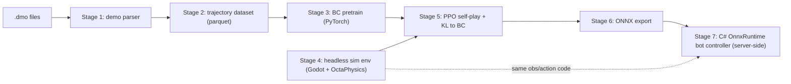

# botlab — PPO arena bots bootstrapped from Sauerbraten demos

**Status: proposal (post-MVP research track).** Bot AI is out of MVP scope; this
track is tracked under
[features.md § Post-MVP](../../docs/features.md#post-mvp--deferred-fidelity), which
wins on ordering and status. It lives under `tools/botlab/` (Python) plus one thin
C# runtime seam and does not touch MVP code paths. Nothing here is implemented yet.

## 1. Hypothesis and minimal scope

**Hypothesis:** behaviour cloning (BC) on human `.dmo` demos gives a policy that
moves and aims in a human-like way. PPO self-play, with a KL leash back to that BC
policy, then makes it *competent* while keeping it *human-like*.

Keep the first experiment as small as possible:

| Knob | Choice | Why |
| --- | --- | --- |
| Mode | **Instagib 1v1** (`insta` FFA, 2 players) | One weapon, one-shot kills, no items, armour or ammo economy |
| Map | One small duel map, e.g. `ot` or `aard3c` (pick whichever has the most demos) | Fixed geometry, so no need to generalise across maps |
| Observations | Vector/ray features, **no pixels** | Cheap to train on a CPU or laptop GPU |
| Policy | MLP 2×256 + GRU 128 | Small enough to export to ONNX and run on a server tick |
| Decision rate | 30 Hz (each action is repeated over the 5 ms physics steps) | Close to the demo `N_POS` rate |

## 2. Pipeline overview

**Rule that keeps this coherent:** observation encoding and action decoding are
defined **once** (spec in `tools/botlab/spec.md`, implemented in C#). The demo
featuriser, the sim env and the runtime bot all call that same C# code. Python
never re-implements the features. It only consumes arrays.

## 3. What the demos actually contain (verified against r6889)

Paths are relative to `$SAUER_REF/src/fpsgame/`.

- File: gzip stream → `demoheader { char magic[16]="SAUERBRATEN_DEMO"; int version=1, protocol=260; }`
  (`game.h:284-291`).
- Then records: `int gamemillis, int chan, int len` (little-endian), followed by
  `len` bytes of the **server→client packet** (`server.cpp:1080 writedemo`).
- Packets hold normal protocol messages. The ones this experiment needs:
  - `N_POS` (`client.cpp:953`): position (fixed-point, `DMF`=1/16 unit), velocity
    and falling magnitude/direction, yaw/pitch (**1° resolution**), and
    **`move`/`strafe` bits plus `physstate`** for each player.
  - `N_SHOTFX`: shooter, gun, from→to, which gives **fire events and aim targets**.
  - `N_DAMAGE`, `N_DIED`, `N_SPAWNSTATE`, `N_MAPCHANGE` (map + mode, used for
    filtering), `N_INITCLIENT`.

**Consequence:** demos give **state trajectories, not raw inputs** (they carry no
`jumping` input, as noted in
[features.md § 7](../../docs/features.md#7-demos--replays)). Actions are recovered
with these labels:

| Action head | Label source |
| --- | --- |
| move, strafe ∈ {-1,0,1} | read directly from the `N_POS` bits |
| jump ∈ {0,1} | `physstate` goes from floor to air while vertical velocity rises |
| fire ∈ {0,1} | an `N_SHOTFX` for that client in this tick |
| Δyaw, Δpitch | difference of consecutive `N_POS` angles, unwrapped and binned |

Each human player in a demo is an independent trajectory, seen from that player's
own perspective.

## 4. Observation and action spec (v0)

**Observation (~120 floats, egocentric, in the yaw frame):**

- Self: velocity (3), on-floor/in-air, pitch, time since last shot (reload), alive flag.
- Opponent (k=1 for 1v1): relative position (3), relative velocity (3),
  **line-of-sight bit** (ported `raycube`), angle error to the opponent (yaw,
  pitch), time since last seen. When there is no line of sight, use the last-seen
  values, so the bot doesn't get wallhacks.
- Geometry: 24 horizontal and 8 downward/up depth rays (normalised distance) from
  the ported octree raycast.
- Previous action (one-hot).

**Action (multi-discrete):** move(3) × strafe(3) × jump(2) × fire(2) × Δyaw(21
bins, non-linear, ±30°/tick) × Δpitch(11 bins).

**Human-likeness constraints, enforced in the env rather than learned:**
observation delay of about 150 ms (reaction time), clamped turn rate, small
Gaussian aim noise. Without these, PPO will discover an aimbot.

## 5. Stages (each one is a commit and has a review gate)

| # | Deliverable | Acceptance check |
| --- | --- | --- |
| **1** | `DemoReader` (C#, a port of `parsemessages` restricted to the messages above) plus a CLI that dumps per-player trajectories | A golden test: parse one demo and assert player count, frags (= `N_DIED` count) and a sample position against the original client's playback. A small C++ probe that prints `N_POS` from the same demo works well here. |
| **2** | Featuriser: trajectories → `obs, action, done` parquet, filtered by mode and map, built on the shared C# obs/action code | Histograms of each action head look plausible. Line-of-sight rate during `N_SHOTFX` > 90%. |
| **3** | BC training (`tools/botlab/bc.py`): per-head cross-entropy, GRU over 64-step sequences, frame-level train/val split by **demo** | Val accuracy above a "repeat previous action" baseline for every head. |
| **4** | Headless env: Godot `--headless` scene, two players, `OctaPhysics` plus insta rifle hitscan, stepping at 30 Hz over a socket (protocol below). N parallel instances. | Replaying a demo's action labels open-loop gives roughly the recorded paths for the first ~1 s. ≥ 2k env-steps/s per core. |
| **5** | PPO (`ppo.py`, CleanRL-style single file) initialised from BC. Loss: `L_ppo + β·KL(π‖π_BC)`, with β annealed from 0.1 to 0.01. Self-play against a pool of past snapshots (sample 80% latest, 20% older). | Win rate vs the BC bot > 70%. Action-statistic divergence from humans (turn-speed and strafe histograms) stays within a set bound. |
| **6** | `export.py` → ONNX (opset 17). Inputs `obs[1,N]` and `h_in[1,128]`; outputs `logits_*` and `h_out`. | ONNXRuntime-Python output matches PyTorch within 1e-5 on 1k recorded observations. |
| **7** | `OnnxBotController` (C#, `Microsoft.ML.OnnxRuntime`) that produces the same `Command`/input struct as a human client. **Runs server-side** (authoritative). | In-game bot vs bot and bot vs human. Inference < 0.2 ms/bot/tick. |

**Env protocol (Stage 4):** length-prefixed FlatBuffers over a local TCP or Unix
socket, following the project's existing FlatSharp usage
([ADR 0008](../../docs/adr/0008-command-logic.md)):
`reset(seed) → obs[]` and `step(actions[]) → obs[], reward[], done[], info`.
[godot_rl_agents](https://github.com/edbeeching/godot_rl_agents) is a possible
off-the-shelf alternative. Evaluate it in Stage 4 and pick one.

**Reward (Stage 5):** +1 for a frag, −1 for a death. Small shaping terms are
annealed to 0 over the first 20% of training: +0.01 × reduction in
angle-to-visible-opponent, −0.001 per tick when standing still.

## 6. Risks and open decisions

- **Demo quality and quantity per map.** Count demos per (mode, map) first. That
  count decides the map, and it might show that FFA/team data has to be used
  instead of 1v1.
- **Physics parity:** the env must use the ported `OctaPhysics` rather than Godot
  physics, or the BC prior won't transfer. This is already the project's yardstick
  ([movement-physics.md](../../docs/movement-physics.md)).
- **Partial observability and wallhacks:** every opponent feature must be gated by
  line of sight plus a delay. Test this explicitly.
- **Label noise:** 1° angle quantisation and the server send rate blur fine aim, so
  the Δyaw bins must be ≥ 1°.
- **Hand-off to a cheaper model:** stages 1, 2, 6 and 7 are mechanical and suit a
  cheap model once `spec.md` is fixed. Stages 4 (env parity) and 5 (PPO tuning)
  need closer supervision.

## Generated artifacts

Datasets (`*.parquet`), checkpoints and exported `.onnx` files go under
`tools/botlab/out/` and are **not committed** (ignored in `.gitignore`).
